# Prastav: Low Level Design

**Academic Project Workflow and Approval Management System**

| | |
|---|---|
| Document | Low Level Design for the whole system |
| Date | 25 October 2026 |
| Repository | `prastav` (artifacts `prastav-backend`, `prastav-frontend`) |
| Base package | `com.prastav` |
| Stack | Java 17, Spring Boot 3.3, Spring Security (JWT), Spring Data JPA, Flyway, PostgreSQL 16; React 18 + TypeScript, Vite, React Router, TanStack Query, Axios, Tailwind CSS |

## 0. How to read this document

This document describes the code as it is. Every class, table, endpoint and diagram element named here exists in the repository with exactly that name. Names in this document, in `docs/diagrams.md` (Mermaid) and in `docs/uml/*.puml` (PlantUML) match the code exactly. The class catalogue in section 8 is generated from the Java sources, so field names, types and method signatures are copied rather than retyped.

## 1. Scope

### 1.1 Problem

Proposal submission, faculty review, revision and approval currently run over email, documents and spreadsheets. Nobody has a single view of a project's status, proposal versions get lost, feedback is not tied to the text it refers to, and there is no audit trail.

### 1.2 What Prastav does

One system for the full proposal lifecycle with an enforced workflow: only valid status transitions, performed only by the right role. Submitted proposal versions are immutable, every review points to the exact version it judged, and every important action is recorded in an append-only audit log.

### 1.3 Non-goals

AI proposal analysis, ML risk prediction, GitHub integration, an external event bus, microservices, cloud deployment, real email delivery, and file uploads (proposals are structured text fields plus an optional link).

### 1.4 Roles

| Role | Can do |
|---|---|
| STUDENT | Register with an institutional student email, create a project, edit own draft, submit and resubmit, start a revision, view own projects, versions, feedback and history |
| FACULTY | View assigned projects, review the latest submitted version: approve, request revision or reject (comments mandatory for the last two) |
| COORDINATOR | View all projects and counts by status, assign a faculty reviewer, create faculty and coordinator accounts |

## 2. Requirements traceability

### 2.1 Functional requirements

| ID | Requirement | Where |
|---|---|---|
| FR-1 | Register/login with JWT, role on account | `AuthController`, `AuthService`, `JwtService`, `SecurityConfig` |
| FR-2 | Student creates project with draft v1 | `ProjectService.createProject`, `ProposalVersionFactory.initialDraft` |
| FR-3 | Draft editable only until submitted | `ProposalService.updateDraft`, `ProposalVersion.updateContent`, DB trigger |
| FR-4 | Submit makes the version immutable, project SUBMITTED | `WorkflowService.submit`, `DraftState.submit` |
| FR-5 | Coordinator assigns reviewer, project UNDER_REVIEW | `WorkflowService.assignReviewer`, `SubmittedState.assignReviewer` |
| FR-6 | Faculty approves / requests revision / rejects with comments | `ReviewService.recordReview`, `ReviewDecisionHandler` x3, `UnderReviewState` |
| FR-7 | Student sees feedback; revision creates vN+1 prefilled | `ProposalService.createNextVersion`, `ProposalVersionFactory.nextDraftFrom`, project page |
| FR-8 | Resubmission returns to UNDER_REVIEW with same reviewer | `RevisionRequestedState.submit` |
| FR-9 | Invalid transitions rejected with clear error | `ProjectState` default methods, `IllegalTransitionException`, `GlobalExceptionHandler` (409) |
| FR-10 | Audit log for every state change, assignment, submission, review | `AuditEventListener`, `AuditLog`, append-only trigger |
| FR-11 | Project timeline | `ProjectHistoryService`, `GET /api/projects/{id}/history`, Timeline tab of the project page |
| FR-12 | Role-scoped lists with status filter, search, coordinator batch filter, pagination | `ProjectService.listProjects`, `ProjectListQuery`, `ProjectSpecifications`, `GET /api/projects?status=&q=&reviewerId=&admissionYear=&branch=&sort=&page=&size=` |
| FR-13 | Notifications on reviewer assignment (to the faculty member), review decision (to the student owner) and resubmission (to the faculty member), stored per recipient with a read flag; paged inbox with unread filter, unread count, mark one or all read, each scoped to the caller; delivery through the configured channels (in-app, email log) | `NotificationListener`, `NotificationDispatcher`, `NotificationChannel`, `Notification`, `NotificationRepository`, `NotificationService`, `NotificationController`, `NotificationMapper`, `GET /api/notifications`, `GET /api/notifications/unread-count`, `PATCH /api/notifications/{id}/read`, `PATCH /api/notifications/read-all`, `V4__notifications.sql` |
| FR-17 | Coordinator reassigns the reviewer of an UNDER_REVIEW project (status unchanged); the new reviewer must be FACULTY and differ from the current one; any other status is ILLEGAL_TRANSITION; audited and both reviewers notified | `PUT /api/projects/{id}/assign`, `WorkflowService.reassignReviewer`, `UnderReviewState.reassignReviewer`, `ReviewerReassignedEvent`, `AuditEventListener` (`REVIEWER_REASSIGNED`), `NotificationListener`, `V5__notification_reviewer_unassigned.sql` |
| FR-14 | Compare two proposal versions field by field | `ProposalDiffService`, `ProposalDiff`, `FieldDiff`, `ProposalVersionRepository.findByProject_IdAndVersionNumber`, `GET /api/projects/{id}/proposals/compare?from=&to=` |
| FR-15 | Role dashboards: counts per status and projects awaiting assignment; coordinator dashboard with counts by status, the list of submitted projects without a reviewer and the open reviews of every faculty member, computed by grouped queries | `ProjectService.countProjects`, `GET /api/projects/summary`, `DashboardService`, `ProjectRepository.findAwaitingAssignment`, `ProjectRepository.reviewerWorkload`, `DashboardController`, `GET /api/dashboard/summary`, web app home pages |
| FR-18 | Institution profile and email policy: institutional domain for every account; student-only registration with `<firstname>.<YY><branch>@domain`, storing admission year and branch; staff accounts created by the coordinator | `InstitutionProperties`, `EmailPolicy`, `PatternEmailPolicy`, `AuthService.register`, `UserService.createAccount`, `POST /api/users`, `V3__user_institution_profile.sql` |

### 2.2 Engineering items

| Item | Evidence |
|---|---|
| Flyway schema with constraints and triggers | `backend/src/main/resources/db/migration/V1__init.sql`, `V2__project_list_indexes.sql`, `V3__user_institution_profile.sql`, `V4__notifications.sql`, `V5__notification_reviewer_unassigned.sql` |
| Seed data (1 coordinator, 2 faculty, 3 students on `nst.rishihood.edu.in`, one shared `prastav.seed.demo-password`) | `DemoDataSeeder` |
| Optimistic locking on `Project` | `@Version Long version`, `CONCURRENT_UPDATE` mapping |
| Swagger UI with Bearer auth | `OpenApiConfig`, `/swagger-ui.html` |
| `allowedActions` in project detail | `AllowedActionsResolver`, `ProjectDetailResponse.allowedActions` |
| Unit tests: every state, WorkflowService, ReviewService, versioning, project list and counts, email policy, registration and account creation, notification service, listener, channels and retries, reviewer reassignment, coordinator dashboard | 207 tests in `backend/src/test/java` (see section 16) |
| MockMvc tests (401 / 403 / 404 / 409 / 400 mapping, list and summary endpoints, coordinator dashboard, account creation, notification inbox) | `ProjectControllerWebTest` (20 tests), `DashboardControllerWebTest` (4 tests), `ProposalControllerWebTest` (6 tests), `UserControllerWebTest` (4 tests), `NotificationControllerWebTest` (12 tests) |
| React UI for three roles | `frontend/src` |
| PostgreSQL via Docker Compose | `docker-compose.yml` (database only) |

## 3. Architecture

Prastav is a **modular monolith**: one Spring Boot deployable and one PostgreSQL database. Each module owns its entities and repository; other modules reach it only through its public service classes (`UserService`, `ProjectStore`, `ProposalService`, `ReviewService`, `AuditQueryService`, `WorkflowService`) or by listening to its domain events.

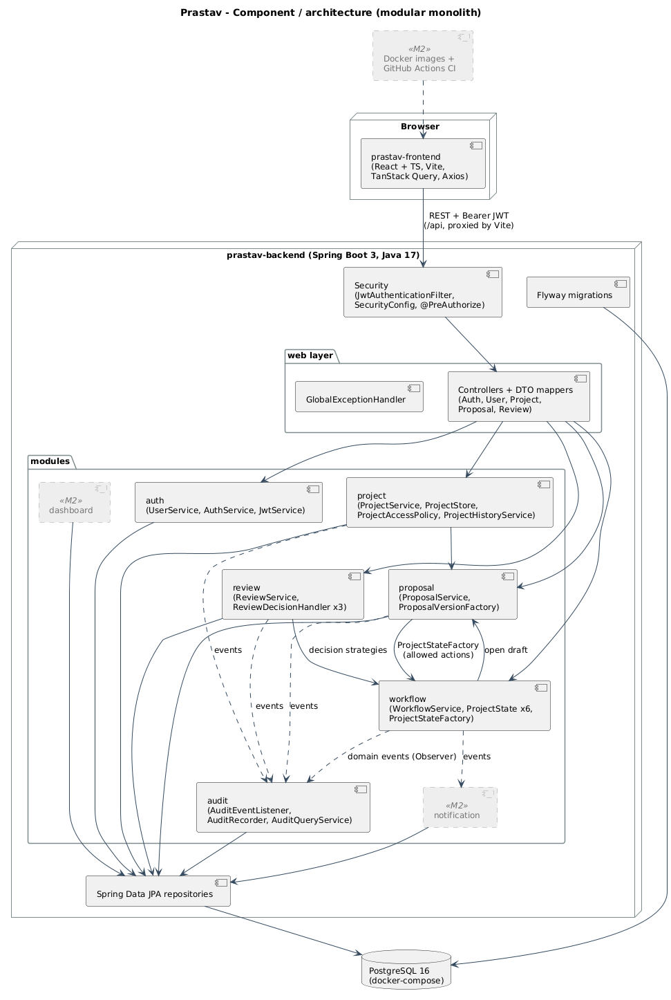

### 3.1 Layers inside a module

| Layer | Contains | Rule |
|---|---|---|
| web | `*Controller`, request/response records, `*Mapper` | HTTP only: parse, validate (`@Valid`), call one service, map to DTO. No business rules. |
| service | `*Service`, `ProjectStore`, `ProjectAccessPolicy`, `AllowedActionsResolver`, decision handlers | Use cases and transactions (`@Transactional`). Authorization layer 2. |
| domain | entities, enums, value records, state classes, `Guards`, events | Business rules. State classes and entities are plain Java and tested without Spring. |
| repository | `*Repository extends JpaRepository` | Persistence only; used inside its own module. |

### 3.2 Module dependencies (no cycles between beans)

```
auth      <- (everyone needs Actor/User)        common <- everyone
workflow  -> project (ProjectStore), proposal (ProposalService), auth (UserService)
proposal  -> project (ProjectStore, ProjectAccessPolicy), workflow (ProjectStateFactory)
review    -> workflow (WorkflowService via handlers), proposal, project, auth
project   -> proposal (ProposalService), workflow (AllowedActionsResolver), auth, audit (history read)
audit     -> listens to events from project, proposal, workflow, review
notification -> project (ProjectStore), auth; listens to events from workflow, review
```

`ProjectStore` exists so that `ProposalService` and `WorkflowService` can load and save projects without depending on `ProjectService`, which itself depends on `ProposalService`; this keeps constructor injection free of cycles.

### 3.3 Request lifecycle

1. `JwtAuthenticationFilter` verifies the Bearer token and puts an `Actor(userId, role)` in the security context.
2. `@PreAuthorize` on the controller method checks the role (authorization layer 1).
3. The controller calls a service with the `Actor` as an explicit parameter.
4. The service loads data, checks ownership/assignment via `ProjectAccessPolicy` or the state guards (layer 2), changes state, saves, publishes events.
5. `AuditEventListener` runs synchronously in the same transaction (audit rows commit or roll back with the change). `NotificationListener` runs after that transaction commits, in a new transaction of its own (section 6.1).
6. The controller maps the result to a response record. Any exception becomes an `ApiError` in `GlobalExceptionHandler` or `RestAuthErrorHandler`.

## 4. Package structure

```
com.prastav
├─ PrastavApplication
├─ common      ApiError, FieldErrorDetail, ErrorCode, PrastavException, NotFoundException,
│              ForbiddenException, ValidationException, ConflictException,
│              UnauthenticatedException, BaseEntity, GlobalExceptionHandler, OpenApiConfig
├─ auth        Role, User, Actor, AuthResult, UserRepository, UserService, AuthService,
│              JwtService, JwtAuthenticationFilter, RestAuthErrorHandler, SecurityConfig,
│              DemoDataSeeder
│              InstitutionProperties, EmailPolicy, PatternEmailPolicy, StudentEmail
│  └─ web      AuthController, UserController, RegisterRequest, LoginRequest, AuthResponse,
│              UserResponse, UserSummary, UserMapper
│              CreateUserRequest
├─ workflow    ProjectStatus, Action, ProjectState, DraftState, SubmittedState,
│              UnderReviewState, RevisionRequestedState, ApprovedState, RejectedState,
│              ProjectStateFactory, Guards, AllowedActionsResolver, IllegalTransitionException,
│              ProjectStatusChangedEvent, ReviewerReassignedEvent, WorkflowService
├─ project     Project, ProjectRepository, ProjectStore, ProjectAccessPolicy, ProjectService,
│              NewProject, ProjectView, ProjectCreatedEvent, ProjectHistoryService,
│              TimelineEntry, TimelineEntryType, ProjectListQuery, ProjectListItem,
│              ProjectSort, ProjectSpecifications, ProjectCounts, ProjectStatusCount,
│              DashboardService, DashboardSummary, ProjectAwaitingAssignment, ReviewerWorkload
│  └─ web      ProjectController, CreateProjectRequest, AssignReviewerRequest,
│              ProjectSummaryResponse, ProjectDetailResponse, ProjectCountsResponse, ProjectMapper,
│              DashboardController, DashboardSummaryResponse, AwaitingAssignmentResponse,
│              ReviewerWorkloadResponse, DashboardMapper
├─ proposal    ProposalVersion, ProposalVersionState, ProposalContent, ProposalVersionFactory,
│              ProposalVersionRepository, ProposalService, ProposalVersionCreatedEvent,
│              ProposalDraftUpdatedEvent, FirstSubmission, ProposalDiffService, ProposalDiff, FieldDiff
│  └─ web      ProposalController, ProposalVersionResponse, ProposalMapper
├─ review      Review, ReviewDecision, ReviewRepository, ReviewService, ReviewDecisionHandler,
│              ApproveDecisionHandler, RequestRevisionDecisionHandler, RejectDecisionHandler,
│              ReviewRecordedEvent
│  └─ web      ReviewController, ReviewRequest, ReviewResponse, ReviewMapper
├─ audit       AuditLog, AuditAction, AuditLogRepository, AuditRecorder, JpaAuditRecorder,
│              AuditEventListener, AuditQueryService
└─ notification Notification, NotificationType, NotificationRepository, NotificationService,
               NotificationChannel, InAppNotificationChannel, EmailNotificationChannel,
               NotificationDispatcher, NotificationProperties, RetryingNotificationChannel,
               NotificationListener
   └─ web      NotificationController, NotificationResponse, NotificationPageResponse,
               UnreadCountResponse, MarkAllReadResponse, NotificationMapper
```

## 5. Workflow engine

### 5.1 Status table (the only legal transitions)

| From | Action | Actor | To | Guard (implemented in) |
|---|---|---|---|---|
| DRAFT | `submit` | Student owner | SUBMITTED | owner; open draft exists; required fields filled (`DraftState.submit` via `Guards`) |
| SUBMITTED | `assignReviewer` | Coordinator | UNDER_REVIEW | actor is COORDINATOR; assignee has FACULTY role (`SubmittedState.assignReviewer`) |
| UNDER_REVIEW | `approve` | Assigned faculty | APPROVED | actor is the assigned reviewer (`UnderReviewState.approve`); review is stored against the latest submitted version (`ReviewService`) |
| UNDER_REVIEW | `requestRevision` | Assigned faculty | REVISION_REQUESTED | assigned reviewer; comments mandatory |
| UNDER_REVIEW | `reject` | Assigned faculty | REJECTED | assigned reviewer; comments mandatory |
| UNDER_REVIEW | `reassignReviewer` | Coordinator | UNDER_REVIEW (unchanged) | actor is COORDINATOR (403); new reviewer has FACULTY role (400); new reviewer differs from the current one (400) (`UnderReviewState.reassignReviewer`) |
| REVISION_REQUESTED | `submit` (resubmit) | Student owner | UNDER_REVIEW | owner; new version is open and complete; reviewer already assigned (`RevisionRequestedState.submit`) |

APPROVED and REJECTED are terminal. Any pair not in this table throws `IllegalTransitionException` and returns HTTP 409 `ILLEGAL_TRANSITION`; for example reassigning while SUBMITTED gives "Action REASSIGN_REVIEWER is not allowed while the project is SUBMITTED" (a SUBMITTED project has no reviewer yet and uses `assignReviewer`).

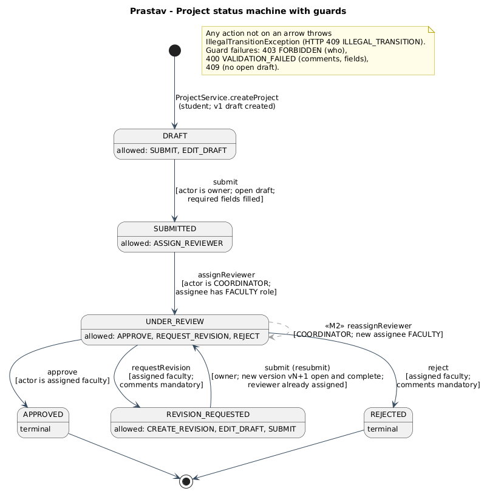

### 5.2 State pattern classes

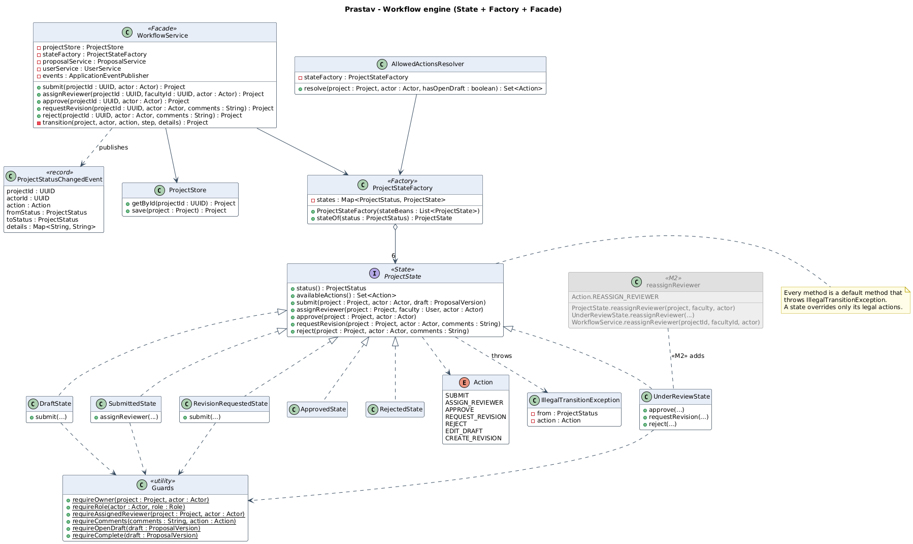

`ProjectState` declares six action methods (`submit`, `assignReviewer`, `reassignReviewer`, `approve`, `requestRevision`, `reject`) as **default methods that throw** `IllegalTransitionException(status(), action)`. Each concrete state overrides only what is legal from it:

| State class | Overrides | `availableActions()` |
|---|---|---|
| `DraftState` | `submit` | SUBMIT, EDIT_DRAFT |
| `SubmittedState` | `assignReviewer` | ASSIGN_REVIEWER |
| `UnderReviewState` | `approve`, `requestRevision`, `reject`, `reassignReviewer` | APPROVE, REQUEST_REVISION, REJECT, REASSIGN_REVIEWER |
| `RevisionRequestedState` | `submit` (resubmit) | CREATE_REVISION, EDIT_DRAFT, SUBMIT |
| `ApprovedState` | nothing (terminal) | none |
| `RejectedState` | nothing (terminal) | none |

`DraftState.submit` and `RevisionRequestedState.submit` share a name but behave differently (SUBMITTED versus UNDER_REVIEW). That polymorphism is what replaces `if (status == ...)` chains.

States are stateless Spring `@Component`s. `ProjectStateFactory` receives `List<ProjectState>` by constructor injection, builds an `EnumMap<ProjectStatus, ProjectState>`, and fails at startup if a status has no state or two states claim one status. Adding a status therefore means one enum value plus one class.

`Guards` holds the static precondition checks used by the states (`requireOwner`, `requireRole`, `requireAssignedReviewer`, `requireComments`, `requireOpenDraft`, `requireComplete`). Keeping them static and dependency-free lets tests construct states with `new DraftState()`.

### 5.3 `WorkflowService` algorithm (Facade)

Every public method (`submit`, `assignReviewer`, `approve`, `requestRevision`, `reject`) is `@Transactional` and follows the same private template `transition(project, actor, action, step, details)`:

1. Load the project through `ProjectStore.getById` (404 if missing). For `submit`, also load the open draft through `ProposalService.findOpenDraft`; for `assignReviewer`, load the faculty user through `UserService.getById`.
2. Remember `from = project.getStatus()`.
3. `stateFactory.stateOf(from)` and call the action on it. The state runs its guards, then mutates the project (`moveTo`, `assignReviewer`) and, for submit, freezes the draft (`ProposalVersion.submit()`).
4. `projectStore.save(project)`. The `@Version` column makes a concurrent second transition fail with `OptimisticLockingFailureException`, mapped to 409 `CONCURRENT_UPDATE`.
5. Publish `ProjectStatusChangedEvent(projectId, actorId, action, from, to, details)`.

If step 3 throws, steps 4 and 5 never run and the transaction rolls back, so an illegal action leaves no trace except the error response.

`reassignReviewer(projectId, facultyId, actor)` is also `@Transactional` and takes the same path, but does not use `transition` because the status does not change:

1. Load the project (`ProjectStore.getById`, 404) and the new reviewer (`UserService.getById`, 404); remember the current reviewer.
2. `stateFactory.stateOf(status).reassignReviewer(project, faculty, actor)`. Only `UnderReviewState` overrides it; every other state throws `IllegalTransitionException(status, REASSIGN_REVIEWER)` (409). `UnderReviewState` checks the COORDINATOR role (403), the FACULTY role of the new reviewer (400) and that it is not the current reviewer (400), then calls `Project.assignReviewer`.
3. `projectStore.save(project)` (optimistic lock as above).
4. Publish `ReviewerReassignedEvent(projectId, actorId, previousReviewerId, newReviewerId)`. It is not a `ProjectStatusChangedEvent`, since from and to would be the same status.

### 5.4 `allowedActions`

`AllowedActionsResolver.resolve(project, actor, hasOpenDraft)` starts from `stateOf(status).availableActions()` and keeps an action only if this actor may perform it:

| Action | Kept when |
|---|---|
| SUBMIT, EDIT_DRAFT | actor owns the project and an open draft exists |
| CREATE_REVISION | actor owns the project and no open draft exists |
| ASSIGN_REVIEWER, REASSIGN_REVIEWER | actor is COORDINATOR |
| APPROVE, REQUEST_REVISION, REJECT | actor is FACULTY and the assigned reviewer |

The UI renders buttons only from this list. The backend still re-checks every action, so a hand-crafted request gets the same 403/409 as before.

`ProposalService` uses the same `availableActions()` to decide whether EDIT_DRAFT or CREATE_REVISION is legal in the current status, so proposal rules and workflow rules cannot drift apart.

## 6. Events and listeners (Observer)

Publishers use Spring's `ApplicationEventPublisher`. `AuditEventListener` uses `@EventListener` and runs **synchronously in the publisher's transaction**: an audit row is committed if and only if the change it describes is committed. `NotificationListener` uses `@TransactionalEventListener` and runs after that transaction commits (section 6.1).

| Event (record) | Published by | Payload | `AuditEventListener` writes |
|---|---|---|---|
| `ProjectCreatedEvent` | `ProjectService.createProject` | projectId, actorId, title | `PROJECT_CREATED`, to_status DRAFT |
| `ProposalVersionCreatedEvent` | `ProposalService.createInitialDraft`, `createNextVersion` | projectId, versionNumber, actorId | `VERSION_CREATED` |
| `ProposalDraftUpdatedEvent` | `ProposalService.updateDraft` | projectId, versionNumber, actorId | `DRAFT_UPDATED` |
| `ProjectStatusChangedEvent` | `WorkflowService` (every transition) | projectId, actorId, action, fromStatus, toStatus, details | `PROPOSAL_SUBMITTED` (SUBMIT), `REVIEWER_ASSIGNED` (ASSIGN_REVIEWER), otherwise `STATUS_CHANGED`; from/to filled |
| `ReviewRecordedEvent` | `ReviewService.recordReview` | projectId, reviewId, versionNumber, reviewerId, decision | `REVIEW_RECORDED` |
| `ReviewerReassignedEvent` | `WorkflowService.reassignReviewer` | projectId, actorId, previousReviewerId, newReviewerId | `REVIEWER_REASSIGNED`, from/to empty (the status does not change, so the entry is not a timeline status change); details `{"previousReviewerId":"...","reviewerId":"..."}` |

`AuditEventListener` depends on the one-method `AuditRecorder` interface (implemented by `JpaAuditRecorder`), not on a repository. `details` is a small JSON object built with Jackson, e.g. `{"versionNumber":"2","action":"SUBMIT"}`.

### 6.1 Notification dispatch

`NotificationListener` turns four of these events into notifications. Assignment and resubmission are `ProjectStatusChangedEvent`s, a decision is a `ReviewRecordedEvent` and a reassignment is a `ReviewerReassignedEvent`.

| Event | Condition | Recipient | `NotificationType` | Message |
|---|---|---|---|---|
| `ProjectStatusChangedEvent` | `action == ASSIGN_REVIEWER` | the assigned reviewer (`Project.getReviewer()`) | `REVIEWER_ASSIGNED` | `You have been assigned to review "<title>"` |
| `ProjectStatusChangedEvent` | `action == SUBMIT` and `fromStatus == REVISION_REQUESTED` | the assigned reviewer | `RESUBMITTED` | `"<title>" was resubmitted as version <details.versionNumber>` |
| `ReviewRecordedEvent` | every decision | the student owner (`Project.getOwner()`) | `REVIEW_DECISION` | `Version <n> of "<title>" was approved` / `needs changes` / `was rejected` |
| `ReviewerReassignedEvent` | always | the previous reviewer (`UserService.getById(previousReviewerId)`) | `REVIEWER_UNASSIGNED` | `You are no longer the reviewer of "<title>"` |
| `ReviewerReassignedEvent` | always | the new reviewer (`Project.getReviewer()`) | `REVIEWER_ASSIGNED` | `You have been assigned to review "<title>"` |

After a reassignment the previous reviewer is no longer a participant, so the project itself returns 403 to them; the notification still names the project and stays in their inbox.

Every other status change (first submission, and the APPROVE, REQUEST_REVISION and REJECT transitions, whose decision arrives as `ReviewRecordedEvent`) is ignored, so a decision produces exactly one notification.

Sequence for one event, for example a reviewer requesting changes:

1. `ReviewService.recordReview` runs the transition and saves the `Review` in its transaction, then publishes `ReviewRecordedEvent`. `AuditEventListener` writes `REVIEW_RECORDED` inside that transaction.
2. Spring holds the event for `NotificationListener` (`@TransactionalEventListener`, phase AFTER_COMMIT) until the transaction commits. If it rolls back, the listener is never called and nobody is notified about a change that did not happen.
3. After the commit the listener starts a new transaction (`@Transactional(propagation = REQUIRES_NEW)`), loads the project through `ProjectStore.getById` and picks the recipient: the owner for a decision, the reviewer for an assignment or resubmission.
4. It builds a transient `Notification(recipient, project, type, message)` and calls `NotificationDispatcher.dispatch`.
5. The dispatcher hands it to each enabled channel in configured order (`in-app`, then `email` by default), each wrapped in `RetryingNotificationChannel`. `InAppNotificationChannel` stores it through `NotificationService.create`; `EmailNotificationChannel` writes it to the log.
6. A channel that still fails after its retries is logged at WARN and the next channel runs. Because the business transaction has already committed, a delivery failure can never undo the review, assignment or resubmission.
7. The recipient reads it through `GET /api/notifications` (section 10.8).

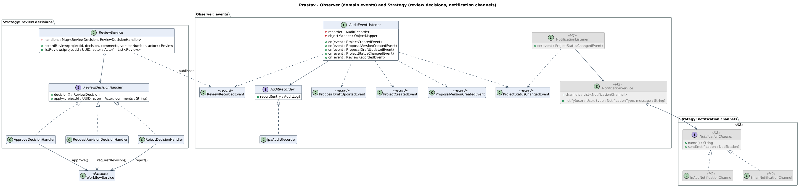

## 7. Review decision strategies (Strategy)

`ReviewDecisionHandler`: `ReviewDecision decision()` and `void apply(UUID projectId, Actor actor, String comments)`.

| Implementation | Decision | Calls |
|---|---|---|
| `ApproveDecisionHandler` | APPROVE | `WorkflowService.approve(projectId, actor)` |
| `RequestRevisionDecisionHandler` | REQUEST_REVISION | `WorkflowService.requestRevision(projectId, actor, comments)` |
| `RejectDecisionHandler` | REJECT | `WorkflowService.reject(projectId, actor, comments)` |

`ReviewService` receives `List<ReviewDecisionHandler>` and indexes it into an `EnumMap`. `recordReview` runs in this order:

1. Pick the handler for the decision.
2. Normalise comments (trim; blank becomes null).
3. Load the latest **submitted** version. If the request carries `versionNumber` and it is not the latest, return 409 (stale-page protection, business rule 4).
4. `handler.apply(...)`: the workflow transition with all guards (assigned reviewer, status, mandatory comments).
5. Save `Review(project, latestVersion, reviewer, decision, comments)` and publish `ReviewRecordedEvent`.

Because step 4 runs before step 5 inside one transaction, a failed transition never leaves a review row behind.

## 8. Class catalogue

Generated from `backend/src/main/java` (122 classes). Private helper methods are omitted; private fields are listed.

### 8.1 Package `com.prastav`

#### `PrastavApplication`

*class* · `src/main/java/com/prastav/PrastavApplication.java`

**Responsibility.** Entry point of the Prastav modular monolith.

**Methods:**

- `public static void main(String[] args)`


### 8.2 Package `com.prastav.common`

#### `ApiError`

*record* · `src/main/java/com/prastav/common/ApiError.java`

**Responsibility.** The single error body used by every endpoint: { timestamp, status, code, message, path, fieldErrors[] }.

**Components:** `Instant timestamp, int status, ErrorCode code, String message, String path, List<FieldErrorDetail> fieldErrors`

**Methods:**

- `public static ApiError of(ErrorCode code, String message, String path, List<FieldErrorDetail> fieldErrors)`

#### `BaseEntity`

*abstract class* `implements Persistable<UUID>` · @MappedSuperclass · `src/main/java/com/prastav/common/BaseEntity.java`

**Responsibility.** Common identity for all entities: an application-assigned UUID and a creation timestamp. Ids are generated in the constructor, so domain objects have an identity before they are saved (which keeps unit tests free of a database). Implementing Persistable tells Spring Data that a freshly constructed entity is new, so save() performs an INSERT instead of a merge.

| Field | Type | Visibility |
|---|---|---|
| `id` | `UUID` | private |
| `createdAt` | `Instant` | private |
| `newEntity` | `boolean` | private |

**Methods:**

- `protected BaseEntity()`
- `public UUID getId()`
- `public Instant getCreatedAt()`
- `public boolean isNew()`
- `protected void markNotNew()`
- `public boolean equals(Object other)`
- `public int hashCode()`

#### `ConflictException`

*class* `extends PrastavException` · `src/main/java/com/prastav/common/ConflictException.java`

**Responsibility.** The operation conflicts with the current state of the data, outside the status table itself, e.g. editing a submitted proposal version or opening a second draft (409 ILLEGAL_TRANSITION).

**Methods:**

- `public ConflictException(String message)`

#### `ErrorCode`

*enum* · `src/main/java/com/prastav/common/ErrorCode.java`

**Responsibility.** Stable, machine-readable error codes returned in ApiError#code(). Each code carries the HTTP status it maps to, so the mapping lives in one place.

**Constants:** `VALIDATION_FAILED`, `UNAUTHENTICATED`, `FORBIDDEN`, `NOT_FOUND`, `ILLEGAL_TRANSITION`, `CONCURRENT_UPDATE`, `INTERNAL_ERROR`

| Field | Type | Visibility |
|---|---|---|
| `httpStatus` | `int` | private |

**Methods:**

- `public int httpStatus()`

#### `FieldErrorDetail`

*record* · `src/main/java/com/prastav/common/FieldErrorDetail.java`

**Responsibility.** One invalid request field, reported inside ApiError#fieldErrors().

**Components:** `String field, String message`

#### `ForbiddenException`

*class* `extends PrastavException` · `src/main/java/com/prastav/common/ForbiddenException.java`

**Responsibility.** The caller is authenticated but not allowed to act on this resource (403 FORBIDDEN).

**Methods:**

- `public ForbiddenException(String message)`

#### `GlobalExceptionHandler`

*class* · @RestControllerAdvice · `src/main/java/com/prastav/common/GlobalExceptionHandler.java`

**Responsibility.** Translates exceptions into the uniform ApiError body. Controllers contain no try/catch; every failure path ends here, which keeps the error contract identical across endpoints. Stack traces are logged, never returned.

| Field | Type | Visibility |
|---|---|---|
| `log` | `static Logger` | private |

**Methods:**

- `public ResponseEntity<ApiError> handleBusiness(PrastavException ex, HttpServletRequest request)`
- `public ResponseEntity<ApiError> handleInvalidBody(MethodArgumentNotValidException ex, HttpServletRequest request)`
- `public ResponseEntity<ApiError> handleMalformed(Exception ex, HttpServletRequest request)`
- `public ResponseEntity<ApiError> handleAccessDenied(AccessDeniedException ex, HttpServletRequest request)`
- `public ResponseEntity<ApiError> handleConcurrentUpdate(OptimisticLockingFailureException ex, HttpServletRequest request)`
- `public ResponseEntity<ApiError> handleNoResource(NoResourceFoundException ex, HttpServletRequest request)`
- `public ResponseEntity<ApiError> handleUnexpected(Exception ex, HttpServletRequest request)`

#### `NotFoundException`

*class* `extends PrastavException` · `src/main/java/com/prastav/common/NotFoundException.java`

**Responsibility.** A requested entity does not exist (404 NOT_FOUND).

**Methods:**

- `public NotFoundException(String entityName, Object id)`

#### `OpenApiConfig`

*class* · @Configuration · `src/main/java/com/prastav/common/OpenApiConfig.java`

**Responsibility.** Swagger UI metadata and the "Authorize" button for Bearer JWTs.

#### `PrastavException`

*abstract class* `extends RuntimeException` · `src/main/java/com/prastav/common/PrastavException.java`

**Responsibility.** Base class for all expected business errors. The ErrorCode decides the HTTP status, so GlobalExceptionHandler needs only one handler for the whole hierarchy.

| Field | Type | Visibility |
|---|---|---|
| `code` | `ErrorCode` | private |

**Methods:**

- `protected PrastavException(ErrorCode code, String message)`
- `public ErrorCode getCode()`

#### `UnauthenticatedException`

*class* `extends PrastavException` · `src/main/java/com/prastav/common/UnauthenticatedException.java`

**Responsibility.** Login failed or credentials are missing (401 UNAUTHENTICATED).

**Methods:**

- `public UnauthenticatedException(String message)`

#### `ValidationException`

*class* `extends PrastavException` · `src/main/java/com/prastav/common/ValidationException.java`

**Responsibility.** A business validation rule failed, e.g. mandatory review comments missing (400 VALIDATION_FAILED).

**Methods:**

- `public ValidationException(String message)`


### 8.3 Package `com.prastav.auth`

#### `Actor`

*record* · `src/main/java/com/prastav/auth/Actor.java`

**Responsibility.** The authenticated caller, rebuilt from the JWT on every request and passed explicitly into services. Passing the actor as a parameter (instead of reading a static security context deep inside the domain) keeps services and state classes testable without Spring Security.

**Components:** `UUID userId, Role role`

**Methods:**

- `public boolean hasRole(Role expected)`

#### `AuthResult`

*record* · `src/main/java/com/prastav/auth/AuthResult.java`

**Responsibility.** Result of a successful register or login: the signed JWT and the user it belongs to.

**Components:** `String token, User user`

#### `AuthService`

*class* · @Service · `src/main/java/com/prastav/auth/AuthService.java`

**Responsibility.** Registration and login. Passwords are hashed with BCrypt; a successful call returns a JWT. Self-registration is for students only, with an email accepted by the EmailPolicy.

| Field | Type | Visibility |
|---|---|---|
| `userRepository` | `UserRepository` | private |
| `passwordEncoder` | `PasswordEncoder` | private |
| `jwtService` | `JwtService` | private |
| `emailPolicy` | `EmailPolicy` | private |

**Methods:**

- `public AuthService(UserRepository userRepository, PasswordEncoder passwordEncoder, JwtService jwtService, EmailPolicy emailPolicy)`
- `public AuthResult register(String name, String email, String password, Role role)`: `role` may be null; anything but STUDENT is rejected; the email must pass `EmailPolicy.requireStudent`
- `public AuthResult login(String email, String password)`

#### `DemoDataSeeder`

*class* `implements ApplicationRunner` · @Component · `src/main/java/com/prastav/auth/DemoDataSeeder.java`

**Responsibility.** Creates the demo accounts (1 coordinator, 2 faculty, 3 students) on an empty database, all on the institutional domain and sharing prastav.seed.demo-password. Student admission year and branch are parsed by the EmailPolicy, exactly as at registration. Done in Java rather than SQL so that passwords are hashed with the same BCrypt encoder the app uses.

| Field | Type | Visibility |
|---|---|---|
| `log` | `static Logger` | private |
| `userRepository` | `UserRepository` | private |
| `passwordEncoder` | `PasswordEncoder` | private |
| `emailPolicy` | `EmailPolicy` | private |
| `emailDomain` | `String` | private |
| `demoPassword` | `String` | private |

**Methods:**

- `public DemoDataSeeder(UserRepository userRepository, PasswordEncoder passwordEncoder, EmailPolicy emailPolicy, InstitutionProperties institution, @Value("${prastav.seed.demo-password}") String demoPassword)`
- `public void run(ApplicationArguments args)`
- `private String email(String localPart)`

#### `EmailPolicy`

*interface* · `src/main/java/com/prastav/auth/EmailPolicy.java`

**Responsibility.** Strategy pattern: the rules an email address must satisfy before an account is opened with it. AuthService, UserService and the seed depend only on this interface, so a different institutional naming scheme is a new implementation rather than an edit to the services. Both methods throw ValidationException when the email is not acceptable.

**Methods:**

- `String requireInstitutional(String email)`: the trimmed, lower-case email if it is on the institution's domain
- `StudentEmail requireStudent(String email)`: the normalized email with admission year and branch parsed from it

#### `InstitutionProperties`

*record* · @ConfigurationProperties(prefix = "prastav.institution") · `src/main/java/com/prastav/auth/InstitutionProperties.java`

**Responsibility.** Institution profile bound from prastav.institution in application.yml: the institution name, the only email domain accepted for accounts, and the regular expression a student email's local part must match. The expression declares the named groups year (two digits) and branch.

**Components:** `String name, String emailDomain, String studentEmailPattern` (all `@NotBlank`)

#### `JwtAuthenticationFilter`

*class* `extends OncePerRequestFilter` · `src/main/java/com/prastav/auth/JwtAuthenticationFilter.java`

**Responsibility.** Reads Authorization: Bearer <jwt>, verifies it and stores the Actor as the principal with authority ROLE_<role>. An invalid token simply leaves the request unauthenticated; the entry point then answers 401. Created inside SecurityConfig, not as a standalone bean.

| Field | Type | Visibility |
|---|---|---|
| `BEARER_PREFIX` | `static String` | private |
| `jwtService` | `JwtService` | private |

**Methods:**

- `public JwtAuthenticationFilter(JwtService jwtService)`
- `protected void doFilterInternal(HttpServletRequest request, HttpServletResponse response, FilterChain chain)`

#### `JwtService`

*class* · @Service · `src/main/java/com/prastav/auth/JwtService.java`

**Responsibility.** Issues and verifies HS256 JWTs carrying two claims: userId and role. Tokens expire after prastav.jwt.expiration-minutes (60 by default).

| Field | Type | Visibility |
|---|---|---|
| `CLAIM_USER_ID` | `static String` | private |
| `CLAIM_ROLE` | `static String` | private |
| `key` | `SecretKey` | private |
| `expiry` | `Duration` | private |

**Methods:**

- `public JwtService(@Value("$`
- `public String generateToken(User user)`
- `public Optional<Actor> parse(String token)`

#### `PatternEmailPolicy`

*class* `implements EmailPolicy` · @Component · `src/main/java/com/prastav/auth/PatternEmailPolicy.java`

**Responsibility.** Strategy pattern: the EmailPolicy driven by InstitutionProperties. Any address on the configured domain is institutional; a student address must also match the configured local-part pattern, e.g. aarav.23csai@nst.rishihood.edu.in gives admission year 2023 and branch CSAI. Input is matched case-insensitively and returned lower-case.

| Field | Type | Visibility |
|---|---|---|
| `CENTURY` | `static int` | private |
| `institution` | `InstitutionProperties` | private |
| `domainSuffix` | `String` | private |
| `studentLocalPart` | `Pattern` | private |

**Methods:**

- `public PatternEmailPolicy(InstitutionProperties institution)`
- `public String requireInstitutional(String email)`
- `public StudentEmail requireStudent(String email)`

#### `RestAuthErrorHandler`

*class* `implements AuthenticationEntryPoint, AccessDeniedHandler` · @Component · `src/main/java/com/prastav/auth/RestAuthErrorHandler.java`

**Responsibility.** Writes 401/403 responses raised inside the security filter chain in the standard ApiError format.

| Field | Type | Visibility |
|---|---|---|
| `objectMapper` | `ObjectMapper` | private |

**Methods:**

- `public RestAuthErrorHandler(ObjectMapper objectMapper)`
- `public void commence(HttpServletRequest request, HttpServletResponse response, AuthenticationException authException) throws IOException`
- `public void handle(HttpServletRequest request, HttpServletResponse response, AccessDeniedException accessDeniedException) throws IOException`

#### `Role`

*enum* · `src/main/java/com/prastav/auth/Role.java`

**Responsibility.** The three roles of Prastav. Stored as a string on the user row and as a JWT claim.

**Constants:** `STUDENT`, `FACULTY`, `COORDINATOR`

#### `SecurityConfig`

*class* · @Configuration · `src/main/java/com/prastav/auth/SecurityConfig.java`

**Responsibility.** Stateless JWT security. Layer 1 of authorization: every request except login/register/Swagger must be authenticated, and @PreAuthorize on controllers gates by role. Layer 2 (ownership and assignment) lives in the services and state classes.

| Field | Type | Visibility |
|---|---|---|
| `jwtService` | `JwtService` | private |
| `errorHandler` | `RestAuthErrorHandler` | private |
| `allowedOrigin` | `String` | private |

**Methods:**

- `public SecurityConfig(JwtService jwtService, RestAuthErrorHandler errorHandler, @Value("$`
- `public SecurityFilterChain securityFilterChain(HttpSecurity http) throws Exception`
- `public CorsConfigurationSource corsConfigurationSource()`
- `public PasswordEncoder passwordEncoder()`

#### `StudentEmail`

*record* · `src/main/java/com/prastav/auth/StudentEmail.java`

**Responsibility.** A normalized student email and the admission year and branch encoded in it.

**Components:** `String email, int admissionYear, String branch`

#### `User`

*class* `extends BaseEntity` · @Entity · `src/main/java/com/prastav/auth/User.java`

**Responsibility.** A person who can log in. The role is fixed on the account and copied into the JWT. Students also carry the admission year and branch parsed from their institutional email.

| Field | Type | Visibility |
|---|---|---|
| `name` | `String` | private |
| `email` | `String` | private |
| `passwordHash` | `String` | private |
| `role` | `Role` | private |
| `admissionYear` | `Integer` (nullable) | private |
| `branch` | `String` (nullable) | private |

**Methods:**

- `protected User()`
- `public User(String name, String email, String passwordHash, Role role)`
- `public static User student(String name, StudentEmail studentEmail, String passwordHash)`
- `public Actor toActor()`
- `public String getName()`
- `public String getEmail()`
- `public String getPasswordHash()`
- `public Role getRole()`
- `public Integer getAdmissionYear()`
- `public String getBranch()`

#### `UserRepository`

*interface* `extends JpaRepository<User, UUID>` · `src/main/java/com/prastav/auth/UserRepository.java`

**Responsibility.** Repository pattern: persistence for User, used only inside the auth module.

**Methods:**

- `Optional<User> findByEmail(String email)`
- `boolean existsByEmail(String email)`
- `List<User> findByRoleOrderByNameAsc(Role role)`
- `List<User> findAllByOrderByNameAsc()`

#### `UserService`

*class* · @Service · `src/main/java/com/prastav/auth/UserService.java`

**Responsibility.** The auth module's public service for other modules. Other modules never touch UserRepository directly; they ask this service. It also creates the FACULTY and COORDINATOR accounts, which only the coordinator may do.

| Field | Type | Visibility |
|---|---|---|
| `userRepository` | `UserRepository` | private |
| `passwordEncoder` | `PasswordEncoder` | private |
| `emailPolicy` | `EmailPolicy` | private |

**Methods:**

- `public UserService(UserRepository userRepository, PasswordEncoder passwordEncoder, EmailPolicy emailPolicy)`
- `public User getById(UUID id)`
- `public List<User> listByRole(Role role)`
- `public Map<UUID, String> namesOf(Collection<UUID> ids)`
- `public User createAccount(Actor actor, String name, String email, String password, Role role)`: coordinator only (403 otherwise); STUDENT rejected (400); email must pass `EmailPolicy.requireInstitutional`; duplicate email 400


### 8.4 Package `com.prastav.auth.web`

#### `AuthController`

*class* · @RestController · `src/main/java/com/prastav/auth/web/AuthController.java`

**Responsibility.** Register, login and "who am I". HTTP only; all rules are in AuthService.

| Field | Type | Visibility |
|---|---|---|
| `authService` | `AuthService` | private |
| `userService` | `UserService` | private |

**Methods:**

- `public AuthController(AuthService authService, UserService userService)`
- `public AuthResponse register(RegisterRequest request)`
- `public AuthResponse login(LoginRequest request)`
- `public UserResponse me(Actor actor)`

#### `AuthResponse`

*record* · `src/main/java/com/prastav/auth/web/AuthResponse.java`

**Responsibility.** Returned by register and login: the JWT plus the user it was issued for.

**Components:** `String token, UserResponse user`

#### `CreateUserRequest`

*record* · `src/main/java/com/prastav/auth/web/CreateUserRequest.java`

**Responsibility.** Body of POST /api/users. FACULTY or COORDINATOR; STUDENT is rejected by the service.

**Components:** `String name, String email, String password, Role role` (`@NotBlank`/`@Size` as `RegisterRequest`, `@NotNull` role)

#### `LoginRequest`

*record* · `src/main/java/com/prastav/auth/web/LoginRequest.java`

**Responsibility.** Body of POST /api/auth/login.

**Components:** `String email, String password`

#### `RegisterRequest`

*record* · `src/main/java/com/prastav/auth/web/RegisterRequest.java`

**Responsibility.** Body of POST /api/auth/register. role is optional; anything but STUDENT is rejected by the service.

**Components:** `String name, String email, String password, Role role`

#### `UserController`

*class* · @RestController · `src/main/java/com/prastav/auth/web/UserController.java`

**Responsibility.** Lets the coordinator list users, e.g. ?role=FACULTY to pick a reviewer, and create FACULTY and COORDINATOR accounts. HTTP only; the rules are in UserService.

| Field | Type | Visibility |
|---|---|---|
| `userService` | `UserService` | private |

**Methods:**

- `public UserController(UserService userService)`
- `public List<UserResponse> list(Role role)`
- `public UserResponse create(Actor actor, CreateUserRequest request)`

#### `UserMapper`

*final class* · `src/main/java/com/prastav/auth/web/UserMapper.java`

**Responsibility.** DTO mapper: entities never leave the service layer as-is.

**Methods:**

- `public static UserResponse toResponse(User user)`
- `public static UserSummary toSummary(User user)`
- `public static AuthResponse toAuthResponse(AuthResult result)`

#### `UserResponse`

*record* · `src/main/java/com/prastav/auth/web/UserResponse.java`

**Responsibility.** Public view of a user; never contains the password hash. Admission year and branch are set for students only.

**Components:** `UUID id, String name, String email, Role role, Integer admissionYear, String branch`

#### `UserSummary`

*record* · `src/main/java/com/prastav/auth/web/UserSummary.java`

**Responsibility.** Compact user reference embedded in other responses (owner, reviewer).

**Components:** `UUID id, String name`


### 8.5 Package `com.prastav.workflow`

#### `Action`

*enum* · `src/main/java/com/prastav/workflow/Action.java`

**Responsibility.** Everything a user can do to a project. The first five are status transitions handled by ProjectState; REASSIGN_REVIEWER is also handled by ProjectState but keeps the status; EDIT_DRAFT and CREATE_REVISION are proposal operations whose availability still depends on the status, so each state lists them too. The UI shows buttons from this list.

**Constants:** `SUBMIT`, `ASSIGN_REVIEWER`, `APPROVE`, `REQUEST_REVISION`, `REJECT`, `REASSIGN_REVIEWER`, `EDIT_DRAFT`, `CREATE_REVISION`

#### `AllowedActionsResolver`

*class* · @Component · `src/main/java/com/prastav/workflow/AllowedActionsResolver.java`

**Responsibility.** Computes allowedActions for the project detail response: the actions legal in the current state, filtered to the ones this actor may perform. The UI only shows buttons from this set; the backend still re-checks every action when it is called.

| Field | Type | Visibility |
|---|---|---|
| `stateFactory` | `ProjectStateFactory` | private |

**Methods:**

- `public AllowedActionsResolver(ProjectStateFactory stateFactory)`
- `public Set<Action> resolve(Project project, Actor actor, boolean hasOpenDraft)`

#### `ApprovedState`

*class* `implements ProjectState` · @Component · `src/main/java/com/prastav/workflow/ApprovedState.java`

**Responsibility.** State pattern: APPROVED. Terminal; inherits the "illegal" default for every action.

**Methods:**

- `public ProjectStatus status()`
- `public Set<Action> availableActions()`

#### `DraftState`

*class* `implements ProjectState` · @Component · `src/main/java/com/prastav/workflow/DraftState.java`

**Responsibility.** State pattern: DRAFT. The owner may edit the draft and submit it once all required fields are filled. Submitting freezes the version (it becomes immutable) and moves the project to SUBMITTED.

**Methods:**

- `public ProjectStatus status()`
- `public Set<Action> availableActions()`
- `public void submit(Project project, Actor actor, ProposalVersion draft)`

#### `Guards`

*final class* · `src/main/java/com/prastav/workflow/Guards.java`

**Responsibility.** Transition preconditions shared by the state classes. Static and dependency-free so that state objects stay plain Java and can be tested with new DraftState().

**Methods:**

- `public static void requireOwner(Project project, Actor actor)`
- `public static void requireRole(Actor actor, Role role)`
- `public static void requireAssignedReviewer(Project project, Actor actor)`
- `public static void requireComments(String comments, Action action)`
- `public static void requireOpenDraft(ProposalVersion draft)`
- `public static void requireComplete(ProposalVersion draft)`

#### `IllegalTransitionException`

*class* `extends PrastavException` · `src/main/java/com/prastav/workflow/IllegalTransitionException.java`

**Responsibility.** Thrown when an action is not legal in the project's current status (409 ILLEGAL_TRANSITION).

| Field | Type | Visibility |
|---|---|---|
| `from` | `ProjectStatus` | private |
| `action` | `Action` | private |

**Methods:**

- `public IllegalTransitionException(ProjectStatus from, Action action)`
- `public ProjectStatus getFrom()`
- `public Action getAction()`

#### `ProjectState`

*interface* · `src/main/java/com/prastav/workflow/ProjectState.java`

**Responsibility.** State pattern. One implementation per ProjectStatus. Every action defaults to "illegal" and a state overrides only the actions it allows, so the transition table lives in six small classes instead of a growing switch statement. Why: adding a status means adding one class (Open/Closed), each state's rules can be unit-tested in isolation, and the same call (e.g. submit) behaves differently per state through polymorphism rather than if/else on the status.

**Methods:**

- `ProjectStatus status()`
- `Set<Action> availableActions()`
- `default void submit(Project project, Actor actor, ProposalVersion draft)`
- `default void assignReviewer(Project project, User faculty, Actor actor)`
- `default void reassignReviewer(Project project, User faculty, Actor actor)`: replaces the assigned reviewer without changing the status
- `default void approve(Project project, Actor actor)`
- `default void requestRevision(Project project, Actor actor, String comments)`
- `default void reject(Project project, Actor actor, String comments)`

#### `ProjectStateFactory`

*class* · @Component · `src/main/java/com/prastav/workflow/ProjectStateFactory.java`

**Responsibility.** Factory pattern. Central place that turns a ProjectStatus into its ProjectState object. Why: callers never instantiate states or switch on the status. Spring injects every ProjectState bean, so a new status is registered by adding its class; the constructor fails fast at startup if any status has no state or two states claim the same status.

| Field | Type | Visibility |
|---|---|---|
| `states` | `Map<ProjectStatus, ProjectState>` | private |

**Methods:**

- `public ProjectStateFactory(List<ProjectState> stateBeans)`
- `public ProjectState stateOf(ProjectStatus status)`

#### `ProjectStatus`

*enum* · `src/main/java/com/prastav/workflow/ProjectStatus.java`

**Responsibility.** The six lifecycle statuses of a project. APPROVED and REJECTED are terminal.

**Constants:** `DRAFT`, `SUBMITTED`, `UNDER_REVIEW`, `REVISION_REQUESTED`, `APPROVED`, `REJECTED`

**Methods:**

- `public boolean isTerminal()`

#### `ProjectStatusChangedEvent`

*record* · `src/main/java/com/prastav/workflow/ProjectStatusChangedEvent.java`

**Responsibility.** Observer pattern event, published by WorkflowService after every successful transition. The workflow does not know who listens (AuditEventListener, NotificationListener).

**Components:** `UUID projectId, UUID actorId, Action action, ProjectStatus fromStatus, ProjectStatus toStatus, Map<String, String> details`

#### `ReviewerReassignedEvent`

*record* · `src/main/java/com/prastav/workflow/ReviewerReassignedEvent.java`

**Responsibility.** Observer pattern event, published by WorkflowService.reassignReviewer after the coordinator replaced the reviewer of an UNDER_REVIEW project. The status does not change, so this is not a ProjectStatusChangedEvent; listeners audit it and notify both reviewers.

**Components:** `UUID projectId, UUID actorId, UUID previousReviewerId, UUID newReviewerId`

#### `RejectedState`

*class* `implements ProjectState` · @Component · `src/main/java/com/prastav/workflow/RejectedState.java`

**Responsibility.** State pattern: REJECTED. Terminal; inherits the "illegal" default for every action.

**Methods:**

- `public ProjectStatus status()`
- `public Set<Action> availableActions()`

#### `RevisionRequestedState`

*class* `implements ProjectState` · @Component · `src/main/java/com/prastav/workflow/RevisionRequestedState.java`

**Responsibility.** State pattern: REVISION_REQUESTED. The owner creates version N+1, edits it and resubmits. submit here goes straight back to UNDER_REVIEW with the same reviewer: the same method name as in DraftState but different behaviour, chosen by polymorphism rather than by an if on the status.

**Methods:**

- `public ProjectStatus status()`
- `public Set<Action> availableActions()`
- `public void submit(Project project, Actor actor, ProposalVersion draft)`

#### `SubmittedState`

*class* `implements ProjectState` · @Component · `src/main/java/com/prastav/workflow/SubmittedState.java`

**Responsibility.** State pattern: SUBMITTED. Waiting for the coordinator to assign a FACULTY reviewer.

**Methods:**

- `public ProjectStatus status()`
- `public Set<Action> availableActions()`
- `public void assignReviewer(Project project, User faculty, Actor actor)`

#### `UnderReviewState`

*class* `implements ProjectState` · @Component · `src/main/java/com/prastav/workflow/UnderReviewState.java`

**Responsibility.** State pattern: UNDER_REVIEW. Only the assigned faculty member may decide. Requesting a revision or rejecting requires comments; approving does not. The coordinator may hand the review to another faculty member, which keeps the status.

**Methods:**

- `public ProjectStatus status()`
- `public Set<Action> availableActions()`
- `public void approve(Project project, Actor actor)`
- `public void requestRevision(Project project, Actor actor, String comments)`
- `public void reject(Project project, Actor actor, String comments)`
- `public void reassignReviewer(Project project, User faculty, Actor actor)`: COORDINATOR only (403); ValidationException (400) when the new reviewer is not FACULTY or is already the assigned reviewer; then `Project.assignReviewer`

#### `WorkflowService`

*class* · @Service · `src/main/java/com/prastav/workflow/WorkflowService.java`

**Responsibility.** Facade pattern. The single entry point for every status change and reviewer change: load project, get its state from ProjectStateFactory, run the action, save, publish ProjectStatusChangedEvent (or ReviewerReassignedEvent for a reassignment, which keeps the status). Controllers and other services never set a status or a reviewer themselves. Why: callers see six simple methods instead of coordinating states, repositories and events, and every change goes through the same audited path in one transaction.

| Field | Type | Visibility |
|---|---|---|
| `projectStore` | `ProjectStore` | private |
| `stateFactory` | `ProjectStateFactory` | private |
| `proposalService` | `ProposalService` | private |
| `userService` | `UserService` | private |
| `events` | `ApplicationEventPublisher` | private |

**Methods:**

- `public WorkflowService(ProjectStore projectStore, ProjectStateFactory stateFactory, ProposalService proposalService, UserService userService, ApplicationEventPublisher events)`
- `public Project submit(UUID projectId, Actor actor)`
- `public Project assignReviewer(UUID projectId, UUID facultyId, Actor actor)`
- `public Project reassignReviewer(UUID projectId, UUID facultyId, Actor actor)`: hands an UNDER_REVIEW project to another faculty member and publishes ReviewerReassignedEvent
- `public Project approve(UUID projectId, Actor actor)`
- `public Project requestRevision(UUID projectId, Actor actor, String comments)`
- `public Project reject(UUID projectId, Actor actor, String comments)`


### 8.6 Package `com.prastav.project`

#### `DashboardService`

*class* · @Service · `src/main/java/com/prastav/project/DashboardService.java`

**Responsibility.** Builds the coordinator dashboard from grouped database queries, so no project list is loaded to count it. An open review is a project UNDER_REVIEW: the reviewer still owes a decision.

| Field | Type | Visibility |
|---|---|---|
| `projectService` | `ProjectService` | private |
| `projectRepository` | `ProjectRepository` | private |
| `accessPolicy` | `ProjectAccessPolicy` | private |

**Methods:**

- `public DashboardService(ProjectService projectService, ProjectRepository projectRepository, ProjectAccessPolicy accessPolicy)`
- `public DashboardSummary summary(Actor actor)`: COORDINATOR only (FORBIDDEN otherwise); counts from `ProjectService.countProjects`, then `findAwaitingAssignment(SUBMITTED)` and `reviewerWorkload(FACULTY, UNDER_REVIEW)`

#### `DashboardSummary`

*record* · `src/main/java/com/prastav/project/DashboardSummary.java`

**Responsibility.** The coordinator dashboard: counts of all projects by status (every status present), the submitted projects that still need a reviewer (oldest first) and the open reviews of every faculty member.

**Components:** `long total, Map<ProjectStatus, Long> byStatus, List<ProjectAwaitingAssignment> awaitingAssignment, List<ReviewerWorkload> reviewerWorkload`

#### `NewProject`

*record* · `src/main/java/com/prastav/project/NewProject.java`

**Responsibility.** Metadata of a project being created (the proposal fields travel separately as ProposalContent).

**Components:** `String title, String description, String techStack, String teamMembers`

#### `Project`

*class* `extends BaseEntity` · @Entity · `src/main/java/com/prastav/project/Project.java`

**Responsibility.** Aggregate root of the workflow: project metadata, owner, assigned reviewer and current status. #moveTo and #assignReviewer are called only by the workflow state classes; @Version gives optimistic locking so two simultaneous transitions cannot both succeed.

| Field | Type | Visibility |
|---|---|---|
| `title` | `String` | private |
| `description` | `String` | private |
| `techStack` | `String` | private |
| `teamMembers` | `String` | private |
| `owner` | `User` | private |
| `reviewer` | `User` | private |
| `status` | `ProjectStatus` | private |
| `version` | `Long` | private |
| `updatedAt` | `Instant` | private |

**Methods:**

- `protected Project()`
- `public Project(String title, String description, String techStack, String teamMembers, User owner)`
- `public void moveTo(ProjectStatus next)`
- `public void assignReviewer(User faculty)`
- `public boolean isOwnedBy(UUID userId)`
- `public boolean isReviewedBy(UUID userId)`
- `public String getTitle()`
- `public String getDescription()`
- `public String getTechStack()`
- `public String getTeamMembers()`
- `public User getOwner()`
- `public User getReviewer()`
- `public ProjectStatus getStatus()`
- `public Long getVersion()`
- `public Instant getUpdatedAt()`

#### `ProjectAccessPolicy`

*class* · @Component · `src/main/java/com/prastav/project/ProjectAccessPolicy.java`

**Responsibility.** Layer 2 of authorization for reads and proposal edits: the coordinator sees everything, a student sees own projects, faculty see projects assigned to them. (Transition rules are checked by the workflow state classes.)

**Methods:**

- `public boolean canView(Project project, Actor actor)`
- `public void requireView(Project project, Actor actor)`
- `public void requireOwner(Project project, Actor actor)`
- `public void requireRole(Actor actor, Role role)`

#### `ProjectAwaitingAssignment`

*interface* · `src/main/java/com/prastav/project/ProjectAwaitingAssignment.java`

**Responsibility.** Projection for ProjectRepository.findAwaitingAssignment: a submitted project with no reviewer. waitingSince is the project's last update, which for a SUBMITTED project is the submission time.

**Methods:**

- `UUID getId()`
- `String getTitle()`
- `UUID getOwnerId()`
- `String getOwnerName()`
- `Instant getWaitingSince()`

#### `ProjectCounts`

*record* · `src/main/java/com/prastav/project/ProjectCounts.java`

**Responsibility.** Role-scoped project counts for the dashboards. byStatus always has an entry for every status. awaitingAssignment is only filled for the coordinator: submitted projects that still need a reviewer.

**Components:** `long total, Map<ProjectStatus, Long> byStatus, Long awaitingAssignment`

#### `ProjectCreatedEvent`

*record* · `src/main/java/com/prastav/project/ProjectCreatedEvent.java`

**Responsibility.** Observer pattern event: a student created a project (recorded as PROJECT_CREATED in the audit log).

**Components:** `UUID projectId, UUID actorId, String title`

#### `ProjectHistoryService`

*class* · @Service · `src/main/java/com/prastav/project/ProjectHistoryService.java`

**Responsibility.** Builds the merged timeline (FR-11): version creations, review decisions and status changes, sorted by time. Status changes come from the audit log, so the timeline and the audit trail agree.

| Field | Type | Visibility |
|---|---|---|
| `projectStore` | `ProjectStore` | private |
| `accessPolicy` | `ProjectAccessPolicy` | private |
| `proposalService` | `ProposalService` | private |
| `reviewService` | `ReviewService` | private |
| `auditQueryService` | `AuditQueryService` | private |
| `userService` | `UserService` | private |

**Methods:**

- `public ProjectHistoryService(ProjectStore projectStore, ProjectAccessPolicy accessPolicy, ProposalService proposalService, ReviewService reviewService, AuditQueryService auditQueryService, UserService userService)`
- `public List<TimelineEntry> history(UUID projectId, Actor actor)`

#### `ProjectListItem`

*record* · `src/main/java/com/prastav/project/ProjectListItem.java`

**Responsibility.** One row of the project list: the project plus when its proposal was first submitted (null while never submitted).

**Components:** `Project project, Instant submittedAt`

#### `ProjectListQuery`

*record* · `src/main/java/com/prastav/project/ProjectListQuery.java`

**Responsibility.** Filters, ordering and paging for the role-scoped project list. Filters are optional; the list is always paged. A negative page or a size outside 1..50 is rejected with VALIDATION_FAILED instead of being silently corrected. admissionYear and branch narrow the list to the cohort of the project owner; the branch is compared in upper case, as it is stored.

**Components:** `Set<ProjectStatus> statuses, String q, UUID reviewerId, Integer admissionYear, String branch, ProjectSort sort, int page, int size`

**Methods:**

- `public ProjectListQuery(...)`: canonical constructor; null statuses become empty, blank `q` and `branch` become null, `branch` is trimmed and upper-cased, null sort becomes LATEST; throws `ValidationException` for `page < 0` or `size` outside 1..50
- `public static ProjectListQuery of(Set<ProjectStatus> statuses, String q, UUID reviewerId, Integer admissionYear, String branch, ProjectSort sort, Integer page, Integer size)`: page 0 and size 10 when not given
- `public boolean filtersByCohort()`: true when admissionYear or branch is set, which only the coordinator may do
- `public Pageable pageable()`

#### `ProjectRepository`

*interface* `extends JpaRepository<Project, UUID>, JpaSpecificationExecutor<Project>` · `src/main/java/com/prastav/project/ProjectRepository.java`

**Responsibility.** Repository pattern: persistence for Project. The list is queried through ProjectSpecifications (`JpaSpecificationExecutor<Project>`); the grouped counts feed the dashboard summary.

**Methods:**

- `List<ProjectStatusCount> countByStatusForOwner(UUID ownerId)`
- `List<ProjectStatusCount> countByStatusForReviewer(UUID reviewerId)`
- `List<ProjectStatusCount> countByStatus()`
- `List<ProjectAwaitingAssignment> findAwaitingAssignment(ProjectStatus status)`: projects in `status` with no reviewer, oldest update first
- `List<ReviewerWorkload> reviewerWorkload(Role role, ProjectStatus status)`: every user with `role` and the count of their projects in `status`, zero included (left join, `GROUP BY`), busiest first then by name
- inherited `Page<Project> findAll(Specification<Project> spec, Pageable pageable)`

#### `ProjectSort`

*enum* · `src/main/java/com/prastav/project/ProjectSort.java`

**Responsibility.** Orderings offered by the project list. Ties are broken by id so pages never overlap.

**Constants:** `LATEST` (updatedAt descending), `OLDEST` (updatedAt ascending), `TITLE` (title, case-insensitive)

**Methods:**

- `public Sort toSort()`

#### `ProjectService`

*class* · @Service · `src/main/java/com/prastav/project/ProjectService.java`

**Responsibility.** Use cases for creating, listing and viewing projects. Status changes go through WorkflowService.

| Field | Type | Visibility |
|---|---|---|
| `projectRepository` | `ProjectRepository` | private |
| `projectStore` | `ProjectStore` | private |
| `accessPolicy` | `ProjectAccessPolicy` | private |
| `proposalService` | `ProposalService` | private |
| `allowedActionsResolver` | `AllowedActionsResolver` | private |
| `userService` | `UserService` | private |
| `events` | `ApplicationEventPublisher` | private |

**Methods:**

- `public ProjectService(ProjectRepository projectRepository, ProjectStore projectStore, ProjectAccessPolicy accessPolicy, ProposalService proposalService, AllowedActionsResolver allowedActionsResolver, UserService userService, ApplicationEventPublisher events)`
- `public ProjectView createProject(NewProject newProject, ProposalContent proposal, Actor actor)`
- `public Page<ProjectListItem> listProjects(Actor actor, ProjectListQuery query)`: throws `ForbiddenException` when a non-coordinator passes admissionYear or branch
- `public ProjectCounts countProjects(Actor actor)`
- `public ProjectView getProject(UUID projectId, Actor actor)`

#### `ProjectSpecifications`

*final class* · `src/main/java/com/prastav/project/ProjectSpecifications.java`

**Responsibility.** Specification pattern: the project list is built from small, composable criteria (role scope, status, reviewer, owner cohort, free-text search) instead of one repository method per combination. Search is case-insensitive over title, description, team members, owner name and reviewer name, with LIKE wildcards escaped.

**Methods:**

- `public static Specification<Project> visibleTo(Actor actor)`
- `public static Specification<Project> statusIn(Set<ProjectStatus> statuses)`
- `public static Specification<Project> reviewedBy(UUID reviewerId)`
- `public static Specification<Project> ownerCohort(Integer admissionYear, String branch)`: owner's admission year and branch; a null value leaves that column open
- `public static Specification<Project> matches(String text)`
- `public static Specification<Project> forQuery(Actor actor, ProjectListQuery listQuery)`

#### `ProjectStatusCount`

*interface* · `src/main/java/com/prastav/project/ProjectStatusCount.java`

**Responsibility.** Projection for the grouped count queries in ProjectRepository.

**Methods:**

- `ProjectStatus getStatus()`
- `long getCount()`

#### `ProjectStore`

*class* · @Component · `src/main/java/com/prastav/project/ProjectStore.java`

**Responsibility.** The project module's load/save port for other modules (workflow, proposal, review). They depend on this class instead of on ProjectRepository, which keeps the module boundary and avoids a constructor cycle with ProjectService.

| Field | Type | Visibility |
|---|---|---|
| `projectRepository` | `ProjectRepository` | private |

**Methods:**

- `public ProjectStore(ProjectRepository projectRepository)`
- `public Project getById(UUID projectId)`
- `public Project save(Project project)`

#### `ProjectView`

*record* · `src/main/java/com/prastav/project/ProjectView.java`

**Responsibility.** Read model for the project detail screen: the project, its newest proposal version, the number of the latest submitted version and the actions this actor may take now.

**Components:** `Project project, ProposalVersion currentProposal, Integer latestSubmittedVersion, Set<Action> allowedActions`

#### `ReviewerWorkload`

*interface* · `src/main/java/com/prastav/project/ReviewerWorkload.java`

**Responsibility.** Projection for ProjectRepository.reviewerWorkload: one faculty member and their open reviews.

**Methods:**

- `UUID getReviewerId()`
- `String getReviewerName()`
- `long getOpenReviews()`

#### `TimelineEntry`

*record* · `src/main/java/com/prastav/project/TimelineEntry.java`

**Responsibility.** One line of the project history (FR-11). A read model, not an entity.

**Components:** `Instant at, TimelineEntryType type, UUID actorId, String actorName, String summary, Integer versionNumber`

#### `TimelineEntryType`

*enum* · `src/main/java/com/prastav/project/TimelineEntryType.java`

**Responsibility.** Kinds of entries in the merged project history.

**Constants:** `VERSION_CREATED`, `STATUS_CHANGED`, `REVIEW`


### 8.7 Package `com.prastav.project.web`

#### `AssignReviewerRequest`

*record* · `src/main/java/com/prastav/project/web/AssignReviewerRequest.java`

**Responsibility.** Body of POST /api/projects/{id}/assign (assign) and PUT /api/projects/{id}/assign (reassign).

**Components:** `UUID facultyId`

#### `AwaitingAssignmentResponse`

*record* · `src/main/java/com/prastav/project/web/AwaitingAssignmentResponse.java`

**Responsibility.** A submitted project that has no reviewer yet.

**Components:** `UUID id, String title, UserSummary owner, Instant waitingSince`

#### `CreateProjectRequest`

*record* · `src/main/java/com/prastav/project/web/CreateProjectRequest.java`

**Responsibility.** Body of POST /api/projects: project metadata plus the (possibly partial) first draft.

**Components:** `String title, String description, String techStack, String teamMembers, ProposalContent proposal`

**Methods:**

- `public NewProject toNewProject()`
- `public ProposalContent proposalOrEmpty()`

#### `DashboardController`

*class* · @RestController · `src/main/java/com/prastav/project/web/DashboardController.java`

**Responsibility.** Coordinator dashboard endpoint. HTTP only.

| Field | Type | Visibility |
|---|---|---|
| `dashboardService` | `DashboardService` | private |

**Methods:**

- `public DashboardController(DashboardService dashboardService)`
- `public DashboardSummaryResponse summary(Actor actor)`: `GET /api/dashboard/summary`, COORDINATOR only

#### `DashboardMapper`

*final class* · `src/main/java/com/prastav/project/web/DashboardMapper.java`

**Responsibility.** DTO mapper for the dashboard.

**Methods:**

- `public static DashboardSummaryResponse toResponse(DashboardSummary summary)`

#### `DashboardSummaryResponse`

*record* · `src/main/java/com/prastav/project/web/DashboardSummaryResponse.java`

**Responsibility.** Body of GET /api/dashboard/summary.

**Components:** `long total, Map<ProjectStatus, Long> byStatus, List<AwaitingAssignmentResponse> awaitingAssignment, List<ReviewerWorkloadResponse> reviewerWorkload`

#### `ProjectController`

*class* · @RestController · `src/main/java/com/prastav/project/web/ProjectController.java`

**Responsibility.** Project endpoints, including the workflow actions triggered from the project page. HTTP only.

| Field | Type | Visibility |
|---|---|---|
| `projectService` | `ProjectService` | private |
| `workflowService` | `WorkflowService` | private |
| `projectHistoryService` | `ProjectHistoryService` | private |

**Methods:**

- `public ProjectController(ProjectService projectService, WorkflowService workflowService, ProjectHistoryService projectHistoryService)`
- `public ProjectDetailResponse create(CreateProjectRequest request, Actor actor)`
- `public ProjectPageResponse list(List<ProjectStatus> status, String q, UUID reviewerId, Integer admissionYear, String branch, ProjectSort sort, Integer page, Integer size, Actor actor)`
- `public ProjectCountsResponse summary(Actor actor)`
- `public ProjectDetailResponse get(UUID id, Actor actor)`
- `public ProjectDetailResponse submit(UUID id, Actor actor)`
- `public ProjectDetailResponse assign(UUID id, AssignReviewerRequest request, Actor actor)`
- `public ProjectDetailResponse reassign(UUID id, AssignReviewerRequest request, Actor actor)`: `PUT /{id}/assign`, COORDINATOR only
- `public List<TimelineEntry> history(UUID id, Actor actor)`

#### `ProjectCountsResponse`

*record* · `src/main/java/com/prastav/project/web/ProjectCountsResponse.java`

**Responsibility.** Body of GET /api/projects/summary: counts over the caller's role-scoped projects. awaitingAssignment is null unless the caller is the coordinator.

**Components:** `long total, Map<ProjectStatus, Long> byStatus, Long awaitingAssignment`

#### `ProjectDetailResponse`

*record* · `src/main/java/com/prastav/project/web/ProjectDetailResponse.java`

**Responsibility.** Project detail including the current proposal and allowedActions for the caller.

**Components:** `UUID id, String title, String description, String techStack, String teamMembers, ProjectStatus status, UserSummary owner, UserSummary reviewer, ProposalVersionResponse currentProposal, Integer latestSubmittedVersion, List<Action> allowedActions, Long version, Instant createdAt, Instant updatedAt`

#### `ProjectMapper`

*final class* · `src/main/java/com/prastav/project/web/ProjectMapper.java`

**Responsibility.** DTO mapper for projects.

**Methods:**

- `public static ProjectSummaryResponse toSummary(ProjectListItem item)`
- `public static ProjectPageResponse toPage(Page<ProjectListItem> page)`
- `public static ProjectCountsResponse toCounts(ProjectCounts counts)`
- `public static ProjectDetailResponse toDetail(ProjectView view)`

#### `ProjectPageResponse`

*record* · `src/main/java/com/prastav/project/web/ProjectPageResponse.java`

**Responsibility.** One page of the project list: the rows plus the paging numbers the UI needs to draw its pager.

**Components:** `List<ProjectSummaryResponse> content, int page, int size, long totalElements, int totalPages`

#### `ProjectSummaryResponse`

*record* · `src/main/java/com/prastav/project/web/ProjectSummaryResponse.java`

**Responsibility.** One row of a project list. submittedAt is when the proposal was first submitted (null for a project that has never been submitted).

**Components:** `UUID id, String title, String description, String teamMembers, ProjectStatus status, UserSummary owner, UserSummary reviewer, Instant submittedAt, Instant updatedAt`

#### `ReviewerWorkloadResponse`

*record* · `src/main/java/com/prastav/project/web/ReviewerWorkloadResponse.java`

**Responsibility.** A faculty member and the number of projects under review assigned to them.

**Components:** `UserSummary reviewer, long openReviews`


### 8.8 Package `com.prastav.proposal`

#### `ProposalContent`

*record* · `src/main/java/com/prastav/proposal/ProposalContent.java`

**Responsibility.** The editable proposal fields as one value. Used as the request body for draft edits and copied into a new version when a revision starts. Fields may be blank while drafting; completeness is checked on submit.

**Components:** `String problemStatement, String objectives, String methodology, String expectedOutcome, String timeline, String referenceLink`

**Methods:**

- `public static ProposalContent empty()`

#### `FieldDiff`

*record* · `src/main/java/com/prastav/proposal/FieldDiff.java`

**Responsibility.** One proposal field in a version comparison: its value in both versions and whether it changed.

**Components:** `String name, String fromValue, String toValue, boolean changed`

#### `FirstSubmission`

*interface* · `src/main/java/com/prastav/proposal/FirstSubmission.java`

**Responsibility.** Projection: when a project's proposal was first submitted.

**Methods:**

- `UUID getProjectId()`
- `Instant getSubmittedAt()`

#### `ProposalDiff`

*record* · `src/main/java/com/prastav/proposal/ProposalDiff.java`

**Responsibility.** Field-by-field comparison of two proposal versions (FR-14). A read model, not an entity.

**Components:** `int fromVersion, int toVersion, List<FieldDiff> fields`

#### `ProposalDiffService`

*class* · @Service · `src/main/java/com/prastav/proposal/ProposalDiffService.java`

**Responsibility.** FR-14: compares two versions of one project's proposal field by field, in the order the proposal form shows them. Every field is returned, changed or not, so the UI can show both versions side by side.

| Field | Type | Visibility |
|---|---|---|
| `versionRepository` | `ProposalVersionRepository` | private |
| `projectStore` | `ProjectStore` | private |
| `accessPolicy` | `ProjectAccessPolicy` | private |

**Methods:**

- `public ProposalDiffService(ProposalVersionRepository versionRepository, ProjectStore projectStore, ProjectAccessPolicy accessPolicy)`
- `public ProposalDiff compare(UUID projectId, int fromVersion, int toVersion, Actor actor)`: checks `requireView` first, then rejects `fromVersion == toVersion` with `ValidationException`, then loads both versions of this project (`NotFoundException` "Proposal version N not found" when either is missing); `changed` is `!Objects.equals(fromValue, toValue)`

#### `ProposalDraftUpdatedEvent`

*record* · `src/main/java/com/prastav/proposal/ProposalDraftUpdatedEvent.java`

**Responsibility.** Observer pattern event: the owner saved changes to the open draft.

**Components:** `UUID projectId, int versionNumber, UUID actorId`

#### `ProposalService`

*class* · @Service · `src/main/java/com/prastav/proposal/ProposalService.java`

**Responsibility.** Proposal versioning use cases: edit the open draft, start a revision, list versions. Whether editing or revising is allowed in the current status is asked of the project's ProjectState, so these rules stay consistent with the workflow table.

| Field | Type | Visibility |
|---|---|---|
| `versionRepository` | `ProposalVersionRepository` | private |
| `versionFactory` | `ProposalVersionFactory` | private |
| `projectStore` | `ProjectStore` | private |
| `accessPolicy` | `ProjectAccessPolicy` | private |
| `stateFactory` | `ProjectStateFactory` | private |
| `events` | `ApplicationEventPublisher` | private |

**Methods:**

- `public ProposalService(ProposalVersionRepository versionRepository, ProposalVersionFactory versionFactory, ProjectStore projectStore, ProjectAccessPolicy accessPolicy, ProjectStateFactory stateFactory, ApplicationEventPublisher events)`
- `public ProposalVersion createInitialDraft(Project project, ProposalContent content, Actor actor)`
- `public ProposalVersion updateDraft(UUID projectId, ProposalContent content, Actor actor)`
- `public ProposalVersion createNextVersion(UUID projectId, Actor actor)`
- `public List<ProposalVersion> listVersions(UUID projectId, Actor actor)`
- `public Optional<ProposalVersion> findOpenDraft(UUID projectId)`
- `public Optional<ProposalVersion> findLatest(UUID projectId)`
- `public Optional<ProposalVersion> findLatestSubmitted(UUID projectId)`
- `public Map<UUID, Instant> firstSubmittedAt(Collection<UUID> projectIds)`

#### `ProposalVersion`

*class* `extends BaseEntity` · @Entity · `src/main/java/com/prastav/proposal/ProposalVersion.java`

**Responsibility.** One numbered version of a project's proposal. Business rule 2: once submitted it is never modified; #updateContent and #submit refuse to touch a SUBMITTED version, and a database trigger enforces the same rule underneath.

| Field | Type | Visibility |
|---|---|---|
| `project` | `Project` | private |
| `versionNumber` | `int` | private |
| `problemStatement` | `String` | private |
| `objectives` | `String` | private |
| `methodology` | `String` | private |
| `expectedOutcome` | `String` | private |
| `timeline` | `String` | private |
| `referenceLink` | `String` | private |
| `state` | `ProposalVersionState` | private |
| `submittedAt` | `Instant` | private |
| `createdBy` | `UUID` | private |

**Methods:**

- `protected ProposalVersion()`
- `public ProposalVersion(Project project, int versionNumber, ProposalContent content, UUID createdBy)`
- `public void updateContent(ProposalContent content)`
- `public void submit()`
- `public boolean isDraft()`
- `public List<String> missingFields()`
- `public boolean isComplete()`
- `public ProposalContent content()`
- `public Project getProject()`
- `public int getVersionNumber()`
- `public String getProblemStatement()`
- `public String getObjectives()`
- `public String getMethodology()`
- `public String getExpectedOutcome()`
- `public String getTimeline()`
- `public String getReferenceLink()`
- `public ProposalVersionState getState()`
- `public Instant getSubmittedAt()`
- `public UUID getCreatedBy()`

#### `ProposalVersionCreatedEvent`

*record* · `src/main/java/com/prastav/proposal/ProposalVersionCreatedEvent.java`

**Responsibility.** Observer pattern event: version N was created (v1 with the project, N+1 for a revision).

**Components:** `UUID projectId, int versionNumber, UUID actorId`

#### `ProposalVersionFactory`

*class* · @Component · `src/main/java/com/prastav/proposal/ProposalVersionFactory.java`

**Responsibility.** Factory pattern. The only place that creates ProposalVersion objects. Why: version numbering (1, then previous + 1) and "prefill the revision from the previous version" are creation rules; keeping them here means they cannot be bypassed or duplicated in services.

**Methods:**

- `public ProposalVersion initialDraft(Project project, ProposalContent content, UUID createdBy)`
- `public ProposalVersion nextDraftFrom(ProposalVersion previous, UUID createdBy)`

#### `ProposalVersionRepository`

*interface* `extends JpaRepository<ProposalVersion, UUID>` · `src/main/java/com/prastav/proposal/ProposalVersionRepository.java`

**Responsibility.** Repository pattern: persistence for ProposalVersion.

**Methods:**

- `List<ProposalVersion> findByProject_IdOrderByVersionNumberAsc(UUID projectId)`
- `Optional<ProposalVersion> findFirstByProject_IdOrderByVersionNumberDesc(UUID projectId)`
- `Optional<ProposalVersion> findByProject_IdAndVersionNumber(UUID projectId, int versionNumber)`: served by the unique constraint `uq_proposal_project_version`
- `Optional<ProposalVersion> findFirstByProject_IdAndStateOrderByVersionNumberDesc(UUID projectId, ProposalVersionState state)`
- `List<FirstSubmission> findFirstSubmissions(Collection<UUID> projectIds)`

#### `ProposalVersionState`

*enum* · `src/main/java/com/prastav/proposal/ProposalVersionState.java`

**Responsibility.** A version is editable while DRAFT and frozen forever once SUBMITTED.

**Constants:** `DRAFT`, `SUBMITTED`


### 8.9 Package `com.prastav.proposal.web`

#### `ProposalController`

*class* · @RestController · `src/main/java/com/prastav/proposal/web/ProposalController.java`

**Responsibility.** Proposal version endpoints under a project. HTTP only.

| Field | Type | Visibility |
|---|---|---|
| `proposalService` | `ProposalService` | private |
| `proposalDiffService` | `ProposalDiffService` | private |

**Methods:**

- `public ProposalController(ProposalService proposalService, ProposalDiffService proposalDiffService)`
- `public ProposalVersionResponse updateDraft(UUID projectId, ProposalContent content, Actor actor)`
- `public ProposalVersionResponse createNextVersion(UUID projectId, Actor actor)`
- `public List<ProposalVersionResponse> list(UUID projectId, Actor actor)`
- `public ProposalDiff compare(UUID projectId, int from, int to, Actor actor)`

#### `ProposalMapper`

*final class* · `src/main/java/com/prastav/proposal/web/ProposalMapper.java`

**Responsibility.** DTO mapper for proposal versions.

**Methods:**

- `public static ProposalVersionResponse toResponse(ProposalVersion version)`

#### `ProposalVersionResponse`

*record* · `src/main/java/com/prastav/proposal/web/ProposalVersionResponse.java`

**Responsibility.** A proposal version as returned by the API; missingFields tells the UI what blocks submission.

**Components:** `UUID id, int versionNumber, ProposalVersionState state, String problemStatement, String objectives, String methodology, String expectedOutcome, String timeline, String referenceLink, List<String> missingFields, Instant submittedAt, Instant createdAt`


### 8.10 Package `com.prastav.review`

#### `ApproveDecisionHandler`

*class* `implements ReviewDecisionHandler` · @Component · `src/main/java/com/prastav/review/ApproveDecisionHandler.java`

**Responsibility.** Strategy for APPROVE: moves the project UNDER_REVIEW to APPROVED. Comments are optional.

| Field | Type | Visibility |
|---|---|---|
| `workflowService` | `WorkflowService` | private |

**Methods:**

- `public ApproveDecisionHandler(WorkflowService workflowService)`
- `public ReviewDecision decision()`
- `public void apply(UUID projectId, Actor actor, String comments)`

#### `RejectDecisionHandler`

*class* `implements ReviewDecisionHandler` · @Component · `src/main/java/com/prastav/review/RejectDecisionHandler.java`

**Responsibility.** Strategy for REJECT: moves UNDER_REVIEW to REJECTED (terminal). Comments are mandatory.

| Field | Type | Visibility |
|---|---|---|
| `workflowService` | `WorkflowService` | private |

**Methods:**

- `public RejectDecisionHandler(WorkflowService workflowService)`
- `public ReviewDecision decision()`
- `public void apply(UUID projectId, Actor actor, String comments)`

#### `RequestRevisionDecisionHandler`

*class* `implements ReviewDecisionHandler` · @Component · `src/main/java/com/prastav/review/RequestRevisionDecisionHandler.java`

**Responsibility.** Strategy for REQUEST_REVISION: moves UNDER_REVIEW to REVISION_REQUESTED. Comments are mandatory.

| Field | Type | Visibility |
|---|---|---|
| `workflowService` | `WorkflowService` | private |

**Methods:**

- `public RequestRevisionDecisionHandler(WorkflowService workflowService)`
- `public ReviewDecision decision()`
- `public void apply(UUID projectId, Actor actor, String comments)`

#### `Review`

*class* `extends BaseEntity` · @Entity · `src/main/java/com/prastav/review/Review.java`

**Responsibility.** An immutable review decision. Business rule 4: every review points at one specific submitted version, so feedback always refers to exactly the text the reviewer read.

| Field | Type | Visibility |
|---|---|---|
| `project` | `Project` | private |
| `proposalVersion` | `ProposalVersion` | private |
| `reviewer` | `User` | private |
| `decision` | `ReviewDecision` | private |
| `comments` | `String` | private |

**Methods:**

- `protected Review()`
- `public Review(Project project, ProposalVersion proposalVersion, User reviewer, ReviewDecision decision, String comments)`
- `public Project getProject()`
- `public ProposalVersion getProposalVersion()`
- `public User getReviewer()`
- `public ReviewDecision getDecision()`
- `public String getComments()`

#### `ReviewDecision`

*enum* · `src/main/java/com/prastav/review/ReviewDecision.java`

**Responsibility.** The three decisions a reviewer can record.

**Constants:** `APPROVE`, `REQUEST_REVISION`, `REJECT`

#### `ReviewDecisionHandler`

*interface* · `src/main/java/com/prastav/review/ReviewDecisionHandler.java`

**Responsibility.** Strategy pattern. One implementation per ReviewDecision; each one triggers the matching workflow transition. Why: ReviewService looks the handler up by decision instead of switching on it, so a new decision type is a new class and the service does not change (Open/Closed). All handlers are interchangeable behind this interface (Liskov).

**Methods:**

- `ReviewDecision decision()`
- `void apply(UUID projectId, Actor actor, String comments)`

#### `ReviewRecordedEvent`

*record* · `src/main/java/com/prastav/review/ReviewRecordedEvent.java`

**Responsibility.** Observer pattern event: a review decision was stored against a specific version.

**Components:** `UUID projectId, UUID reviewId, int versionNumber, UUID reviewerId, ReviewDecision decision`

#### `ReviewRepository`

*interface* `extends JpaRepository<Review, UUID>` · `src/main/java/com/prastav/review/ReviewRepository.java`

**Responsibility.** Repository pattern: persistence for Review.

**Methods:**

- `List<Review> findByProject_IdOrderByCreatedAtAsc(UUID projectId)`

#### `ReviewService`

*class* · @Service · `src/main/java/com/prastav/review/ReviewService.java`

**Responsibility.** Records a reviewer's decision: picks the ReviewDecisionHandler strategy for the decision, lets it run the workflow transition (which checks status, assignment and comments), then stores the Review against the latest submitted version and publishes ReviewRecordedEvent. Everything happens in one transaction, so a failed transition stores no review.

| Field | Type | Visibility |
|---|---|---|
| `reviewRepository` | `ReviewRepository` | private |
| `handlers` | `Map<ReviewDecision, ReviewDecisionHandler>` | private |
| `proposalService` | `ProposalService` | private |
| `projectStore` | `ProjectStore` | private |
| `accessPolicy` | `ProjectAccessPolicy` | private |
| `userService` | `UserService` | private |
| `events` | `ApplicationEventPublisher` | private |

**Methods:**

- `public ReviewService(ReviewRepository reviewRepository, List<ReviewDecisionHandler> decisionHandlers, ProposalService proposalService, ProjectStore projectStore, ProjectAccessPolicy accessPolicy, UserService userService, ApplicationEventPublisher events)`
- `public Review recordReview(UUID projectId, ReviewDecision decision, String comments, Integer versionNumber, Actor actor)`
- `public List<Review> listReviews(UUID projectId, Actor actor)`


### 8.11 Package `com.prastav.review.web`

#### `ReviewController`

*class* · @RestController · `src/main/java/com/prastav/review/web/ReviewController.java`

**Responsibility.** Review endpoints. HTTP only.

| Field | Type | Visibility |
|---|---|---|
| `reviewService` | `ReviewService` | private |

**Methods:**

- `public ReviewController(ReviewService reviewService)`
- `public ReviewResponse record(UUID projectId, ReviewRequest request, Actor actor)`
- `public List<ReviewResponse> list(UUID projectId, Actor actor)`

#### `ReviewMapper`

*final class* · `src/main/java/com/prastav/review/web/ReviewMapper.java`

**Responsibility.** DTO mapper for reviews.

**Methods:**

- `public static ReviewResponse toResponse(Review review)`

#### `ReviewRequest`

*record* · `src/main/java/com/prastav/review/web/ReviewRequest.java`

**Responsibility.** Body of POST /api/projects/{id}/reviews. Comments are required for REQUEST_REVISION and REJECT (checked by the workflow state). versionNumber is optional stale-page protection.

**Components:** `ReviewDecision decision, String comments, Integer versionNumber`

#### `ReviewResponse`

*record* · `src/main/java/com/prastav/review/web/ReviewResponse.java`

**Responsibility.** A stored review decision.

**Components:** `UUID id, int versionNumber, ReviewDecision decision, String comments, UserSummary reviewer, Instant createdAt`


### 8.12 Package `com.prastav.audit`

#### `AuditAction`

*enum* · `src/main/java/com/prastav/audit/AuditAction.java`

**Responsibility.** What happened, as recorded in audit_logs.action.

**Constants:** `PROJECT_CREATED`, `VERSION_CREATED`, `DRAFT_UPDATED`, `PROPOSAL_SUBMITTED`, `REVIEWER_ASSIGNED`, `REVIEWER_REASSIGNED`, `REVIEW_RECORDED`, `STATUS_CHANGED`

#### `AuditEventListener`

*class* · @Component · `src/main/java/com/prastav/audit/AuditEventListener.java`

**Responsibility.** Observer pattern. Subscribes to domain events and turns each one into an AuditLog entry. Why: the workflow, proposal and review code only publish facts; they do not know auditing exists (SRP), and a new side effect is a new listener rather than an edit to the workflow (OCP). Listeners run synchronously inside the publisher's transaction, so a change and its audit row commit or roll back together.

| Field | Type | Visibility |
|---|---|---|
| `recorder` | `AuditRecorder` | private |
| `objectMapper` | `ObjectMapper` | private |

**Methods:**

- `public AuditEventListener(AuditRecorder recorder, ObjectMapper objectMapper)`
- `public void on(ProjectCreatedEvent event)`
- `public void on(ProposalVersionCreatedEvent event)`
- `public void on(ProposalDraftUpdatedEvent event)`
- `public void on(ProjectStatusChangedEvent event)`
- `public void on(ReviewerReassignedEvent event)`: REVIEWER_REASSIGNED with previousReviewerId and reviewerId in details
- `public void on(ReviewRecordedEvent event)`

#### `AuditLog`

*class* `extends BaseEntity` · @Entity · `src/main/java/com/prastav/audit/AuditLog.java`

**Responsibility.** Append-only audit entry: who did what, when, and the status before/after. No setters; a database trigger also blocks UPDATE and DELETE on the table. Builder pattern (#builder()): an entry has up to seven fields, several optional, so a builder reads better than a long constructor and makes the optional ones explicit at the call site.

| Field | Type | Visibility |
|---|---|---|
| `projectId` | `UUID` | private |
| `actorId` | `UUID` | private |
| `action` | `AuditAction` | private |
| `fromStatus` | `ProjectStatus` | private |
| `toStatus` | `ProjectStatus` | private |
| `details` | `String` | private |

**Methods:**

- `protected AuditLog()`
- `public static Builder builder()`
- `public UUID getProjectId()`
- `public UUID getActorId()`
- `public AuditAction getAction()`
- `public ProjectStatus getFromStatus()`
- `public ProjectStatus getToStatus()`
- `public String getDetails()`

**Nested `AuditLog.Builder`** (static builder) methods:

- `public Builder projectId(UUID projectId)`
- `public Builder actorId(UUID actorId)`
- `public Builder action(AuditAction action)`
- `public Builder fromStatus(ProjectStatus fromStatus)`
- `public Builder toStatus(ProjectStatus toStatus)`
- `public Builder details(String details)`
- `public AuditLog build()`

#### `AuditLogRepository`

*interface* `extends JpaRepository<AuditLog, UUID>` · `src/main/java/com/prastav/audit/AuditLogRepository.java`

**Responsibility.** Repository pattern: persistence for AuditLog. Only inserts and reads are used.

**Methods:**

- `List<AuditLog> findByProjectIdOrderByCreatedAtAsc(UUID projectId)`

#### `AuditQueryService`

*class* · @Service · `src/main/java/com/prastav/audit/AuditQueryService.java`

**Responsibility.** Read side of the audit module, used by the project history timeline.

| Field | Type | Visibility |
|---|---|---|
| `auditLogRepository` | `AuditLogRepository` | private |

**Methods:**

- `public AuditQueryService(AuditLogRepository auditLogRepository)`
- `public List<AuditLog> findByProject(UUID projectId)`

#### `AuditRecorder`

*interface* · `src/main/java/com/prastav/audit/AuditRecorder.java`

**Responsibility.** Small write-only port for audit entries (Interface Segregation): the listener needs to append, nothing else, so it depends on this one-method interface rather than on a repository.

**Methods:**

- `void record(AuditLog entry)`

#### `JpaAuditRecorder`

*class* `implements AuditRecorder` · @Component · `src/main/java/com/prastav/audit/JpaAuditRecorder.java`

**Responsibility.** AuditRecorder backed by the audit_logs table.

| Field | Type | Visibility |
|---|---|---|
| `auditLogRepository` | `AuditLogRepository` | private |

**Methods:**

- `public JpaAuditRecorder(AuditLogRepository auditLogRepository)`
- `public void record(AuditLog entry)`

### 8.13 Package `com.prastav.notification`

**Delivery (Strategy).** A notification is delivered through `NotificationDispatcher.dispatch(Notification)`. Each delivery route is a `NotificationChannel` strategy: `InAppNotificationChannel` stores it through `NotificationService.create`, and `EmailNotificationChannel` writes the email to the log without sending anything. `prastav.notification.enabled-channels` (`NOTIFICATION_CHANNELS`, default `in-app,email`) lists the channels in the order they run.

**Retries (Decorator).** The dispatcher wraps every enabled channel in a `RetryingNotificationChannel`. A failed delivery is tried again up to `prastav.notification.retry.max-attempts` times in total (`NOTIFICATION_RETRY_MAX_ATTEMPTS`, default 3), with `prastav.notification.retry.delay` between attempts (`NOTIFICATION_RETRY_DELAY`, default 200ms). When every attempt fails, the decorator rethrows the last exception; it does not log the final failure itself. The dispatcher catches that `RuntimeException`, logs it at WARN and moves on to the next channel, so a failing email route never loses the in-app notification. A name in the list with no matching channel bean stops the application at startup.


#### `EmailNotificationChannel`

*class* `implements NotificationChannel` · @Component · `src/main/java/com/prastav/notification/EmailNotificationChannel.java`

**Responsibility.** Strategy pattern: the NotificationChannel for email. It writes the message that would be mailed to the application log and sends nothing.

**Methods:**

- `public String name()`: `"email"` (`NAME`)
- `public void deliver(Notification notification)`: logs recipient email, type and message at INFO

#### `InAppNotificationChannel`

*class* `implements NotificationChannel` · @Component · `src/main/java/com/prastav/notification/InAppNotificationChannel.java`

**Responsibility.** Strategy pattern: the NotificationChannel that stores the notification in the recipient's inbox.

| Field | Type | Visibility |
|---|---|---|
| `notificationService` | `NotificationService` | private |

**Methods:**

- `public InAppNotificationChannel(NotificationService notificationService)`
- `public String name()`: `"in-app"` (`NAME`)
- `public void deliver(Notification notification)`: `NotificationService.create(recipient, project, type, message)`

#### `Notification`

*class* `extends BaseEntity` · @Entity · `src/main/java/com/prastav/notification/Notification.java`

**Responsibility.** An in-app message for one user, optionally about a project. Only the read flag changes after creation, and only through markRead().

| Field | Type | Visibility |
|---|---|---|
| `recipient` | `User` (`@ManyToOne`, not null, column `recipient_id`) | private |
| `project` | `Project` (`@ManyToOne`, nullable, column `project_id`) | private |
| `type` | `NotificationType` | private |
| `message` | `String` (max 500) | private |
| `read` | `boolean` (column `is_read`) | private |

**Methods:**

- `protected Notification()`
- `public Notification(User recipient, Project project, NotificationType type, String message)`: recipient, type and message are required
- `public void markRead()`
- `public boolean isAddressedTo(UUID userId)`
- `public User getRecipient()`
- `public Project getProject()`
- `public NotificationType getType()`
- `public String getMessage()`
- `public boolean isRead()`

#### `NotificationChannel`

*interface* · `src/main/java/com/prastav/notification/NotificationChannel.java`

**Responsibility.** Strategy pattern: one way of delivering a Notification to its recipient. The dispatcher depends only on this interface, so adding a delivery route is a new implementation rather than an edit to the dispatcher. Implementations signal a failed delivery by throwing a runtime exception.

**Methods:**

- `String name()`: the name used in `prastav.notification.enabled-channels`
- `void deliver(Notification notification)`

#### `NotificationDispatcher`

*class* · @Component · `src/main/java/com/prastav/notification/NotificationDispatcher.java`

**Responsibility.** Sends a notification through every channel named in `prastav.notification.enabled-channels`, in the configured order. A channel that throws is logged and skipped, so one failing channel never stops the others. An unknown channel name fails at startup.

| Field | Type | Visibility |
|---|---|---|
| `enabledChannels` | `List<NotificationChannel>` (each a `RetryingNotificationChannel`) | private |

**Methods:**

- `public NotificationDispatcher(List<NotificationChannel> channels, NotificationProperties properties)`: resolves the configured names to channels and wraps each in a RetryingNotificationChannel; IllegalStateException for an unknown name
- `public void dispatch(Notification notification)`: calls `deliver` on each enabled channel; a RuntimeException left after the retries is logged at WARN and the next channel runs

#### `NotificationListener`

*class* · @Component · `src/main/java/com/prastav/notification/NotificationListener.java`

**Responsibility.** Observer pattern. Subscribes to workflow and review events and tells the people involved through NotificationDispatcher: the assigned faculty member hears about an assignment and a resubmission, the student owner hears about every review decision, and a reassignment reaches both the old and the new reviewer. Why: the workflow and review code only publish facts and do not know notifications exist, so a new notification is a new handler here rather than an edit to a service. Handlers run after the publisher's transaction commits and in a transaction of their own, so a notification is only sent for a change that really happened, and a delivery problem can never roll that change back.

| Field | Type | Visibility |
|---|---|---|
| `projectStore` | `ProjectStore` | private |
| `userService` | `UserService` | private |
| `dispatcher` | `NotificationDispatcher` | private |

**Methods:**

- `public NotificationListener(ProjectStore projectStore, UserService userService, NotificationDispatcher dispatcher)`
- `public void on(ProjectStatusChangedEvent event)`: `@TransactionalEventListener`, `@Transactional(REQUIRES_NEW)`; ASSIGN_REVIEWER notifies the reviewer (REVIEWER_ASSIGNED); SUBMIT from REVISION_REQUESTED notifies the reviewer (RESUBMITTED); any other action is ignored
- `public void on(ReviewerReassignedEvent event)`: `@TransactionalEventListener`, `@Transactional(REQUIRES_NEW)`; notifies the previous reviewer (REVIEWER_UNASSIGNED), then the new reviewer (REVIEWER_ASSIGNED)
- `public void on(ReviewRecordedEvent event)`: `@TransactionalEventListener`, `@Transactional(REQUIRES_NEW)`; notifies the project owner (REVIEW_DECISION)
- `private void notify(User recipient, Project project, NotificationType type, String message)`: dispatches a new `Notification`

#### `NotificationProperties`

*record* · @ConfigurationProperties(prefix = "prastav.notification") · @Validated · `src/main/java/com/prastav/notification/NotificationProperties.java`

**Responsibility.** Notification delivery settings bound from `prastav.notification` in application.yml: the names of the channels every notification is sent through, and how often each channel is retried.

**Components:** `@NotNull List<String> enabledChannels, @NotNull @Valid Retry retry`

Nested record `NotificationProperties.Retry`: `@Min(1) int maxAttempts, @NotNull Duration delay` (attempts including the first one, and the pause between two attempts).

#### `NotificationRepository`

*interface* `extends JpaRepository<Notification, UUID>` · `src/main/java/com/prastav/notification/NotificationRepository.java`

**Responsibility.** Repository pattern: persistence for Notification. Every query is scoped to one recipient.

**Methods:**

- `Page<Notification> findByRecipientIdOrderByCreatedAtDesc(UUID recipientId, Pageable pageable)`
- `Page<Notification> findByRecipientIdAndReadFalseOrderByCreatedAtDesc(UUID recipientId, Pageable pageable)`
- `long countByRecipientIdAndReadFalse(UUID recipientId)`
- `int markAllReadFor(UUID recipientId)`: `@Modifying` JPQL update of the recipient's unread rows

#### `NotificationService`

*class* · @Service · `src/main/java/com/prastav/notification/NotificationService.java`

**Responsibility.** Creates notifications and serves a user's own inbox. Reads and updates are always scoped to the calling actor: a user can only list, count and mark their own notifications.

| Field | Type | Visibility |
|---|---|---|
| `MAX_PAGE_SIZE` | `int` (50) | static final, package-private |
| `notificationRepository` | `NotificationRepository` | private |

**Methods:**

- `public NotificationService(NotificationRepository notificationRepository)`
- `public Notification create(User recipient, Project project, NotificationType type, String message)`: stores an unread notification; `project` may be null
- `public Page<Notification> listFor(Actor actor, boolean unreadOnly, Pageable pageable)`: newest first
- `public Page<Notification> listFor(Actor actor, boolean unreadOnly, int page, int size)`: 400 VALIDATION_FAILED for a negative page or a size outside 1 to 50, otherwise the page above with `PageRequest.of(page, size)`
- `public long unreadCount(Actor actor)`
- `public Notification markRead(UUID notificationId, Actor actor)`: 404 NOT_FOUND for an unknown id, 403 FORBIDDEN for another user's notification
- `public int markAllRead(Actor actor)`: returns the number of notifications changed

#### `RetryingNotificationChannel`

*class* `implements NotificationChannel` · `src/main/java/com/prastav/notification/RetryingNotificationChannel.java`

**Responsibility.** Decorator pattern: wraps any NotificationChannel and retries a failed delivery up to maxAttempts times in total, pausing delay between attempts. Retrying is added around a channel without changing it, and every channel gets the same behaviour. When the last attempt fails the last exception is rethrown, so NotificationDispatcher logs the failure in one place and moves on.

| Field | Type | Visibility |
|---|---|---|
| `delegate` | `NotificationChannel` | private |
| `maxAttempts` | `int` | private |
| `delay` | `Duration` | private |

**Methods:**

- `public RetryingNotificationChannel(NotificationChannel delegate, int maxAttempts, Duration delay)`: IllegalArgumentException when maxAttempts is below 1
- `public String name()`: the wrapped channel's name
- `public void deliver(Notification notification)`: returns on the first successful attempt; logs each failed attempt that will be retried at INFO; rethrows the last exception after maxAttempts failures; an interrupt during the pause stops retrying and rethrows

#### `NotificationType`

*enum* · `src/main/java/com/prastav/notification/NotificationType.java`

**Responsibility.** What a notification is about. Stored as a string in notifications.type.

**Constants:** `REVIEWER_ASSIGNED`, `REVIEWER_UNASSIGNED`, `REVIEW_DECISION`, `RESUBMITTED`

### 8.14 Package `com.prastav.notification.web`

#### `MarkAllReadResponse`

*record* · `src/main/java/com/prastav/notification/web/MarkAllReadResponse.java`

**Responsibility.** Body of PATCH /api/notifications/read-all: how many unread notifications were marked read.

**Components:** `int updated`

#### `NotificationController`

*class* · @RestController · @PreAuthorize("hasAnyRole('STUDENT', 'FACULTY', 'COORDINATOR')") · `src/main/java/com/prastav/notification/web/NotificationController.java`

**Responsibility.** The caller's own notification inbox. Every role has one; nobody can read or change another user's. HTTP only.

| Field | Type | Visibility |
|---|---|---|
| `notificationService` | `NotificationService` | private |

**Methods:**

- `public NotificationController(NotificationService notificationService)`
- `public NotificationPageResponse list(boolean unread, int page, int size, Actor actor)`: defaults `unread=false`, `page=0`, `size=10`
- `public UnreadCountResponse unreadCount(Actor actor)`
- `public NotificationResponse markRead(UUID id, Actor actor)`
- `public MarkAllReadResponse markAllRead(Actor actor)`

#### `NotificationMapper`

*final class* · `src/main/java/com/prastav/notification/web/NotificationMapper.java`

**Responsibility.** DTO mapper for notifications.

**Methods:**

- `public static NotificationResponse toResponse(Notification notification)`
- `public static NotificationPageResponse toPage(Page<Notification> page)`

#### `NotificationPageResponse`

*record* · `src/main/java/com/prastav/notification/web/NotificationPageResponse.java`

**Responsibility.** One page of the caller's inbox: the rows plus the paging numbers the UI needs to draw its pager.

**Components:** `List<NotificationResponse> content, int page, int size, long totalElements, int totalPages`

#### `NotificationResponse`

*record* · `src/main/java/com/prastav/notification/web/NotificationResponse.java`

**Responsibility.** One notification in the caller's inbox. projectId and projectTitle are null when it has no project.

**Components:** `UUID id, NotificationType type, String message, UUID projectId, String projectTitle, boolean read, Instant createdAt`

#### `UnreadCountResponse`

*record* · `src/main/java/com/prastav/notification/web/UnreadCountResponse.java`

**Responsibility.** Body of GET /api/notifications/unread-count.

**Components:** `long count`

## 9. Database schema

Owned by Flyway (`V1__init.sql`, `V2__project_list_indexes.sql`, `V3__user_institution_profile.sql`, `V4__notifications.sql`, `V5__notification_reviewer_unassigned.sql`); Hibernate runs with `ddl-auto: none`. All ids are application-generated UUIDs; all timestamps are `TIMESTAMPTZ` stored in UTC.

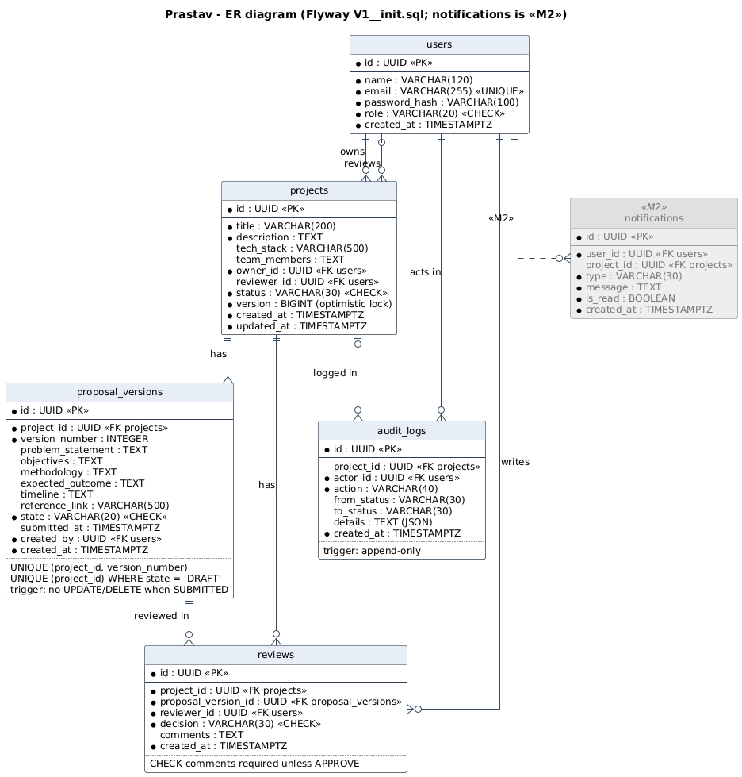

### 9.1 `users`

| Column | Type | Constraints |
|---|---|---|
| id | UUID | PK |
| name | VARCHAR(120) | NOT NULL |
| email | VARCHAR(255) | NOT NULL, UNIQUE (stored lower-case) |
| password_hash | VARCHAR(100) | NOT NULL (BCrypt) |
| role | VARCHAR(20) | NOT NULL, CHECK in (STUDENT, FACULTY, COORDINATOR) |
| admission_year | INTEGER | nullable; 2000 + YY from a student email |
| branch | VARCHAR(20) | nullable; upper-case branch from a student email, e.g. CSAI |
| created_at | TIMESTAMPTZ | NOT NULL |

Index `idx_users_admission_year_branch` on (admission_year, branch) for cohort filters. Staff rows leave both columns null.

### 9.2 `projects`

| Column | Type | Constraints |
|---|---|---|
| id | UUID | PK |
| title | VARCHAR(200) | NOT NULL |
| description | TEXT | NOT NULL |
| tech_stack | VARCHAR(500) | |
| team_members | TEXT | free text |
| owner_id | UUID | NOT NULL, FK users; index |
| reviewer_id | UUID | FK users, nullable; index |
| status | VARCHAR(30) | NOT NULL, CHECK in the six statuses; index |
| version | BIGINT | NOT NULL DEFAULT 0, optimistic lock |
| created_at, updated_at | TIMESTAMPTZ | NOT NULL; `updated_at` indexed (`V2__project_list_indexes.sql`) for the default list order |

### 9.3 `proposal_versions`

| Column | Type | Constraints |
|---|---|---|
| id | UUID | PK |
| project_id | UUID | NOT NULL, FK projects |
| version_number | INTEGER | NOT NULL, CHECK >= 1; UNIQUE (project_id, version_number) |
| problem_statement, objectives, methodology, expected_outcome, timeline | TEXT | nullable while DRAFT; required to submit (checked in code) |
| reference_link | VARCHAR(500) | optional |
| state | VARCHAR(20) | NOT NULL, CHECK in (DRAFT, SUBMITTED) |
| submitted_at | TIMESTAMPTZ | CHECK: set if and only if state = SUBMITTED |
| created_by | UUID | NOT NULL, FK users |
| created_at | TIMESTAMPTZ | NOT NULL |

Extra integrity: partial unique index `ux_proposal_one_open_draft` on (project_id) WHERE state = 'DRAFT' (business rule 7); trigger `trg_proposal_versions_immutable` rejects UPDATE or DELETE of a row whose state is SUBMITTED (business rule 2).

### 9.4 `reviews`

| Column | Type | Constraints |
|---|---|---|
| id | UUID | PK |
| project_id | UUID | NOT NULL, FK projects; index |
| proposal_version_id | UUID | NOT NULL, FK proposal_versions |
| reviewer_id | UUID | NOT NULL, FK users |
| decision | VARCHAR(30) | NOT NULL, CHECK in (APPROVE, REQUEST_REVISION, REJECT) |
| comments | TEXT | CHECK: non-blank unless decision = APPROVE (business rule 5) |
| created_at | TIMESTAMPTZ | NOT NULL |

### 9.5 `audit_logs`

| Column | Type | Constraints |
|---|---|---|
| id | UUID | PK |
| project_id | UUID | FK projects, nullable |
| actor_id | UUID | NOT NULL, FK users |
| action | VARCHAR(40) | NOT NULL (`AuditAction`) |
| from_status, to_status | VARCHAR(30) | nullable |
| details | TEXT | JSON text |
| created_at | TIMESTAMPTZ | NOT NULL; index (project_id, created_at) |

Trigger `trg_audit_logs_append_only` rejects UPDATE and DELETE.

### 9.6 `notifications`

Created by `V4__notifications.sql`; `V5__notification_reviewer_unassigned.sql` replaces `notifications_type_check` to allow REVIEWER_UNASSIGNED.

| Column | Type | Constraints |
|---|---|---|
| id | UUID | PK |
| recipient_id | UUID | NOT NULL, FK users |
| project_id | UUID | FK projects, nullable |
| type | VARCHAR(30) | NOT NULL, CHECK `notifications_type_check` in (REVIEWER_ASSIGNED, REVIEWER_UNASSIGNED, REVIEW_DECISION, RESUBMITTED) |
| message | VARCHAR(500) | NOT NULL |
| is_read | BOOLEAN | NOT NULL, DEFAULT false |
| created_at | TIMESTAMPTZ | NOT NULL |

Indexes: `idx_notifications_recipient_read` (recipient_id, is_read) for the unread count and unread filter; `idx_notifications_recipient_created` (recipient_id, created_at) for the newest-first inbox.

### 9.7 Indexes

Every index in the schema besides the primary keys. Each one serves a column that a query filters, joins or orders on.

| Table | Index | Columns | Migration | Serves |
|---|---|---|---|---|
| users | `users_email_key` (from `UNIQUE`) | email | `V1__init.sql` | login and duplicate-email checks |
| users | `idx_users_admission_year_branch` | (admission_year, branch) | `V3__user_institution_profile.sql` | cohort filters on students |
| projects | `idx_projects_owner` | owner_id | `V1__init.sql` | student list scope, dashboard counts per owner, join to users |
| projects | `idx_projects_reviewer` | reviewer_id | `V1__init.sql` | faculty list scope, `reviewerId` filter, counts per reviewer, join for the coordinator dashboard's reviewer workload |
| projects | `idx_projects_status` | status | `V1__init.sql` | `status` filter, counts by status, the dashboard's awaiting-assignment list |
| projects | `idx_projects_updated_at` | updated_at | `V2__project_list_indexes.sql` | default list order (LATEST, OLDEST) |
| proposal_versions | `uq_proposal_project_version` (constraint) | (project_id, version_number) | `V1__init.sql` | sequential version numbers; versions of one project |
| proposal_versions | `ux_proposal_one_open_draft` (partial, unique) | project_id WHERE state = 'DRAFT' | `V1__init.sql` | business rule 7: one open draft per project |
| reviews | `idx_reviews_project` | project_id | `V1__init.sql` | review history of a project |
| audit_logs | `idx_audit_logs_project` | (project_id, created_at) | `V1__init.sql` | project timeline in time order |
| notifications | `idx_notifications_recipient_read` | (recipient_id, is_read) | `V4__notifications.sql` | unread count and unread filter |
| notifications | `idx_notifications_recipient_created` | (recipient_id, created_at) | `V4__notifications.sql` | newest-first inbox |

## 10. REST API contracts

Base path `/api`. All endpoints except register, login and Swagger need `Authorization: Bearer <jwt>`. Timestamps are ISO-8601 UTC strings. Errors always use the `ApiError` body (section 11).

| Method | Path | Role | Purpose | Success |
|---|---|---|---|---|
| POST | /auth/register | public | Register a STUDENT with an institutional student email | 201 `AuthResponse` |
| POST | /auth/login | public | Log in | 200 `AuthResponse` |
| GET | /auth/me | any | Current user | 200 `UserResponse` |
| GET | /users?role=FACULTY | COORDINATOR | List users (reviewer picker) | 200 `UserResponse[]` |
| POST | /users | COORDINATOR | Create a FACULTY or COORDINATOR account | 201 `UserResponse` |
| POST | /projects | STUDENT | Create project + draft v1 | 201 `ProjectDetailResponse` |
| GET | /projects?status=&q=&reviewerId=&admissionYear=&branch=&sort=&page=&size= | any | Role-scoped, paged list with optional filters, search and sort (section 10.7) | 200 `ProjectPageResponse` |
| GET | /projects/summary | any | Role-scoped counts by status for the dashboards | 200 `ProjectCountsResponse` |
| GET | /dashboard/summary | COORDINATOR | Counts by status, projects awaiting assignment, reviewer workload (section 10.9) | 200 `DashboardSummaryResponse` |
| GET | /projects/{id} | participant | Detail with `allowedActions` | 200 `ProjectDetailResponse` |
| PUT | /projects/{id}/proposal | STUDENT owner | Edit open draft | 200 `ProposalVersionResponse` |
| POST | /projects/{id}/proposals | STUDENT owner | Create next version (REVISION_REQUESTED only) | 201 `ProposalVersionResponse` |
| GET | /projects/{id}/proposals | participant | All versions | 200 `ProposalVersionResponse[]` |
| GET | /projects/{id}/proposals/compare?from=&to= | participant | Field-by-field comparison of two versions (section 10.3) | 200 `ProposalDiff` |
| POST | /projects/{id}/submit | STUDENT owner | Submit or resubmit | 200 `ProjectDetailResponse` |
| POST | /projects/{id}/assign | COORDINATOR | Assign reviewer (SUBMITTED) | 200 `ProjectDetailResponse` |
| PUT | /projects/{id}/assign | COORDINATOR | Reassign reviewer (UNDER_REVIEW only, section 10.4) | 200 `ProjectDetailResponse` |
| POST | /projects/{id}/reviews | FACULTY assigned | Record decision | 201 `ReviewResponse` |
| GET | /projects/{id}/reviews | participant | Review history | 200 `ReviewResponse[]` |
| GET | /projects/{id}/history | participant | Merged timeline | 200 `TimelineEntry[]` |
| GET | /notifications?unread=&page=&size= | any (own) | The caller's notifications, newest first, paged (section 10.8) | 200 `NotificationPageResponse` |
| GET | /notifications/unread-count | any (own) | Number of unread notifications | 200 `UnreadCountResponse` |
| PATCH | /notifications/{id}/read | recipient | Mark one notification read | 200 `NotificationResponse` |
| PATCH | /notifications/read-all | any (own) | Mark every unread notification read | 200 `MarkAllReadResponse` |

"Participant" means the owner, the assigned reviewer or any coordinator (`ProjectAccessPolicy.canView`).

### 10.1 Auth

`POST /api/auth/register`

```json
{ "name": "Aarav Mehta", "email": "aarav.23csai@nst.rishihood.edu.in", "password": "Password@123" }
```

`201 Created` (login returns the same shape with 200):

```json
{
  "token": "eyJhbGciOiJIUzI1NiJ9.eyJzdWIiOiI3ZjFjLi4uIiwidXNlcklkIjoiN2YxYy4uLiIsInJvbGUiOiJTVFVERU5UIn0.sig",
  "user": { "id": "7f1c2a9e-3b0d-4c1e-9a55-1d2e3f4a5b6c", "name": "Aarav Mehta", "email": "aarav.23csai@nst.rishihood.edu.in",
            "role": "STUDENT", "admissionYear": 2023, "branch": "CSAI" }
}
```

Rules: `role` is optional and only STUDENT is accepted; the email must be on `prastav.institution.email-domain` and match `prastav.institution.student-email-pattern` (`<firstname>.<YY><branch>`), compared case-insensitively and stored lower-case. A faculty-style email, another domain, another role or a duplicate email returns 400 VALIDATION_FAILED; wrong credentials on login return 401 UNAUTHENTICATED with "Invalid email or password".

`POST /api/users` (COORDINATOR)

```json
{ "name": "Dr. Kavya Menon", "email": "kavya.menon@nst.rishihood.edu.in", "password": "Password@123", "role": "FACULTY" }
```

`201 Created` with `UserResponse` (`admissionYear` and `branch` null). Only the institutional domain is checked, not the student pattern. STUDENT, another domain or a duplicate email returns 400 VALIDATION_FAILED; any other caller role returns 403 FORBIDDEN.

### 10.2 Create project

`POST /api/projects` (STUDENT)

```json
{
  "title": "Smart Attendance",
  "description": "Face recognition attendance for lecture halls.",
  "techStack": "Java, React, OpenCV",
  "teamMembers": "Aarav Mehta, Diya Kapoor",
  "proposal": {
    "problemStatement": "Attendance is taken on paper and takes ten minutes per lecture.",
    "objectives": "Automate attendance using face recognition.",
    "methodology": null,
    "expectedOutcome": null,
    "timeline": null,
    "referenceLink": null
  }
}
```

`201 Created`, `ProjectDetailResponse`:

```json
{
  "id": "0b8f6c1e-2d4a-4f7b-8e3c-5a6b7c8d9e0f",
  "title": "Smart Attendance",
  "description": "Face recognition attendance for lecture halls.",
  "techStack": "Java, React, OpenCV",
  "teamMembers": "Aarav Mehta, Diya Kapoor",
  "status": "DRAFT",
  "owner": { "id": "7f1c2a9e-3b0d-4c1e-9a55-1d2e3f4a5b6c", "name": "Aarav Mehta" },
  "reviewer": null,
  "currentProposal": {
    "id": "c3d4e5f6-0000-4a1b-9c2d-3e4f5a6b7c8d",
    "versionNumber": 1,
    "state": "DRAFT",
    "problemStatement": "Attendance is taken on paper and takes ten minutes per lecture.",
    "objectives": "Automate attendance using face recognition.",
    "methodology": null,
    "expectedOutcome": null,
    "timeline": null,
    "referenceLink": null,
    "missingFields": ["methodology", "expectedOutcome", "timeline"],
    "submittedAt": null,
    "createdAt": "2026-10-19T09:00:00.120Z"
  },
  "latestSubmittedVersion": null,
  "allowedActions": ["SUBMIT", "EDIT_DRAFT"],
  "version": 0,
  "createdAt": "2026-10-19T09:00:00.118Z",
  "updatedAt": "2026-10-19T09:00:00.118Z"
}
```

`allowedActions` is computed for the caller: the same project fetched by the coordinator returns `[]` while DRAFT and `["ASSIGN_REVIEWER"]` once SUBMITTED.

### 10.3 Edit draft and versions

`PUT /api/projects/{id}/proposal` with a full `ProposalContent` body (same six fields as above) returns `ProposalVersionResponse`. In SUBMITTED or UNDER_REVIEW it returns 409 `ILLEGAL_TRANSITION` "Action EDIT_DRAFT is not allowed while the project is SUBMITTED". In REVISION_REQUESTED before a new version exists it returns 409 "There is no open draft; create a new version first".

`POST /api/projects/{id}/proposals` (no body) returns `201` with version N+1 in state DRAFT, prefilled from version N. A second call while that draft is open returns 409 "Version 2 is already an open draft".

`GET /api/projects/{id}/proposals` returns all versions oldest first; submitted versions have `"state": "SUBMITTED"` and a `submittedAt`.

`GET /api/projects/{id}/proposals/compare?from=1&to=2` (any participant: the owner, the assigned faculty, the coordinator) returns every proposal field in form order, with its value in each version and whether it changed:

```json
{
  "fromVersion": 1,
  "toVersion": 2,
  "fields": [
    { "name": "problemStatement", "fromValue": "Paper-based approvals are slow", "toValue": "Paper-based approvals are slow", "changed": false },
    { "name": "objectives", "fromValue": "Digitise the approval flow", "toValue": "Digitise the approval flow", "changed": false },
    { "name": "methodology", "fromValue": "Spring Boot + React", "toValue": "Spring Boot + React + PostgreSQL", "changed": true },
    { "name": "expectedOutcome", "fromValue": "A working workflow system", "toValue": "A working workflow system", "changed": false },
    { "name": "timeline", "fromValue": "8 weeks", "toValue": "10 weeks", "changed": true },
    { "name": "referenceLink", "fromValue": "https://example.org/ref", "toValue": null, "changed": true }
  ]
}
```

`from` may be greater than `to`; the sides are reported as given. Either version may be a draft. A version number that does not exist in this project returns 404 `NOT_FOUND` ("Proposal version 7 not found"); `from` equal to `to` returns 400 `VALIDATION_FAILED` ("from and to must be different versions"); a missing or non-numeric `from` or `to` returns 400 `VALIDATION_FAILED`; a caller who is not a participant gets 403 `FORBIDDEN`. Access is checked before anything else.

### 10.4 Submit and assign

`POST /api/projects/{id}/submit` (no body) returns the updated `ProjectDetailResponse` (`"status": "SUBMITTED"` from DRAFT, or `"UNDER_REVIEW"` from REVISION_REQUESTED). An incomplete draft returns:

```json
{
  "timestamp": "2026-10-19T09:05:11.402Z",
  "status": 400,
  "code": "VALIDATION_FAILED",
  "message": "Proposal is incomplete. Missing: methodology, expectedOutcome, timeline",
  "path": "/api/projects/0b8f6c1e-2d4a-4f7b-8e3c-5a6b7c8d9e0f/submit",
  "fieldErrors": []
}
```

`POST /api/projects/{id}/assign` (COORDINATOR)

```json
{ "facultyId": "a1b2c3d4-1111-4a2b-8c3d-4e5f6a7b8c9d" }
```

returns `ProjectDetailResponse` with `"status": "UNDER_REVIEW"` and `"reviewer": { "id": "a1b2c3d4-...", "name": "Dr. Anita Rao" }`. A non-faculty `facultyId` returns 400 "Reviewer must have the FACULTY role".

`PUT /api/projects/{id}/assign` (COORDINATOR) reassigns the reviewer of a project that is UNDER_REVIEW. The body is the same `AssignReviewerRequest`:

```json
{ "facultyId": "e5f6a7b8-2222-4c3d-9e4f-5a6b7c8d9e0f" }
```

It returns `ProjectDetailResponse` with the status unchanged and the new reviewer:

```json
{ "id": "0b8f6c1e-...", "title": "AI Based Crop Monitoring", "status": "UNDER_REVIEW",
  "owner": { "id": "7f1c...", "name": "Aarav Mehta" },
  "reviewer": { "id": "e5f6a7b8-...", "name": "Dr. Vikram Shah" },
  "allowedActions": ["REASSIGN_REVIEWER"], "...": "other ProjectDetailResponse fields" }
```

The audit log gets `REVIEWER_REASSIGNED` with `{"previousReviewerId":"a1b2c3d4-...","reviewerId":"e5f6a7b8-..."}`. The previous reviewer receives `REVIEWER_UNASSIGNED` and the new one `REVIEWER_ASSIGNED` (section 6.1). Errors:

| Case | Response |
|---|---|
| Student or faculty caller | 403 `FORBIDDEN` "Your role is not allowed to perform this action" |
| Missing `facultyId` | 400 `VALIDATION_FAILED` with `fieldErrors: [{ "field": "facultyId", ... }]` |
| Unknown project or user | 404 `NOT_FOUND` |
| New reviewer is not FACULTY | 400 `VALIDATION_FAILED` "Reviewer must have the FACULTY role" |
| New reviewer is the current reviewer | 400 `VALIDATION_FAILED` "Dr. Anita Rao is already the assigned reviewer" |
| Project not UNDER_REVIEW | 409 `ILLEGAL_TRANSITION` "Action REASSIGN_REVIEWER is not allowed while the project is SUBMITTED" |
| Concurrent change to the project | 409 `CONCURRENT_UPDATE` |

### 10.5 Reviews

`POST /api/projects/{id}/reviews` (assigned FACULTY)

```json
{ "decision": "REQUEST_REVISION", "comments": "Explain how student consent and data retention are handled.", "versionNumber": 1 }
```

`201 Created`, `ReviewResponse`:

```json
{
  "id": "e9f8a7b6-2222-4c3d-8e4f-5a6b7c8d9e0f",
  "versionNumber": 1,
  "decision": "REQUEST_REVISION",
  "comments": "Explain how student consent and data retention are handled.",
  "reviewer": { "id": "a1b2c3d4-1111-4a2b-8c3d-4e5f6a7b8c9d", "name": "Dr. Anita Rao" },
  "createdAt": "2026-10-19T10:12:40.017Z"
}
```

`versionNumber` is optional; if sent and not the latest submitted version: 409 "Only the latest submitted version (v2) can be reviewed". Missing comments for REQUEST_REVISION or REJECT: 400 "Comments are mandatory for REQUEST_REVISION". An unassigned faculty member: 403 "Only the assigned reviewer can review this project". Approving a SUBMITTED project:

```json
{
  "timestamp": "2026-10-19T10:01:02.551Z",
  "status": 409,
  "code": "ILLEGAL_TRANSITION",
  "message": "Action APPROVE is not allowed while the project is SUBMITTED",
  "path": "/api/projects/0b8f6c1e-2d4a-4f7b-8e3c-5a6b7c8d9e0f/reviews",
  "fieldErrors": []
}
```

### 10.6 History

`GET /api/projects/{id}/history` returns `TimelineEntry[]` sorted by time:

```json
[
  { "at": "2026-10-19T09:00:00.118Z", "type": "STATUS_CHANGED", "actorId": "7f1c...", "actorName": "Aarav Mehta", "summary": "Project created as DRAFT", "versionNumber": null },
  { "at": "2026-10-19T09:00:00.120Z", "type": "VERSION_CREATED", "actorId": "7f1c...", "actorName": "Aarav Mehta", "summary": "Version 1 created", "versionNumber": 1 },
  { "at": "2026-10-19T09:20:31.004Z", "type": "STATUS_CHANGED", "actorId": "7f1c...", "actorName": "Aarav Mehta", "summary": "DRAFT -> SUBMITTED", "versionNumber": null },
  { "at": "2026-10-19T09:41:12.660Z", "type": "STATUS_CHANGED", "actorId": "5d6e...", "actorName": "Meera Nair", "summary": "SUBMITTED -> UNDER_REVIEW", "versionNumber": null },
  { "at": "2026-10-19T10:12:40.010Z", "type": "STATUS_CHANGED", "actorId": "a1b2...", "actorName": "Dr. Anita Rao", "summary": "UNDER_REVIEW -> REVISION_REQUESTED", "versionNumber": null },
  { "at": "2026-10-19T10:12:40.017Z", "type": "REVIEW", "actorId": "a1b2...", "actorName": "Dr. Anita Rao", "summary": "REQUEST_REVISION on version 1: Explain how student consent and data retention are handled.", "versionNumber": 1 }
]
```

### 10.7 Project list and summary

`GET /api/projects` returns one page of the caller's projects: a student sees own projects, faculty the projects assigned to them, the coordinator every project (`ProjectSpecifications.visibleTo`). Every parameter is optional, and filters combine with AND inside that scope. Filtering, ordering and paging all run in the database query (`ProjectRepository.findAll(Specification, Pageable)`).

| Parameter | Meaning |
|---|---|
| `status` | One or more `ProjectStatus` values, repeated or comma-separated |
| `q` | Case-insensitive text contained in the title, description, team members, owner name or reviewer name |
| `reviewerId` | Only projects assigned to this faculty member |
| `admissionYear` | Coordinator only: projects whose owner's admission year matches, e.g. `2023` |
| `branch` | Coordinator only: projects whose owner's branch matches, case-insensitive, e.g. `csai` or `CSAI` |
| `sort` | `LATEST` (default, last update first), `OLDEST`, `TITLE`; ties are broken by id so pages never overlap |
| `page` | Zero-based page index, default 0 |
| `size` | Rows per page, 1 to 50, default 10 |

An unknown `status` or `sort`, a malformed `reviewerId`, a non-numeric or negative `page`, or a `size` outside 1 to 50 returns 400 `VALIDATION_FAILED` (for example "size must be between 1 and 50"); a non-numeric `admissionYear` also returns 400. A student or faculty member passing `admissionYear` or `branch` gets 403 `FORBIDDEN` ("This action requires the COORDINATOR role") rather than having the filter silently ignored. `GET /api/projects?status=UNDER_REVIEW&q=crop&admissionYear=2023&branch=CSAI&page=0&size=10` as the coordinator:

```json
{
  "content": [
    { "id": "0b8f6c1e-...", "title": "AI Based Crop Monitoring", "description": "Crop health analysis from drone images.",
      "teamMembers": "Aarav Mehta, Priya Das", "status": "UNDER_REVIEW",
      "owner": { "id": "7f1c...", "name": "Aarav Mehta" }, "reviewer": { "id": "a1b2...", "name": "Dr. Anita Rao" },
      "submittedAt": "2026-10-19T09:20:31.004Z", "updatedAt": "2026-10-19T09:41:12.660Z" }
  ],
  "page": 0,
  "size": 10,
  "totalElements": 1,
  "totalPages": 1
}
```

`submittedAt` is the first submission time of the proposal (null for a project never submitted). A page past the end returns an empty `content` with the real `totalElements`.

`GET /api/projects/summary` counts the caller's role-scoped projects (own for a student, assigned for faculty, all for the coordinator). Every status is present; `awaitingAssignment` (SUBMITTED projects, which have no reviewer yet) is only filled for the coordinator:

```json
{ "total": 8, "byStatus": { "DRAFT": 1, "SUBMITTED": 2, "UNDER_REVIEW": 2, "REVISION_REQUESTED": 1, "APPROVED": 1, "REJECTED": 1 }, "awaitingAssignment": 2 }
```

### 10.8 Notifications

Every role has an inbox, and every endpoint works only on the caller's own notifications: the recipient is always the `Actor` from the token, never a parameter. Notifications are created by `NotificationListener` (section 6.1), not through the API.

`GET /api/notifications?unread=true&page=0&size=10`

| Parameter | Meaning |
|---|---|
| `unread` | `true` returns only unread notifications; default `false` (all) |
| `page` | Zero-based page index, default 0 |
| `size` | Rows per page, 1 to 50, default 10 |

A negative `page` or a `size` outside 1 to 50 returns 400 `VALIDATION_FAILED` ("size must be between 1 and 50"); a non-numeric value also returns 400. Rows are newest first.

```json
{
  "content": [
    { "id": "3c9e7a10-...", "type": "REVIEW_DECISION", "message": "Version 1 of \"AI Based Crop Monitoring\" needs changes",
      "projectId": "0b8f6c1e-...", "projectTitle": "AI Based Crop Monitoring", "read": false,
      "createdAt": "2026-10-19T10:12:40.102Z" },
    { "id": "8d21f4b5-...", "type": "REVIEW_DECISION", "message": "Version 1 of \"Library Seat Booking\" was approved",
      "projectId": "4a77d0e2-...", "projectTitle": "Library Seat Booking", "read": false,
      "createdAt": "2026-10-18T15:02:11.540Z" }
  ],
  "page": 0,
  "size": 10,
  "totalElements": 2,
  "totalPages": 1
}
```

`GET /api/notifications/unread-count`

```json
{ "count": 2 }
```

`PATCH /api/notifications/{id}/read` (no body) returns the updated `NotificationResponse`. Marking an already read notification again is allowed and changes nothing. An unknown id is 404 `NOT_FOUND`; another user's notification is 403 `FORBIDDEN` ("You can only change your own notifications"); a malformed id is 400.

```json
{ "id": "3c9e7a10-...", "type": "REVIEW_DECISION", "message": "Version 1 of \"AI Based Crop Monitoring\" needs changes",
  "projectId": "0b8f6c1e-...", "projectTitle": "AI Based Crop Monitoring", "read": true,
  "createdAt": "2026-10-19T10:12:40.102Z" }
```

`PATCH /api/notifications/read-all` (no body) marks every unread notification of the caller and returns how many changed:

```json
{ "updated": 2 }
```

Without a token every notification endpoint returns 401 `UNAUTHENTICATED`.

### 10.9 Coordinator dashboard

`GET /api/dashboard/summary` is for the coordinator only: a student or faculty member gets 403 `FORBIDDEN` and a call without a token 401 `UNAUTHENTICATED`. Everything is computed in the database with grouped queries; no project list is loaded to be counted.

- `total` and `byStatus`: every project counted per status (`GROUP BY status`), every status present.
- `awaitingAssignment`: SUBMITTED projects with no reviewer, oldest first. `waitingSince` is the time the project entered SUBMITTED.
- `reviewerWorkload`: every FACULTY account with its number of open reviews, meaning projects UNDER_REVIEW assigned to it (`LEFT JOIN` plus `GROUP BY`, so a faculty member with no open review appears with 0). Busiest first, then by name.

```json
{
  "total": 8,
  "byStatus": { "DRAFT": 1, "SUBMITTED": 2, "UNDER_REVIEW": 3, "REVISION_REQUESTED": 1, "APPROVED": 1, "REJECTED": 0 },
  "awaitingAssignment": [
    { "id": "0b8f6c1e-...", "title": "AI Based Crop Monitoring",
      "owner": { "id": "7f1c...", "name": "Aarav Mehta" }, "waitingSince": "2026-10-19T09:20:31.004Z" },
    { "id": "5d2e9a40-...", "title": "Smart Attendance",
      "owner": { "id": "c3d4...", "name": "Diya Kapoor" }, "waitingSince": "2026-10-21T11:02:47.318Z" }
  ],
  "reviewerWorkload": [
    { "reviewer": { "id": "a1b2...", "name": "Dr. Anita Rao" }, "openReviews": 2 },
    { "reviewer": { "id": "e5f6...", "name": "Dr. Vikram Shah" }, "openReviews": 1 }
  ]
}
```

## 11. Validation and error codes

`ApiError`: `{ timestamp, status, code, message, path, fieldErrors[] }` with `fieldErrors` items `{ field, message }`.

| Code | HTTP | Raised by | Example |
|---|---|---|---|
| VALIDATION_FAILED | 400 | `@Valid` failures (with `fieldErrors`), malformed JSON or UUID, `ValidationException` (incomplete proposal, missing review comments, non-faculty assignee, reassignment to the current reviewer, non-student registration, email outside the institutional domain or student pattern, duplicate email) | `fieldErrors: [{ "field": "title", "message": "must not be blank" }]` |
| UNAUTHENTICATED | 401 | `RestAuthErrorHandler.commence` (no/invalid/expired token), `UnauthenticatedException` (bad login) | "Authentication required: send a valid Bearer token" |
| FORBIDDEN | 403 | `@PreAuthorize` denial, `ForbiddenException` from `ProjectAccessPolicy` or `Guards` | "Only the assigned reviewer can review this project" |
| NOT_FOUND | 404 | `NotFoundException` | "Project 0b8f... not found" |
| ILLEGAL_TRANSITION | 409 | `IllegalTransitionException`, `ConflictException` (edit submitted version, second open draft, stale versionNumber, resubmit without new version) | "Action APPROVE is not allowed while the project is SUBMITTED" |
| CONCURRENT_UPDATE | 409 | `OptimisticLockingFailureException` on `Project.version` | "The project was changed by someone else at the same time. Reload and try again." |
| INTERNAL_ERROR | 500 | anything unexpected (logged with stack trace, never returned) | "Unexpected server error" |

Bean Validation limits: title 200, description 4000, techStack 500, teamMembers 2000, each proposal text field 4000 (timeline 2000), referenceLink 500, review comments 4000, password 8 to 72 characters (BCrypt input limit). Draft fields may be blank; completeness is enforced on submit by `ProposalVersion.missingFields()`.

## 12. Security design

| Concern | Design |
|---|---|
| Passwords | BCrypt (`BCryptPasswordEncoder`), never returned (`UserResponse` has no hash) |
| Tokens | HS256 JWT, 60-minute expiry, claims `userId` and `role` (+ `sub`), secret from `JWT_SECRET` (startup fails if shorter than 32 bytes) |
| Sessions | Stateless (`SessionCreationPolicy.STATELESS`), CSRF disabled because no cookies are used |
| Authorization layer 1 | `@PreAuthorize("hasRole(...)")` on controller methods: STUDENT for create/edit/submit/revise, COORDINATOR for assign, reassign, user list and account creation, FACULTY for reviews |
| Authorization layer 2 | Ownership and assignment in the service/domain: `ProjectAccessPolicy` for reads and proposal edits, `Guards` inside state transitions. Needed because a role check cannot tell which student owns which project. |
| Visibility | Business rule 1: `ProjectService.listProjects` scopes queries by role; `requireView` on every per-project read. Notifications: every query is scoped to the caller's id and `NotificationService.markRead` returns 403 for another user's notification |
| Errors | 401/403 from the filter chain are written by `RestAuthErrorHandler` in `ApiError` format; no stack traces in responses |
| CORS | Only `prastav.cors.allowed-origin` (default `http://localhost:5173`) for `/api/**`; in development Vite proxies `/api`, so the browser uses one origin |
| Registration | Self-registration limited to STUDENT with an institutional student email (`PatternEmailPolicy`); FACULTY and COORDINATOR accounts come from `POST /api/users` (COORDINATOR only) or the seed |
| Frontend | Token in `localStorage` or `sessionStorage` (acceptable for an intranet demo; an httpOnly cookie is the hardening option). A 401 response clears the session. Route guards hide pages by role; the backend remains the authority. |

## 13. Design patterns

| Pattern | Where (exact classes) | Why |
|---|---|---|
| State | `ProjectState`, `DraftState`, `SubmittedState`, `UnderReviewState`, `RevisionRequestedState`, `ApprovedState`, `RejectedState` | Each status owns its legal actions; no status switch statements; illegal by default |
| Factory | `ProjectStateFactory` (status to state), `ProposalVersionFactory` (v1 and vN+1 prefilled) | Creation and lookup rules live in one place |
| Facade | `WorkflowService` | One simple API over states, persistence and events; every transition takes the same audited path |
| Observer | `ProjectCreatedEvent`, `ProposalVersionCreatedEvent`, `ProposalDraftUpdatedEvent`, `ProjectStatusChangedEvent`, `ReviewerReassignedEvent`, `ReviewRecordedEvent` consumed by `AuditEventListener`; `ProjectStatusChangedEvent`, `ReviewerReassignedEvent` and `ReviewRecordedEvent` also consumed by `NotificationListener` | Side effects (audit, notifications) decoupled from the workflow; a new side effect is a new listener |
| Strategy | `ReviewDecisionHandler` + `ApproveDecisionHandler`, `RequestRevisionDecisionHandler`, `RejectDecisionHandler`; `EmailPolicy` + `PatternEmailPolicy` (institution email rules, swappable per institution); `NotificationChannel` + `InAppNotificationChannel`, `EmailNotificationChannel` chosen by `NotificationDispatcher` from configuration | Add a decision, an email rule or a delivery channel by adding a class |
| Decorator | `RetryingNotificationChannel` wrapping every `NotificationChannel` enabled in `NotificationDispatcher` | Retry is added around any channel without changing the channel or the dispatcher, and every channel is retried the same way |
| Specification | `ProjectSpecifications` (role scope, status, reviewer, text search) combined by `ProjectService.listProjects` | One composable query for every list filter instead of a repository method per combination |
| Repository | `UserRepository`, `ProjectRepository`, `ProposalVersionRepository`, `ReviewRepository`, `AuditLogRepository`, `NotificationRepository` | Persistence abstraction (Spring Data JPA) |
| Builder | `AuditLog.builder()` / `AuditLog.Builder` | Readable construction with optional fields |
| DTO + Mapper | `*Request`/`*Response` records, `UserMapper`, `ProjectMapper`, `DashboardMapper`, `ProposalMapper`, `ReviewMapper`, `NotificationMapper` | Entities never leave the service layer as JSON |
| Value object | `ProposalContent`, `Actor`, `NewProject` | Immutable records passed between layers |

## 14. SOLID mapping

| Principle | Evidence in code |
|---|---|
| **S**ingle responsibility | `ProjectController` handles HTTP only; `ProjectService` handles project use cases; `DraftState` handles only DRAFT rules; `AuditEventListener` handles only auditing; `ProposalVersionFactory` only creates versions; `AllowedActionsResolver` only computes buttons |
| **O**pen/closed | New status: new `ProjectState` class (auto-registered by `ProjectStateFactory`). New decision: new `ReviewDecisionHandler`. New side effect: new `@EventListener` class. New email rule: new `EmailPolicy`. None needs edits to `WorkflowService` or `ReviewService` |
| **L**iskov substitution | Any `ProjectState` can be returned by the factory and used by `WorkflowService` the same way; every `ReviewDecisionHandler` honours the same `apply` contract; `TerminalStatesTest` exercises states through the interface |
| **I**nterface segregation | `AuditRecorder` has one method; `ReviewDecisionHandler` has two; `ProjectState` holds only transition methods (no persistence); `ProjectStore` exposes only `getById`/`save` to other modules |
| **D**ependency inversion | Services receive collaborators through constructors and depend on abstractions (`ApplicationEventPublisher`, `AuditRecorder`, `List<ProjectState>`, `List<ReviewDecisionHandler>`, `PasswordEncoder`). State classes and entities import no Spring service or repository, so they are tested with plain `new` |

## 15. Design decisions and trade-offs

### 15.1 Decisions

| Decision | Alternatives | Why this one | Cost |
|---|---|---|---|
| Modular monolith | Microservices | One team, one database, simple transactions; modules can be split later along the same boundaries | Discipline needed to respect module boundaries |
| State pattern | Enum + switch | Open/closed, one class per status, isolated tests | More classes; reading the flow means opening several files (mitigated by the diagrams) |
| Synchronous `@EventListener` for audit | `@TransactionalEventListener(AFTER_COMMIT)`, outbox | Audit must be exactly as durable as the change: same transaction | A failing audit insert rolls back the business change (acceptable: audit is mandatory) |
| `@TransactionalEventListener` (after commit, `REQUIRES_NEW`) for notifications | Synchronous `@EventListener`, outbox | Nobody is notified about a change that rolled back, and a delivery failure or retry pause never rolls back or holds the business transaction | A crash between the commit and the dispatch loses that notification (no outbox) |
| Immutable versions + DB trigger | Edit in place with history table | Reviews must judge exactly the submitted text; defence in depth | Each revision duplicates text (tiny) |
| Single reviewer per project | Reviewer panel | One accountable reviewer keeps the workflow simple | Two-reviewer rule needs a policy change (see INTERVIEW_PREP) |
| Proposal as text fields + link | File upload | No file storage; fields can be validated and compared one by one | Formatting is plain text |
| Application-assigned UUIDs + `Persistable` | DB sequences | Entities have ids before saving; pure unit tests | Must implement `isNew()` correctly (done in `BaseEntity`) |
| Optimistic locking on `Project` | Pessimistic locks | Conflicts are rare; no lock waits | Caller sees 409 and retries |
| `allowedActions` from backend | UI computes from status | One source of truth; UI cannot drift | One more field per detail response |
| Comments check in state and DB | Only in code | Business rule 5 enforced even for direct SQL | Two places to change if the rule changes |
| `ddl-auto: none` | `validate` | Flyway is the single source of truth; avoids `TEXT` vs `VARCHAR` false alarms | Mapping errors surface at first query, not at startup |
| `open-in-view: false`, eager owner/reviewer | OSIV | No lazy loading from controllers | A few extra joins/selects on lists (fine for demo data; the list is paged) |
| REJECTED is final | Coordinator reopen | A decision stays final and auditable | A reopen would be a new state/transition |
| Only students self-register | Open registration | Prevent privilege escalation; tie student accounts to the institution | `PatternEmailPolicy`; staff created by the coordinator or seed data |

### 15.2 Known limitations

The frontend has no automated tests. The JWT is kept in browser storage. Docker Compose runs only the database; the backend and frontend run from Maven and npm.

## 16. Testing design

### 16.1 Tests (`backend/src/test/java`)

| Test class | What it proves |
|---|---|
| `DraftStateTest` | owner submits complete draft (version frozen); non-owner 403; incomplete 400; no draft 409; assign/approve/revise/reject illegal |
| `SubmittedStateTest` | coordinator assigns faculty; non-coordinator 403; non-faculty assignee 400; approving a SUBMITTED project is illegal |
| `UnderReviewStateTest` | approve, request revision, reject; comments mandatory; unassigned faculty and student 403; submit/assign illegal; coordinator reassigns and the status stays; faculty or student reassigning 403; non-faculty new reviewer 400; same reviewer 400 |
| `RevisionRequestedStateTest` | resubmit returns to UNDER_REVIEW with same reviewer; no new version 409; non-owner 403; review/assign illegal |
| `TerminalStatesTest` | APPROVED and REJECTED refuse every action through the interface, including reassignment |
| `ProjectStateFactoryTest` | every status resolves; missing or duplicate state fails fast |
| `AllowedActionsResolverTest` | buttons per role and state, including CREATE_REVISION vs EDIT_DRAFT and REASSIGN_REVIEWER for the coordinator only while UNDER_REVIEW |
| `WorkflowServiceTest` | transitions save and publish the event with from/to/details; illegal transition saves and publishes nothing; revision loop keeps the reviewer; reassignment saves, keeps UNDER_REVIEW and publishes `ReviewerReassignedEvent` with both reviewers; reassignment from each of the five other statuses is ILLEGAL_TRANSITION with nothing saved or published; same reviewer, non-faculty reviewer and non-coordinator save and publish nothing |
| `ReviewServiceTest` | strategy lookup per decision; review stored against latest submitted version; stale version 409 before any transition; failed transition stores nothing; non-participant 403 |
| `ProposalServiceTest` | sequential numbering and prefill; v1 unchanged after v2 edits; one open draft; no revision while UNDER_REVIEW; no edit when SUBMITTED; owner-only edit |
| `ProposalVersionTest` | immutability; missing-field detection; factory numbering |
| `ProposalDiffServiceTest` | every field in form order with fromValue, toValue and changed; identical versions have no changed field and reversed order is kept; version outside the project 404; same version 400 before any read; non-participant student and unassigned faculty 403 before any read; coordinator can compare |
| `ProjectServiceTest` | create in DRAFT with v1 and event; faculty cannot create; list paging, sort and first-submission time; coordinator batch filter accepted, student or faculty passing admission year or branch 403; counts per role with zero-filled statuses and awaiting-assignment for the coordinator; stranger 403; latest submitted version in detail |
| `DashboardServiceTest` | the coordinator's summary combines the status counts, the awaiting-assignment rows (SUBMITTED) and the reviewer workload (FACULTY, UNDER_REVIEW) from the repository queries; student and faculty 403 without touching any query |
| `ProjectListQueryTest` | defaults (page 0, size 10, LATEST), trimming, size bounds 1 and 50 accepted, negative page and size 0 or 51 rejected with `ValidationException`, branch trimmed and upper-cased, blank branch is no filter, LIKE wildcard escaping |
| `ProjectSpecificationsTest` | role scope (student by owner, faculty by reviewer, coordinator everything), empty filters match everything, owner cohort by admission year and branch (a missing value leaves that column open), a student query combines owner scope, status and lower-case search over five columns |
| `AuditEventListenerTest` | status change becomes an audit row with before/after and JSON details; reassignment becomes REVIEWER_REASSIGNED with both reviewer ids and no status; action mapping |
| `PatternEmailPolicyTest` | valid student email parsed to year and branch; uppercase input normalized; wrong domain, missing or malformed year or branch rejected; faculty email institutional but not a student email |
| `InstitutionConfigTest` | the shipped `application.yml` binds `InstitutionProperties` and parses a demo student email |
| `AuthServiceTest` | student registration stores admission year and branch; omitted role means STUDENT; FACULTY and COORDINATOR, faculty-style email, other domain and duplicate email rejected |
| `UserServiceTest` | coordinator creates FACULTY and COORDINATOR without the student pattern; other callers 403; STUDENT, other domain and duplicate email rejected |
| `ProposalControllerWebTest` (MockMvc, `@WebMvcTest`) | compare body (`fromVersion`, `toVersion`, `fields[]`); 404, 400 and 403 error bodies; missing or non-numeric version 400 without calling the service; 401 without token |
| `UserControllerWebTest` (MockMvc, `@WebMvcTest`) | coordinator gets 201 `UserResponse`; student 403; missing role 400 with field error; policy rejection 400 |
| `NotificationServiceTest` | create stores an unread notification (project optional, recipient/type/message required); list and unread count scoped to the caller, unread-only filter; page and size passed to the repository, negative page and size 0 or 51 rejected; recipient marks read; another user 403; unknown id 404; mark-all-read scoped to the caller; mapper with and without project |
| `NotificationListenerTest` | assignment notifies the assigned faculty (REVIEWER_ASSIGNED); resubmission from REVISION_REQUESTED notifies the faculty with the version (RESUBMITTED); a first submission and a decision's status change notify nobody; each of the three decisions notifies the student owner with its message (REVIEW_DECISION); reassignment notifies the previous reviewer (REVIEWER_UNASSIGNED) and the new reviewer (REVIEWER_ASSIGNED) |
| `NotificationDispatcherTest` | every enabled channel called in configured order; a throwing channel is retried up to max attempts and does not stop the others; every channel is wrapped in the retry decorator; a channel left out of the configuration is never called; unknown channel name rejected |
| `NotificationChannelTest` | in-app channel stores through `NotificationService.create`; email channel only logs; the shipped `application.yml` enables `in-app` and `email` with 3 attempts and a 200ms delay |
| `RetryingNotificationChannelTest` | no retry on success; succeeds on a later attempt; gives up after max attempts and rethrows the last failure; keeps the wrapped name; at least one attempt required |
| `NotificationControllerWebTest` (MockMvc, `@WebMvcTest`) | 401 without token; each of the three roles lists its own inbox with default paging and the page envelope; `unread`, `page` and `size` bound; out-of-range size 400 from the service; malformed page or id 400 without calling the service; unread count; recipient marks one read; another user's notification 403; unknown id 404; read-all returns the changed count |
| `DashboardControllerWebTest` (MockMvc, `@WebMvcTest`) | coordinator gets 200 with counts, awaiting-assignment rows (id, owner, waitingSince) and reviewer workload; student and faculty 403 `FORBIDDEN` without calling the service; 401 `UNAUTHENTICATED` without token |
| `ProjectControllerWebTest` (MockMvc, `@WebMvcTest`) | 401 without token; 403 for a student calling assign; 409 body for an illegal transition; list filter binding (including `admissionYear` and `branch`) and the page envelope (`content`, `page`, `size`, `totalElements`, `totalPages`); defaults for a call without parameters; 400 `VALIDATION_FAILED` for an unknown status or sort, a malformed reviewer id, a negative or non-numeric page, a non-numeric admission year and size 0 or 51; 403 for a student batch filter; summary body; `PUT /{id}/assign` calls `reassignReviewer` for the coordinator, 403 for student and faculty, 400 without `facultyId`, 409 ILLEGAL_TRANSITION body outside UNDER_REVIEW |

All unit tests are plain JUnit 5 + Mockito with real state objects; no Spring context and no database are needed. `NotificationListenerTest` calls the listener methods directly, so it checks who is notified with what, not the after-commit timing, which comes from Spring.

## 17. Diagram index

PlantUML sources are in `docs/uml/*.puml` (shared style `_style.iuml`), rendered PNGs in `docs/uml/png/`. Mermaid equivalents are in `docs/diagrams.md` with renders in `docs/uml/mermaid-png/`.

| Diagram | File |
|---|---|
| Use cases | `01_use_case` |
| Domain class diagram | `02_domain_class` |
| Workflow State-pattern class diagram | `03_workflow_state_pattern` |
| Project state diagram with guards | `04_project_state` |
| Sequence: create + submit | `05_seq_create_submit` |
| Sequence: assign + review + request revision | `06_seq_assign_review_revision` |
| Sequence: resubmit + approve | `07_seq_resubmit_approve` |
| Sequence: illegal transition rejected | `08_seq_illegal_transition` |
| ER diagram | `10_er` |
| Component / architecture | `11_component_architecture` |
| Observer, Strategy and Decorator (events, review decisions, email policy, notification channels and retries) | `12_events_and_strategies` |

### Use cases

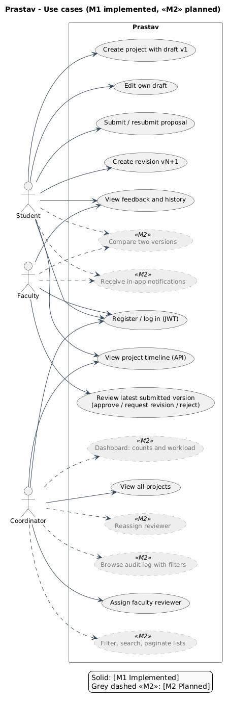

### Domain model

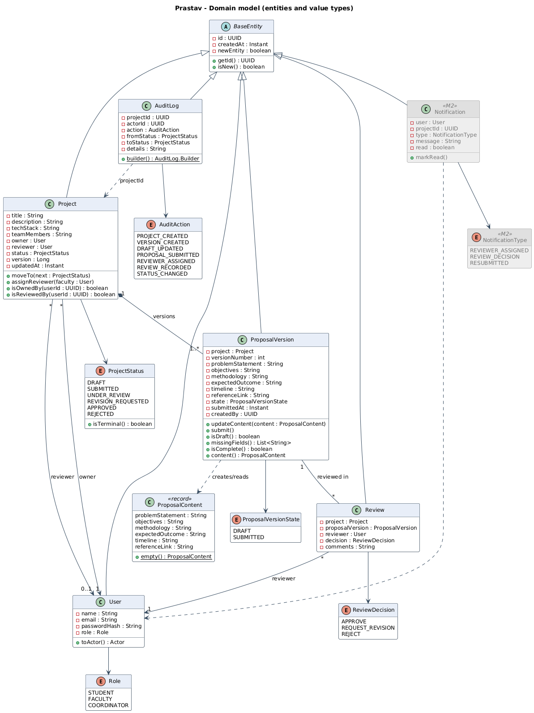

### Sequence: create and submit

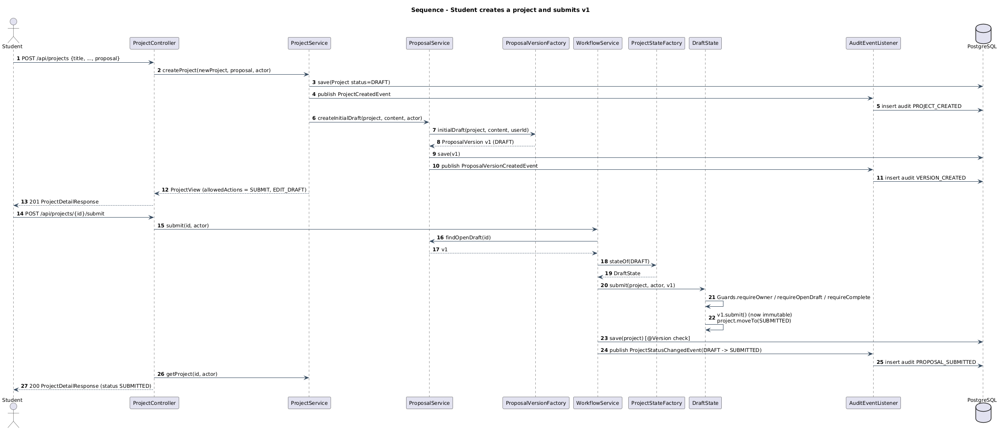

### Sequence: assign, review, request revision

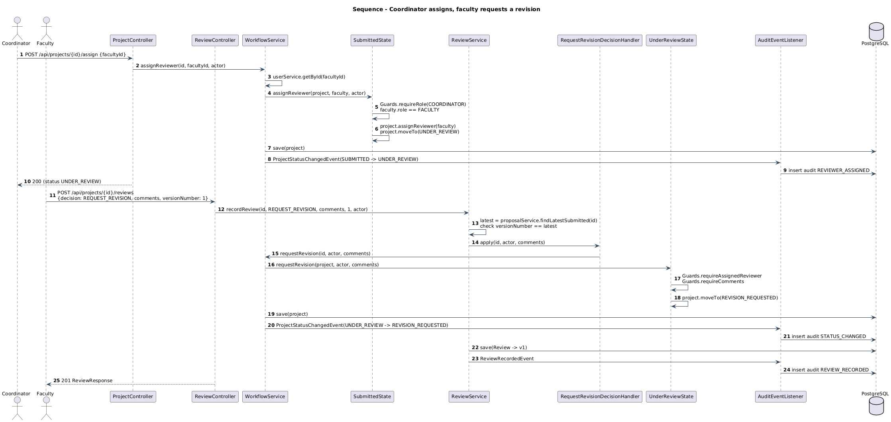

### Sequence: resubmit and approve

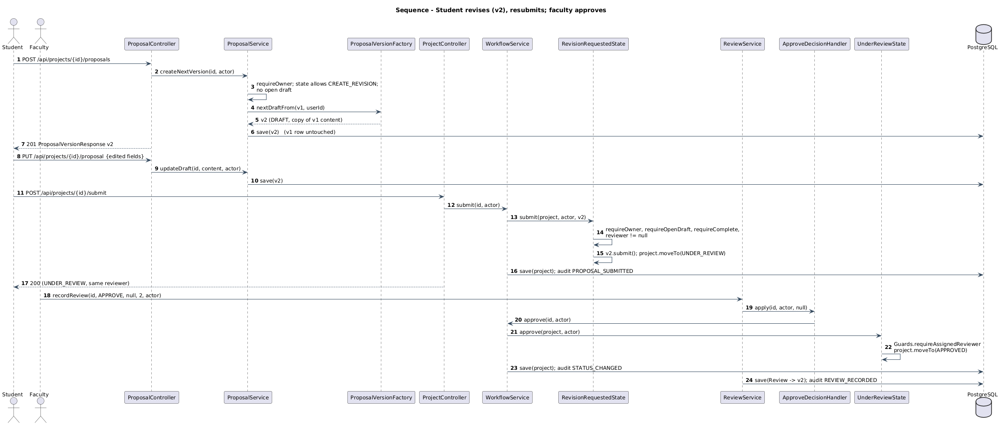

### Sequence: illegal transition

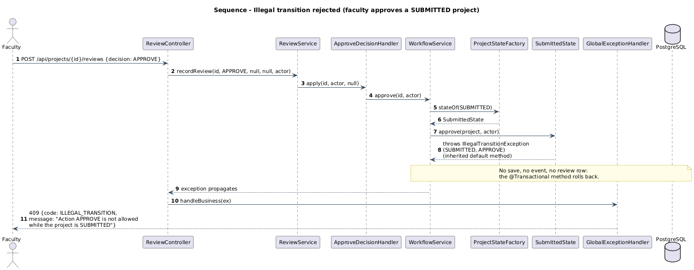

## 18. Frontend architecture

The web app (`frontend/`, artifact `prastav-frontend`) is a React 18 + TypeScript single-page app built with Vite. Styling is Tailwind CSS 3 with the design tokens in `tailwind.config.js` (documented in `docs/design/README.md`); icons come from lucide-react and the Plus Jakarta Sans font is self-hosted.

### 18.1 Routing and guards

`src/router.tsx` defines one `createBrowserRouter` tree (a data router, which the wizard needs for `useBlocker`).

| Route | Element | Guard |
|---|---|---|
| `/` | `LandingPage` (redirects a signed-in user to `/app`) | none |
| `/login`, `/register` | `LoginPage`, `RegisterPage` inside `AuthLayout` | none (a signed-in user is redirected) |
| `/app` | `AppShell` with `HomePage` (`StudentHome`, `FacultyHome` or `CoordinatorHome`) | `RequireAuth` |
| `/app/projects` | `ProjectsPage` configured by role (My, Assigned or All Projects) | `RequireAuth` |
| `/app/projects/new`, `/app/projects/:id/edit` | `ProjectWizardPage` | `RequireAuth roles=[STUDENT]` |
| `/app/projects/:id` | `ProjectDetailPage` | `RequireAuth` (the API enforces participation) |
| `/app/reviews` | `ProjectsPage mode="reviews"` (Under Review, oldest first) | `RequireAuth roles=[FACULTY, COORDINATOR]` |
| `/app/assign` | `AssignPage` (Submitted projects) | `RequireAuth roles=[COORDINATOR]` |

`RequireAuth` sends an anonymous visitor to `/login` with the requested path in the navigation state, so signing in returns there; a wrong role goes to `/app`. Route guards only shape navigation: every rule is enforced again by the API.

### 18.2 Layouts and component structure

| Folder | Contents |
|---|---|
| `src/layouts/` | `AppShell`: sidebar with role navigation from `config/navigation.ts` (a drawer below the `lg` breakpoint), top bar with global search (navigates to `/app/projects?q=`) and the account menu; `AuthLayout`: split layout for sign in and registration |
| `src/components/ui/` | Design system: `Button`, `Input`/`Textarea`/`Select`, `Card`, `StatCard`, `StatusPill`, `Avatar`/`AvatarStack`, `DataTable`, `Pagination`, `FilterBar`, `Tabs`, `Stepper`, `DropdownMenu`, `Modal`, `ToastProvider`, `Skeleton`, `EmptyState`, `PageHeader`, `CtaBand`, `Logo` |
| `src/components/` | Domain components: `WorkflowRail`, `ReviewPanel`, `AssignReviewerPanel`, `ProposalFields`/`ProposalView`, `ErrorNote`, and the label maps in `labels.ts` |
| `src/pages/` | One file per screen; `pages/home/` holds the role homes and `pages/projects/` the shared table columns and the assign dialog |
| `src/config/` | `brand.ts` (product name, tagline, institution), `navigation.ts`, `demoAccounts.ts` |
| `src/assets/` | Illustrations and `index.ts`, the single place every image is referenced |
| `src/lib/` | Formatting, people helpers (initials, avatar colour, team parsing), `useProjectListParams`, `useDebouncedValue`, `useDocumentTitle` |

### 18.3 Data flow

- `src/api/client.ts` is the Axios instance. It adds the Bearer token from the stored session, clears the session and returns to `/login` on a 401, and turns any error into one readable sentence (`errorMessage`) or per-field messages (`fieldErrors`). The session is kept in `localStorage` when "Remember me" is ticked and in `sessionStorage` otherwise.
- `src/api/endpoints.ts` has one function per endpoint and `src/api/types.ts` mirrors the backend DTOs. `listProjects` reads the `ProjectPageResponse` envelope and returns `{ items, total, page, size, totalPages }` (`content`, `totalElements` and the paging numbers).
- Server state lives in TanStack Query. Keys start with `['projects']` for lists and counts, `['project', id]`, `['versions', id]`, `['reviews', id]` and `['history', id]` for one project. Every mutation invalidates the keys it affects, so lists, dashboards and the project page stay in step.
- List filters (`status`, `q`, `reviewerId`, `admissionYear`, `branch`, `sort`, `page`) live in the URL through `useProjectListParams`, so a filtered list can be shared; the search and branch boxes update the URL after a 300 ms pause (the branch is upper-cased) and paging keeps the previous page on screen while the next one loads. The batch year and branch controls are shown to the coordinator only; the year offers this year and the five before it. The pager reads `page`, `size` and `totalElements` from the response envelope, and a page past the end (for example from an old link) moves to the last page.
- Buttons for workflow actions come only from `allowedActions` in `ProjectDetailResponse`. List rows, which carry no `allowedActions`, only offer shortcuts that the target page checks again (for example "Edit draft" for a DRAFT row opens the wizard, which shows "Nothing to edit" if the draft is gone).

### 18.4 Wizard

`ProjectWizardPage` writes a proposal in four steps: Basic Info, Problem and Objectives, Methodology and Outcomes, Timeline and Review. Next validates the current step; Save draft works at every step and creates the project on the first save (`POST /api/projects`), then updates the open draft (`PUT /api/projects/{id}/proposal`). Project details (title, description, tech stack, team) are read-only when editing because the API has no endpoint to change them. Submit opens a confirmation dialog, saves, then calls `POST /api/projects/{id}/submit`. For a project in REVISION_REQUESTED the same page shows a "Revision v{n}" banner and the reviewer's latest feedback in a collapsible side panel. Leaving with unsaved changes asks for confirmation (`useBlocker` and `beforeunload`).

### 18.5 States and accessibility

Every data view has a loading skeleton, an empty state and an error with Retry; successful actions show a toast. Inputs are labelled, errors are announced (`role="alert"`, live regions for toasts and counters), menus, tabs, the stepper and dialogs are keyboard operable with visible focus, and animations respect `prefers-reduced-motion`. The layout is designed at 1440px and works down to 360px: the sidebar becomes a drawer and tables scroll sideways.

