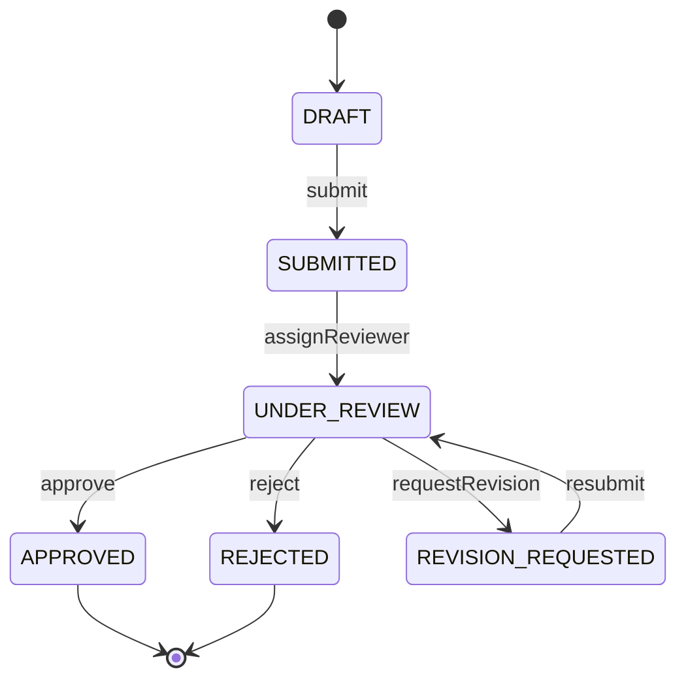
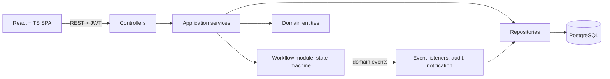

# Prastaav — PRD & Technical Specification

*Academic Project Workflow and Approval Management System*

Capstone project · Single final evaluation: first week of November 2026

**Delivery note:** one final submission and evaluation (confirmed by faculty on 24 Oct 2026). The M1/M2 labels in the tables below mean Build Phase 1 and Build Phase 2, an internal build order only; both ship together. Anything not built is removed from the LLD and UML. See Section 3.

---

## 1. Product Requirements

### 1.1 Problem

Proposal submission, faculty review, revision and approval currently run over email, documents and spreadsheets. Result: no single view of project status, lost proposal versions, unclear feedback, repeated communication, no audit trail.

### 1.2 Goals

- One centralized system for the full proposal lifecycle.
- Enforced workflow: only valid status transitions, only by the right role.
- Immutable proposal versions + review feedback history.
- Role-based access (Student, Faculty, Coordinator).
- Auditable record of every important action.
- Clean OOP / SOLID / design-pattern showcase that the team can defend in the interview.

### 1.3 Non-goals (V1)

AI proposal analysis, ML risk prediction, GitHub integration, event bus (Kafka etc.), microservices, cloud deployment, real email sending, file uploads (proposals are structured text fields + optional links).

### 1.4 Roles

| Role | Can do |
| --- | --- |
| STUDENT | Create project, edit own draft, submit, view feedback, create revision, resubmit, view own project history |
| FACULTY | View assigned projects, review latest submitted version, approve / request revision / reject with comments |
| COORDINATOR | View all projects, assign/reassign faculty, monitor status, view audit log, manage users |

### 1.5 Functional Requirements

| ID | Requirement | Milestone |
| --- | --- | --- |
| FR-1 | Register/login with JWT; role on user account | M1 |
| FR-2 | Student creates a project (title, description, team members text, tech stack) with an initial draft proposal v1 | M1 |
| FR-3 | Student edits draft proposal; draft is mutable only until submitted | M1 |
| FR-4 | Student submits proposal; version becomes immutable and project moves to SUBMITTED | M1 |
| FR-5 | Coordinator assigns a faculty reviewer; project moves to UNDER\_REVIEW | M1 |
| FR-6 | Faculty reviews latest submitted version: APPROVE / REQUEST\_REVISION / REJECT with comments | M1 |
| FR-7 | Student sees decision and feedback; on revision, creates new version vN+1 prefilled from previous | M1 |
| FR-8 | Student resubmits revised version; project returns to UNDER\_REVIEW with same faculty | M1 |
| FR-9 | Invalid transitions rejected with clear error (e.g. approve a DRAFT) | M1 |
| FR-10 | Every state change, assignment, submission and review recorded in audit log (who, what, when, before/after) | M1 |
| FR-11 | Project timeline view (all versions, reviews, status changes in order) | M1 (API) / M2 (UI) |
| FR-12 | Role-scoped project lists with status filter, search and pagination | M2 |
| FR-13 | In-app notifications on assignment, review decision, resubmission | M2 |
| FR-14 | Compare two proposal versions (field-level diff) | M2 |
| FR-15 | Coordinator dashboard: counts by status, pending-assignment list, reviewer workload | M2 |
| FR-16 | Coordinator audit-log viewer with filters | M2 |
| FR-17 | Reassign reviewer (with audit entry) | M2 |
| FR-18 | Institution profile and email policy: every account uses the institutional domain (`nst.rishihood.edu.in`, configured in `application.yml`); self-registration creates STUDENT accounts only and requires `<firstname>.<YY><branch>@domain`, from which admission year (2000 + YY) and branch are stored; FACULTY and COORDINATOR accounts are created by the coordinator (`POST /api/users`) or the seed; any other email or role is rejected with `VALIDATION_FAILED` | |

### 1.6 Workflow

Statuses: `DRAFT`, `SUBMITTED`, `UNDER_REVIEW`, `REVISION_REQUESTED`, `APPROVED`, `REJECTED`.

| From | Action | Actor | To | Guard |
| --- | --- | --- | --- | --- |
| DRAFT | submit | Student (owner) | SUBMITTED | required proposal fields filled |
| SUBMITTED | assignReviewer | Coordinator | UNDER\_REVIEW | assignee has FACULTY role |
| UNDER\_REVIEW | approve | Assigned faculty | APPROVED | reviewing latest submitted version |
| UNDER\_REVIEW | requestRevision | Assigned faculty | REVISION\_REQUESTED | comments mandatory |
| UNDER\_REVIEW | reject | Assigned faculty | REJECTED | comments mandatory |
| REVISION\_REQUESTED | submit (resubmit) | Student (owner) | UNDER\_REVIEW | new version exists, reviewer already assigned |
| UNDER\_REVIEW | reassignReviewer | Coordinator | UNDER\_REVIEW | M2 |

APPROVED and REJECTED are terminal. Anything not in the table is illegal.



### 1.7 Business Rules

1. A student sees only own projects (owner = creator). Faculty sees only assigned projects. Coordinator sees all.
2. A submitted proposal version is never modified or deleted.
3. Version numbers are sequential per project (1, 2, 3…).
4. A review always references one specific version; only the latest submitted version can be reviewed.
5. REQUEST\_REVISION and REJECT require non-empty comments.
6. Faculty cannot review a project they are not assigned to; a student cannot review own project.
7. Only one open draft per project at a time.

### 1.8 Non-Functional Requirements

- Security: BCrypt passwords, JWT, RBAC + ownership checks on every endpoint.
- Data integrity: DB constraints + optimistic locking (`@Version`) on Project to prevent double transitions.
- Testability: domain logic independent of Spring and DB.
- Maintainability: layered modules, constructor injection, no business logic in controllers.
- Documentation: Swagger UI for all endpoints, README, UML diagrams.
- Performance: list endpoints paginated; typical response under 300 ms on demo data.

---

## 2. Technical Specification

### 2.1 Architecture

Modular monolith, one Spring Boot deployable, one PostgreSQL database. Modules communicate through service interfaces and domain events, never by reaching into another module's repositories.



Layers per module: `web` (controller + DTOs) → `service` (use cases, transactions) → `domain` (entities, rules, state objects) → `repository` (Spring Data JPA).

### 2.2 Package Structure

```
com.prastaav
 ├─ auth        (User, Role, JwtService, SecurityConfig, AuthController)
 ├─ project     (Project, ProjectService, ProjectController, ProjectRepository)
 ├─ proposal    (ProposalVersion, ProposalService, ProposalController)
 ├─ review      (Review, ReviewDecision, ReviewService, ReviewController)
 ├─ workflow    (ProjectStatus, ProjectState + 6 state classes, ProjectStateFactory, WorkflowService)
 ├─ audit       (AuditLog, AuditEventListener, AuditController)
 ├─ notification (Notification, NotificationType, NotificationRepository, NotificationService; web: NotificationResponse, NotificationMapper)
 └─ common      (ApiError, GlobalExceptionHandler, exceptions, base entity)
```

### 2.3 Data Model

**users** — id (UUID PK), name, email (unique), password\_hash, role (STUDENT/FACULTY/COORDINATOR), admission\_year (nullable, students), branch (nullable, students), created\_at; index (admission\_year, branch)

**projects** — id, title, description, tech\_stack, team\_members (text), owner\_id (FK users), reviewer\_id (FK users, nullable), status, version (optimistic lock), created\_at, updated\_at

**proposal\_versions** — id, project\_id (FK), version\_number, problem\_statement, objectives, methodology, expected\_outcome, timeline, reference\_link (optional), state (DRAFT/SUBMITTED), submitted\_at (nullable), created\_by, created\_at; unique (project\_id, version\_number)

**reviews** — id, project\_id (FK), proposal\_version\_id (FK), reviewer\_id (FK users), decision (APPROVE/REQUEST\_REVISION/REJECT), comments, created\_at

**audit\_logs** — id, project\_id (nullable FK), actor\_id, action (PROJECT\_CREATED, PROPOSAL\_SUBMITTED, REVIEWER\_ASSIGNED, REVIEW\_RECORDED, STATUS\_CHANGED, …), from\_status, to\_status, details (JSON text), created\_at — append-only

**notifications** — id, recipient\_id (FK users), project\_id (nullable FK projects), type (REVIEWER\_ASSIGNED/REVIEW\_DECISION/RESUBMITTED), message, is\_read, created\_at; indexes (recipient\_id, is\_read) and (recipient\_id, created\_at)

Relationships: User 1—\* Project (owner); User 1—\* Project (reviewer); Project 1—\* ProposalVersion; ProposalVersion 1—\* Review; Project 1—\* AuditLog; User 1—\* Notification (recipient); Project 0..1—\* Notification.

Use Flyway migrations (`V1__init.sql`, …) so schema is reproducible.

### 2.4 Workflow Engine (State Pattern)

Each status is a class that allows only its legal actions; every other action throws `IllegalTransitionException`. Adding a status = adding one class + factory entry (Open/Closed).

```java
public interface ProjectState {
    ProjectStatus status();
    default void submit(Project p, Actor a)         { throw new IllegalTransitionException(status(), Action.SUBMIT); }
    default void assignReviewer(Project p, User f, Actor a) { throw new IllegalTransitionException(status(), Action.ASSIGN); }
    default void approve(Project p, Actor a)        { throw new IllegalTransitionException(status(), Action.APPROVE); }
    default void requestRevision(Project p, Actor a){ throw new IllegalTransitionException(status(), Action.REQUEST_REVISION); }
    default void reject(Project p, Actor a)         { throw new IllegalTransitionException(status(), Action.REJECT); }
}

public class DraftState implements ProjectState {
    public ProjectStatus status() { return ProjectStatus.DRAFT; }
    @Override public void submit(Project p, Actor a) {
        Guards.requireOwner(p, a);
        p.moveTo(ProjectStatus.SUBMITTED);
    }
}
```

`RevisionRequestedState.submit()` moves to UNDER\_REVIEW (resubmission) — same method, different behaviour per state (polymorphism instead of if/else).

`WorkflowService` is the single entry point (Facade): load project → get state via `ProjectStateFactory` → call action → save → publish `ProjectStatusChangedEvent`. Controllers and other services never set `status` directly.

### 2.5 Design Patterns and SOLID Mapping

| Pattern | Where | Why |
| --- | --- | --- |
| State | `workflow` module | Replaces status if/else chains; legal transitions per state |
| Observer (Spring events) | `ProjectStatusChangedEvent`, `ReviewRecordedEvent` → `AuditEventListener`, `NotificationListener` | Audit and notifications decoupled from workflow |
| Factory | `ProjectStateFactory`, `ProposalVersionFactory` (new version from previous) | Centralized object creation |
| Strategy | `ReviewDecisionHandler` per decision (Approve/Revise/Reject); `EmailPolicy` / `PatternEmailPolicy` for account emails; `NotificationChannel` (InApp now, Email later) | Add behaviour without modifying services |
| Facade | `WorkflowService` | One simple API over state, repository, events |
| Repository | Spring Data JPA | Persistence abstraction |
| Builder | `AuditLog.builder()`, DTO builders | Readable construction of multi-field objects |
| DTO / Mapper | web layer | Entities never exposed over REST |

| SOLID | Evidence in code |
| --- | --- |
| S | Controller handles HTTP only; service handles use case; state classes handle transition rules; listeners handle side effects |
| O | New status/decision/notification channel = new class, no edits to existing ones |
| L | All `ProjectState` and `ReviewDecisionHandler` implementations are interchangeable behind the interface |
| I | Small interfaces: `ProjectState`, `NotificationChannel`, `AuditRecorder` — no fat interface |
| D | Services depend on interfaces and are constructor-injected; domain does not import Spring/JPA repositories |

### 2.6 REST API

Base path `/api`. All except auth require `Authorization: Bearer <jwt>`.

| Method | Path | Role | Purpose | M |
| --- | --- | --- | --- | --- |
| POST | /auth/register | public | Register a STUDENT with an institutional student email (FR-18) | 1 |
| POST | /auth/login | public | Returns JWT + user | 1 |
| GET | /auth/me | any | Current user | 1 |
| GET | /users?role=FACULTY | COORDINATOR | List faculty for assignment | 1 |
| POST | /users | COORDINATOR | Create a FACULTY or COORDINATOR account on the institutional domain (FR-18) | |
| POST | /projects | STUDENT | Create project + draft v1 | 1 |
| GET | /projects?status=&q=&reviewerId=&sort=&page=&size= | any | Role-scoped list with status filter, search, sort and paging; `X-Total-Count` header | 1 |
| GET | /projects/{id} | owner/reviewer/coordinator | Project detail + current status | 1 |
| PUT | /projects/{id}/proposal | STUDENT (owner) | Edit current draft version | 1 |
| POST | /projects/{id}/proposals | STUDENT (owner) | Create next version draft (only in REVISION\_REQUESTED) | 1 |
| GET | /projects/{id}/proposals | participants | All versions | 1 |
| POST | /projects/{id}/submit | STUDENT (owner) | Submit / resubmit (state decides) | 1 |
| POST | /projects/{id}/assign | COORDINATOR | Body: facultyId | 1 |
| POST | /projects/{id}/reviews | FACULTY (assigned) | Body: decision, comments | 1 |
| GET | /projects/{id}/reviews | participants | Review history | 1 |
| GET | /projects/{id}/history | participants | Merged timeline (versions + reviews + status changes) | 1 |
| GET | /projects/{id}/proposals/compare?from=1&to=2 | participants | Field-level diff | 2 |
| GET | /projects/summary | any | Role-scoped counts by status; projects awaiting assignment for the coordinator | 2 |
| GET | /audit | COORDINATOR | Filterable audit log | 2 |
| GET | /notifications | any | My notifications | 2 |
| PATCH | /notifications/{id}/read | any | Mark read | 2 |
| PUT | /projects/{id}/assign | COORDINATOR | Reassign reviewer | 2 |

Error format: `{ timestamp, status, code, message, path, fieldErrors[] }`. Codes: `VALIDATION_FAILED` 400, `UNAUTHENTICATED` 401, `FORBIDDEN` 403, `NOT_FOUND` 404, `ILLEGAL_TRANSITION` 409, `CONCURRENT_UPDATE` 409.

### 2.7 Security

- Spring Security stateless, JWT (HS256, 1h expiry), claims: userId, role.
- `@PreAuthorize` for role gates; service-level ownership checks (owner / assigned reviewer) via a `ProjectAccessPolicy` class.
- Passwords BCrypt; no stack traces in responses; CORS limited to frontend origin.
- Seed creates one coordinator, two faculty and three students on the institutional domain, sharing `prastav.seed.demo-password`.
- `EmailPolicy` (Strategy) checks the institutional domain for every new account and parses admission year and branch from student emails (FR-18).

### 2.8 Frontend (React + TypeScript)

Vite, React Router, TanStack Query, Axios (JWT interceptor), plain CSS or Tailwind. Route guards by role. Typed API client generated or hand-written from OpenAPI.

| Page | Role | M |
| --- | --- | --- |
| Login / Register | all | 1 |
| My Projects + Create Project | Student | 1 |
| Project Detail (status badge, versions, feedback, action buttons shown by state and role) | all | 1 |
| Proposal Editor (draft / new revision) | Student | 1 |
| Assigned Projects + Review form | Faculty | 1 |
| All Projects + Assign Faculty | Coordinator | 1 (basic) |
| Timeline tab | all | 2 |
| Version Compare | all | 2 |
| Dashboard, Audit Log viewer | Coordinator | 2 |
| Notification bell | all | 2 |

Key UI rule: the backend decides what is allowed; the UI only hides buttons based on `allowedActions` returned in the project detail response (computed from state + role).

### 2.9 Testing

- JUnit 5 + Mockito. Priority order: (1) every state class: legal and illegal transitions, (2) `WorkflowService` with mocked repository/publisher, (3) services: version numbering, review rules, access policy, (4) controller slice tests with MockMvc for auth/error mapping.
- M2: integration tests with Testcontainers PostgreSQL for the full happy path and revision loop.
- Target: all workflow + service logic covered; around 70% line coverage overall.

### 2.10 DevOps

- Git: `main` (stable) + `develop` + feature branches, PRs with one reviewer.
- Docker: Dockerfile for backend and frontend, `docker-compose.yml` (db, backend, frontend) — M2.
- GitHub Actions: build + test on PR (M2; a minimal workflow is welcome in M1).
- Swagger UI at `/swagger-ui.html` via springdoc-openapi.

---

## 3. Single-Release Delivery Plan

### 3.1 Scope and delivery

One deliverable and one evaluation in the first week of November 2026 (confirmed by faculty on 24 Oct). Target: code complete and diagrams final by **Sat 31 Oct**, with **Sun 1 Nov** as buffer. Phase 1 (core, already built) and Phase 2 (extensions) ship together.

| Tier | Scope |
| --- | --- |
| Must | Phase 1 baseline (FR-1 to FR-11), notifications with Strategy + Decorator (FR-13), reviewer reassignment (FR-17), list pagination/filter/search (FR-12), version compare (FR-14), DB indexes, tests for all new logic, full LLD + UML |
| Should | Coordinator dashboard summary (FR-15), filterable audit API (FR-16) |
| Could | Audit viewer UI, full docker-compose, GitHub Actions CI, Testcontainers integration tests |

Rule: anything not finished by Fri 30 Oct is removed from the LLD, UML and README. The design must describe exactly what the code does.

### 3.2 Baseline already built (Phase 1)

Auth with JWT and roles, projects, versioned immutable proposals, State-pattern workflow with `allowedActions`, review decision strategies, audit logging through domain events, history timeline, global error handling, Flyway schema, seed data, Swagger, React UI for the three roles and unit tests. Phase 2 extends this code. Package, class and folder names already in the repository are the source of truth and must not be renamed.

### 3.3 Design additions required by the evaluation rubric

| Area | Addition |
| --- | --- |
| Inheritance and abstraction | Abstract `BaseEntity` (id, createdAt, updatedAt, optimistic-lock version) extended by every entity; interfaces `ProjectState`, `ReviewDecisionHandler`, `NotificationChannel`, `AuditRecorder` |
| Creational patterns | Factory (`ProjectStateFactory`), Builder (`AuditLog`, DTOs), Singleton (stateless Spring beans in singleton scope; explain why shared mutable state is avoided) |
| Structural patterns | Facade (`WorkflowService`), Decorator (`RetryingNotificationChannel` wraps any `NotificationChannel`) |
| Behavioural patterns | State (workflow), Observer (domain events to audit and notification listeners), Strategy (review decisions, notification channels) |
| Class relationships | Composition: Project ◆ ProposalVersion. Aggregation: Project ◇ Review, Project ◇ AuditLog. Association: User to Project (owner, reviewer), Review to ProposalVersion. Inheritance: entities extend `BaseEntity`. Multiplicities shown on every association |
| Database indexes | projects(status), projects(owner\_id), projects(reviewer\_id); proposal\_versions unique(project\_id, version\_number); reviews(project\_id); audit\_logs(project\_id, created\_at); notifications(user\_id, is\_read) |
| Concurrency | Optimistic locking on Project; a test shows two concurrent submissions give one success and one `CONCURRENT_UPDATE` (409) |
| Diagrams | Use case; domain class; workflow State-pattern class; project state; sequence (create+submit, assign+review, resubmit+approve, illegal transition, notification dispatch); activity (submit → assign → review → revise/approve); ER; architecture |

### 3.4 Rubric traceability

| Evaluation criterion | Where it is shown |
| --- | --- |
| 1. Requirement analysis | Sections 1.4 to 1.8, use case diagram |
| 2. Class diagram | Domain and State-pattern class diagrams, relationships per 3.3 |
| 3. OOP | BaseEntity, state and strategy interfaces, polymorphic state classes, encapsulated `Project.moveTo` |
| 4. SOLID | Section 2.5 mapping, one named class per letter |
| 5. Design patterns | Sections 2.5 and 3.3, with justification for each |
| 6. Sequence / activity | Five sequence diagrams and one activity diagram |
| 7. API / interface design | Section 2.6, DTOs, controller → service → repository separation |
| 8. Database schema | Section 2.3, Flyway migrations, indexes in 3.3 |
| 9. Errors, validation, edge cases | Section 2.6 error codes, validation annotations, illegal transitions, concurrency test |
| 10. Working implementation | Repository, README run steps, demo script in 3.7 |

### 3.5 Deliverables checklist

1. Repository with README (3-command run guide) and an honest commit history from both members.
2. `LLD.pdf` covering the whole implemented system.
3. UML diagrams as PNG/PDF plus PlantUML and Mermaid sources.
4. Passing backend tests and a frontend that builds.
5. Viva sheet: design questions, live-coding drills, who owns which module.

### 3.6 Day plan

| Day | Target |
| --- | --- |
| Sat 24 Oct | Publish baseline to GitHub; teammate clones and reads the code; one branch per task |
| Sun 25 Oct | Notifications backend; pagination/filter backend; DB indexes |
| Mon 26 Oct | Decorator, reassignment, version compare backend; frontend list and timeline |
| Tue 27 Oct | Notification UI, reassign UI, compare view; tests for new logic |
| Wed 28 Oct | Should items; generate UML and LLD from the code and fix mismatches |
| Thu 29 Oct | Could items if time allows; README; end-to-end demo run |
| Fri 30 Oct | Mock viva; each member explains diagrams and their modules; live-coding drill |
| Sat 31 Oct | Freeze code and documents |
| Sun 1 Nov | Buffer |

### 3.7 Demo script

1. Student creates a project and submits v1.
2. Coordinator assigns faculty; show the audit entry.
3. Faculty requests revision; student sees the notification.
4. Student creates v2, resubmits, compares v1 and v2.
5. Faculty approves; show timeline and audit log.
6. Show an illegal transition and a concurrent update being rejected.
7. Open the code: State classes, Decorator, one unit test; add a small feature live.

### 3.8 Ownership of remaining work

| Person | Owns |
| --- | --- |
| A | Notification module (entity, Strategy, Decorator, listeners, endpoints), reviewer reassignment, audit API, backend tests for these, class/sequence/activity diagrams, LLD sections on OOP, SOLID, patterns, error handling and concurrency |
| B | Pagination/filter/search, DB index migration, version compare, dashboard, all new frontend work, use case/ER/architecture diagrams, LLD sections on requirements, API and schema, README, Docker and CI if time allows |

Every member must be able to explain the whole system, not only their own modules.

---

## 4. Interview Preparation

**Questions you should be able to answer**

- Why modular monolith rather than microservices? (single team, one DB, simpler transactions; modules ready to split later)
- Why State pattern over a status enum with switch statements? (OCP, each state owns its rules, easy to test)
- Why events for audit/notifications? (workflow does not know about side effects; SRP, easy to add listeners)
- Why are proposal versions immutable? (audit integrity, reviewers judge exactly what was submitted)
- How do you stop two people changing the same project at once? (`@Version` optimistic locking)
- Where is authorization enforced and why in two places? (role at the endpoint, ownership in the service policy)

**Likely live-coding tasks — know exactly where you would change code**

| Task | Where |
| --- | --- |
| Add a new status `ON_HOLD` | new `OnHoldState`, enum value, factory entry, Flyway migration if constrained, tests |
| Add a new role, e.g. REVIEW\_COMMITTEE | `Role` enum, `ProjectAccessPolicy`, `@PreAuthorize` on new endpoints |
| Require two reviewers before approval | `Review` count check in `UnderReviewState.approve` or a new `ApprovalPolicy` strategy |
| New notification channel (email) | implement `NotificationChannel`, register as bean |
| Add a deadline field to proposals | entity + migration + DTO + form field |
| Limit resubmissions to 3 | guard in `RevisionRequestedState.submit` + test |

Rehearse at least two of these end to end before M1.

---

## 5. Risks and Decisions to Confirm

| Risk / open point | Suggested decision |
| --- | --- |
| Final evaluation is only days away | Ship the vertical slice, cut UI polish first, protect state machine + tests |
| Team members unfamiliar with each other's modules | Daily 15-min walkthrough; rotate who demos which module |
| Single vs multiple reviewers | Single reviewer in V1 (rule can become a Strategy later) |
| Proposal as file upload vs form fields | Form fields + optional link (no file storage in V1) |
| Can REJECTED be reopened? | No in V1; coordinator reopen is a possible future extension |
| Can a student edit project metadata after submission? | No; only new versions carry changes |

Confirm these with your faculty before M1 if the guidelines are ambiguous.
