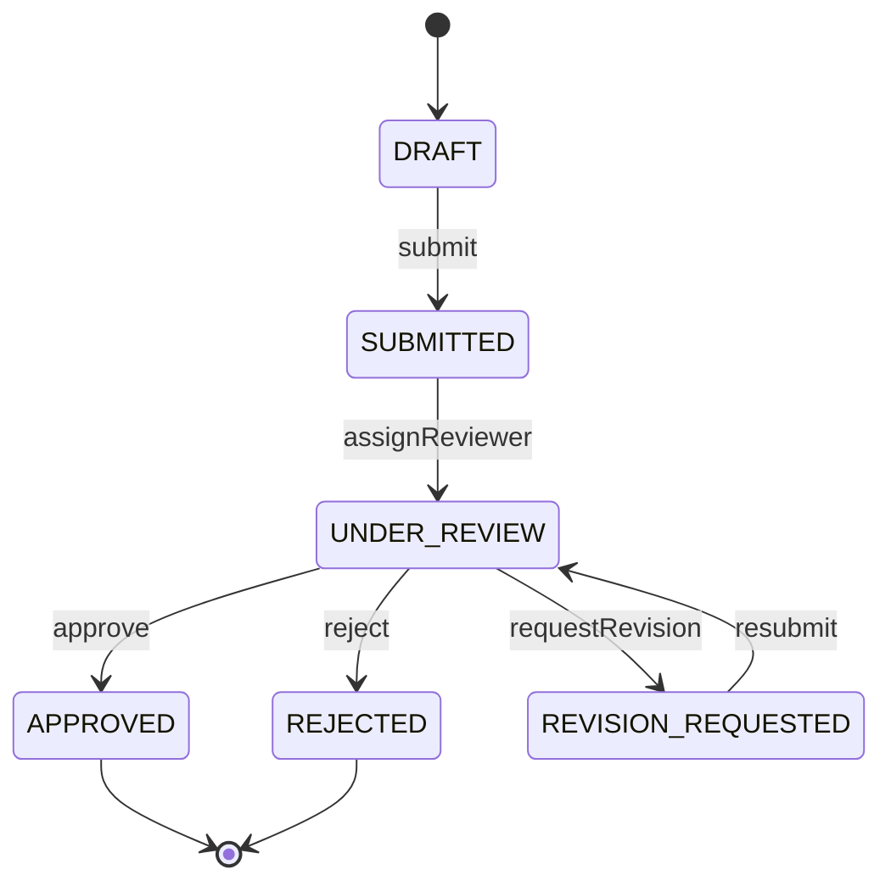
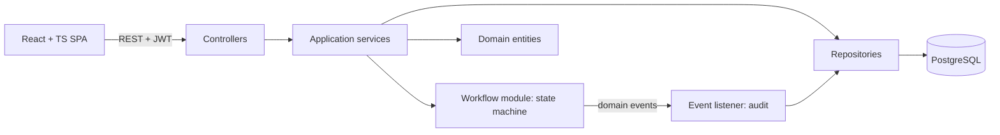

# Prastaav — PRD & Technical Specification

*Academic Project Workflow and Approval Management System*

---

## 1. Product Requirements

### 1.1 Problem

Proposal submission, faculty review, revision and approval currently run over email, documents and spreadsheets. Result: no single view of project status, lost proposal versions, unclear feedback, repeated communication, no audit trail.

### 1.2 Goals

- One centralized system for the full proposal lifecycle.
- Enforced workflow: only valid status transitions, only by the right role.
- Immutable proposal versions + review feedback history.
- Role-based access (Student, Faculty, Coordinator).
- Auditable record of every important action.
- Clean OOP / SOLID / design-pattern showcase that the team can defend in the interview.

### 1.3 Non-goals

AI proposal analysis, ML risk prediction, GitHub integration, event bus (Kafka etc.), microservices, cloud deployment, real email sending, file uploads (proposals are structured text fields + optional links).

Product decisions: one assigned faculty reviewer per project; a REJECTED project is final and cannot be reopened; project metadata is fixed after submission and changes travel only in new proposal versions.

### 1.4 Roles

| Role | Can do |
| --- | --- |
| STUDENT | Create project, edit own draft, submit, view feedback, create revision, resubmit, view own project history |
| FACULTY | View assigned projects, review latest submitted version, approve / request revision / reject with comments |
| COORDINATOR | View all projects, assign faculty, monitor status, view audit log, manage users |

### 1.5 Functional Requirements

| ID | Requirement |
| --- | --- |
| FR-1 | Register/login with JWT; role on user account |
| FR-2 | Student creates a project (title, description, team members text, tech stack) with an initial draft proposal v1 |
| FR-3 | Student edits draft proposal; draft is mutable only until submitted |
| FR-4 | Student submits proposal; version becomes immutable and project moves to SUBMITTED |
| FR-5 | Coordinator assigns a faculty reviewer; project moves to UNDER\_REVIEW |
| FR-6 | Faculty reviews latest submitted version: APPROVE / REQUEST\_REVISION / REJECT with comments |
| FR-7 | Student sees decision and feedback; on revision, creates new version vN+1 prefilled from previous |
| FR-8 | Student resubmits revised version; project returns to UNDER\_REVIEW with same faculty |
| FR-9 | Invalid transitions rejected with clear error (e.g. approve a DRAFT) |
| FR-10 | Every state change, assignment, submission and review recorded in audit log (who, what, when, before/after) |
| FR-11 | Project timeline view (all versions, reviews, status changes in order) |
| FR-12 | Role-scoped project lists with status filter, case-insensitive search, a coordinator-only batch filter (owner's admission year and branch; other roles passing it get `FORBIDDEN`) and pagination (page from 0, size 1 to 50, default 10); filtering and paging run in the database; invalid parameters are rejected with `VALIDATION_FAILED` |
| FR-13 | In-app notifications on assignment, review decision, resubmission, delivered through the configured channels (in-app inbox; email written to the log), each retried a configured number of times |
| FR-14 | Compare two proposal versions of one project field by field: every proposal field with its value in each version and whether it changed; project participants only; a version outside the project is `NOT_FOUND`, the same version on both sides is `VALIDATION_FAILED` |
| FR-15 | Coordinator dashboard: counts by status, pending-assignment list, reviewer workload |
| FR-16 | Coordinator audit-log viewer with filters |
| FR-17 | Reassign reviewer (with audit entry) |
| FR-18 | Institution profile and email policy: every account uses the institutional domain (`nst.rishihood.edu.in`, configured in `application.yml`); self-registration creates STUDENT accounts only and requires `<firstname>.<YY><branch>@domain`, from which admission year (2000 + YY) and branch are stored; FACULTY and COORDINATOR accounts are created by the coordinator (`POST /api/users`) or the seed; any other email or role is rejected with `VALIDATION_FAILED` |

### 1.6 Workflow

Statuses: `DRAFT`, `SUBMITTED`, `UNDER_REVIEW`, `REVISION_REQUESTED`, `APPROVED`, `REJECTED`.

| From | Action | Actor | To | Guard |
| --- | --- | --- | --- | --- |
| DRAFT | submit | Student (owner) | SUBMITTED | required proposal fields filled |
| SUBMITTED | assignReviewer | Coordinator | UNDER\_REVIEW | assignee has FACULTY role |
| UNDER\_REVIEW | approve | Assigned faculty | APPROVED | reviewing latest submitted version |
| UNDER\_REVIEW | requestRevision | Assigned faculty | REVISION\_REQUESTED | comments mandatory |
| UNDER\_REVIEW | reject | Assigned faculty | REJECTED | comments mandatory |
| REVISION\_REQUESTED | submit (resubmit) | Student (owner) | UNDER\_REVIEW | new version exists, reviewer already assigned |

APPROVED and REJECTED are terminal. Anything not in the table is illegal.



### 1.7 Business Rules

1. A student sees only own projects (owner = creator). Faculty sees only assigned projects. Coordinator sees all.
2. A submitted proposal version is never modified or deleted.
3. Version numbers are sequential per project (1, 2, 3…).
4. A review always references one specific version; only the latest submitted version can be reviewed.
5. REQUEST\_REVISION and REJECT require non-empty comments.
6. Faculty cannot review a project they are not assigned to; a student cannot review own project.
7. Only one open draft per project at a time.

### 1.8 Non-Functional Requirements

- Security: BCrypt passwords, JWT, RBAC + ownership checks on every endpoint.
- Data integrity: DB constraints + optimistic locking (`@Version`) on Project to prevent double transitions.
- Testability: domain logic independent of Spring and DB.
- Maintainability: layered modules, constructor injection, no business logic in controllers.
- Documentation: Swagger UI for all endpoints, README, UML diagrams.
- Performance: list endpoints paginated; typical response under 300 ms on demo data.

---

## 2. Technical Specification

### 2.1 Architecture

Modular monolith, one Spring Boot deployable, one PostgreSQL database. Modules communicate through service interfaces and domain events, never by reaching into another module's repositories.



Layers per module: `web` (controller + DTOs) → `service` (use cases, transactions) → `domain` (entities, rules, state objects) → `repository` (Spring Data JPA).

### 2.2 Package Structure

```
com.prastav
 ├─ auth        (User, Role, JwtService, SecurityConfig, EmailPolicy, AuthController, UserController)
 ├─ project     (Project, ProjectService, ProjectSpecifications, ProjectController, ProjectRepository)
 ├─ proposal    (ProposalVersion, ProposalService, ProposalController)
 ├─ review      (Review, ReviewDecision, ReviewService, ReviewController)
 ├─ workflow    (ProjectStatus, ProjectState + 6 state classes, ProjectStateFactory, WorkflowService)
 ├─ audit       (AuditLog, AuditEventListener, AuditQueryService)
 ├─ notification (Notification, NotificationType, NotificationRepository, NotificationService, NotificationChannel, InAppNotificationChannel, EmailNotificationChannel, NotificationDispatcher, NotificationProperties, RetryingNotificationChannel; web: NotificationResponse, NotificationMapper)
 └─ common      (ApiError, GlobalExceptionHandler, exceptions, base entity)
```

### 2.3 Data Model

**users** — id (UUID PK), name, email (unique), password\_hash, role (STUDENT/FACULTY/COORDINATOR), admission\_year (nullable, students), branch (nullable, students), created\_at; index (admission\_year, branch)

**projects** — id, title, description, tech\_stack, team\_members (text), owner\_id (FK users), reviewer\_id (FK users, nullable), status, version (optimistic lock), created\_at, updated\_at

**proposal\_versions** — id, project\_id (FK), version\_number, problem\_statement, objectives, methodology, expected\_outcome, timeline, reference\_link (optional), state (DRAFT/SUBMITTED), submitted\_at (nullable), created\_by, created\_at; unique (project\_id, version\_number)

**reviews** — id, project\_id (FK), proposal\_version\_id (FK), reviewer\_id (FK users), decision (APPROVE/REQUEST\_REVISION/REJECT), comments, created\_at

**audit\_logs** — id, project\_id (nullable FK), actor\_id, action (PROJECT\_CREATED, PROPOSAL\_SUBMITTED, REVIEWER\_ASSIGNED, REVIEW\_RECORDED, STATUS\_CHANGED, …), from\_status, to\_status, details (JSON text), created\_at — append-only

**notifications** — id, recipient\_id (FK users), project\_id (nullable FK projects), type (REVIEWER\_ASSIGNED/REVIEW\_DECISION/RESUBMITTED), message, is\_read, created\_at; indexes (recipient\_id, is\_read) and (recipient\_id, created\_at)

Relationships: User 1—\* Project (owner); User 1—\* Project (reviewer); Project 1—\* ProposalVersion; ProposalVersion 1—\* Review; Project 1—\* AuditLog; User 1—\* Notification (recipient); Project 0..1—\* Notification.

Use Flyway migrations (`V1__init.sql`, …) so schema is reproducible.

### 2.4 Workflow Engine (State Pattern)

Each status is a class that allows only its legal actions; every other action throws `IllegalTransitionException`. Adding a status = adding one class + factory entry (Open/Closed).

```java
public interface ProjectState {
    ProjectStatus status();
    default void submit(Project p, Actor a)         { throw new IllegalTransitionException(status(), Action.SUBMIT); }
    default void assignReviewer(Project p, User f, Actor a) { throw new IllegalTransitionException(status(), Action.ASSIGN); }
    default void approve(Project p, Actor a)        { throw new IllegalTransitionException(status(), Action.APPROVE); }
    default void requestRevision(Project p, Actor a){ throw new IllegalTransitionException(status(), Action.REQUEST_REVISION); }
    default void reject(Project p, Actor a)         { throw new IllegalTransitionException(status(), Action.REJECT); }
}

public class DraftState implements ProjectState {
    public ProjectStatus status() { return ProjectStatus.DRAFT; }
    @Override public void submit(Project p, Actor a) {
        Guards.requireOwner(p, a);
        p.moveTo(ProjectStatus.SUBMITTED);
    }
}
```

`RevisionRequestedState.submit()` moves to UNDER\_REVIEW (resubmission) — same method, different behaviour per state (polymorphism instead of if/else).

`WorkflowService` is the single entry point (Facade): load project → get state via `ProjectStateFactory` → call action → save → publish `ProjectStatusChangedEvent`. Controllers and other services never set `status` directly.

### 2.5 Design Patterns and SOLID Mapping

| Pattern | Where | Why |
| --- | --- | --- |
| State | `workflow` module | Replaces status if/else chains; legal transitions per state |
| Observer (Spring events) | `ProjectStatusChangedEvent`, `ReviewRecordedEvent` → `AuditEventListener` | Audit decoupled from workflow |
| Factory | `ProjectStateFactory`, `ProposalVersionFactory` (new version from previous) | Centralized object creation |
| Strategy | `ReviewDecisionHandler` per decision (Approve/Revise/Reject); `EmailPolicy` / `PatternEmailPolicy` for account emails; `NotificationChannel` (in-app, email log) run by `NotificationDispatcher` | Add behaviour without modifying services |
| Decorator | `RetryingNotificationChannel` around every enabled `NotificationChannel` | Retries without changing any channel |
| Specification | `ProjectSpecifications` (role scope, status, reviewer, search) | One composable query for every list filter |
| Facade | `WorkflowService` | One simple API over state, repository, events |
| Repository | Spring Data JPA | Persistence abstraction |
| Builder | `AuditLog.builder()` | Readable construction of multi-field objects |
| DTO / Mapper | web layer | Entities never exposed over REST |

| SOLID | Evidence in code |
| --- | --- |
| S | Controller handles HTTP only; service handles use case; state classes handle transition rules; listeners handle side effects |
| O | New status/decision/email policy = new class, no edits to existing ones |
| L | All `ProjectState` and `ReviewDecisionHandler` implementations are interchangeable behind the interface |
| I | Small interfaces: `ProjectState`, `EmailPolicy`, `AuditRecorder` — no fat interface |
| D | Services depend on interfaces and are constructor-injected; domain does not import Spring/JPA repositories |

### 2.6 REST API

Base path `/api`. All except auth require `Authorization: Bearer <jwt>`.

| Method | Path | Role | Purpose |
| --- | --- | --- | --- |
| POST | /auth/register | public | Register a STUDENT with an institutional student email (FR-18) |
| POST | /auth/login | public | Returns JWT + user |
| GET | /auth/me | any | Current user |
| GET | /users?role=FACULTY | COORDINATOR | List faculty for assignment |
| POST | /users | COORDINATOR | Create a FACULTY or COORDINATOR account on the institutional domain (FR-18) |
| POST | /projects | STUDENT | Create project + draft v1 |
| GET | /projects?status=&q=&reviewerId=&admissionYear=&branch=&sort=&page=&size= | any | Role-scoped list with status filter, search, batch filter (coordinator only), sort and paging; returns `{ content, page, size, totalElements, totalPages }` |
| GET | /projects/summary | any | Role-scoped counts by status; projects awaiting assignment for the coordinator |
| GET | /projects/{id} | owner/reviewer/coordinator | Project detail + current status |
| PUT | /projects/{id}/proposal | STUDENT (owner) | Edit current draft version |
| POST | /projects/{id}/proposals | STUDENT (owner) | Create next version draft (only in REVISION\_REQUESTED) |
| GET | /projects/{id}/proposals | participants | All versions |
| GET | /projects/{id}/proposals/compare?from=&to= | participants | Field-by-field comparison of two versions (FR-14) |
| POST | /projects/{id}/submit | STUDENT (owner) | Submit / resubmit (state decides) |
| POST | /projects/{id}/assign | COORDINATOR | Body: facultyId |
| POST | /projects/{id}/reviews | FACULTY (assigned) | Body: decision, comments |
| GET | /projects/{id}/reviews | participants | Review history |
| GET | /projects/{id}/history | participants | Merged timeline (versions + reviews + status changes) |

Error format: `{ timestamp, status, code, message, path, fieldErrors[] }`. Codes: `VALIDATION_FAILED` 400, `UNAUTHENTICATED` 401, `FORBIDDEN` 403, `NOT_FOUND` 404, `ILLEGAL_TRANSITION` 409, `CONCURRENT_UPDATE` 409.

### 2.7 Security

- Spring Security stateless, JWT (HS256, 1h expiry), claims: userId, role.
- `@PreAuthorize` for role gates; service-level ownership checks (owner / assigned reviewer) via a `ProjectAccessPolicy` class.
- Passwords BCrypt; no stack traces in responses; CORS limited to frontend origin.
- Seed creates one coordinator, two faculty and three students on the institutional domain, sharing `prastav.seed.demo-password`.
- `EmailPolicy` (Strategy) checks the institutional domain for every new account and parses admission year and branch from student emails (FR-18).

### 2.8 Frontend (React + TypeScript)

Vite, React Router, TanStack Query, Axios (JWT interceptor), Tailwind CSS. Route guards by role. Hand-written typed API client mirroring the backend DTOs.

| Page | Role |
| --- | --- |
| Landing page | all |
| Login / Register | all |
| Home dashboard with counts by status | each role has its own |
| Project list (My / Assigned / All Projects) with status filter, search, sort and paging | all |
| Create project wizard and draft / revision editor | Student |
| Project detail (overview, versions, reviews, timeline, action buttons shown by state and role) | all |
| Reviews (projects under review) | Faculty, Coordinator |
| Assign faculty | Coordinator |

Key UI rule: the backend decides what is allowed; the UI only hides buttons based on `allowedActions` returned in the project detail response (computed from state + role).

### 2.9 Testing

- JUnit 5 + Mockito. Priority order: (1) every state class: legal and illegal transitions, (2) `WorkflowService` with mocked repository/publisher, (3) services: version numbering, review rules, access policy, (4) controller slice tests with MockMvc for auth/error mapping.
- Target: all workflow + service logic covered; around 70% line coverage overall.

### 2.10 DevOps

- Git: `main` (stable) + short-lived feature branches; every change goes through a pull request reviewed by the other team member.
- Docker Compose runs PostgreSQL 16 for development (`docker-compose.yml`); the backend runs with Maven and the frontend with npm.
- Flyway owns the schema (`backend/src/main/resources/db/migration`).
- Swagger UI at `/swagger-ui.html` via springdoc-openapi.
