# Prastav diagrams (Mermaid)

The same diagrams as the PlantUML sources in `docs/uml/*.puml` (rendered PNGs in `docs/uml/png/`).
Names match the code exactly, and every element exists in the code.
Mermaid renders of these blocks are in `docs/uml/mermaid-png/`.

## 1. Use cases

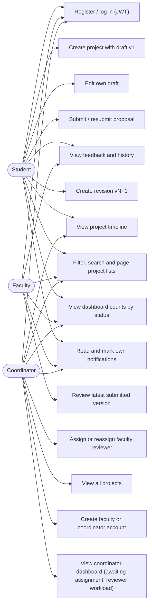

## 2. Domain class diagram

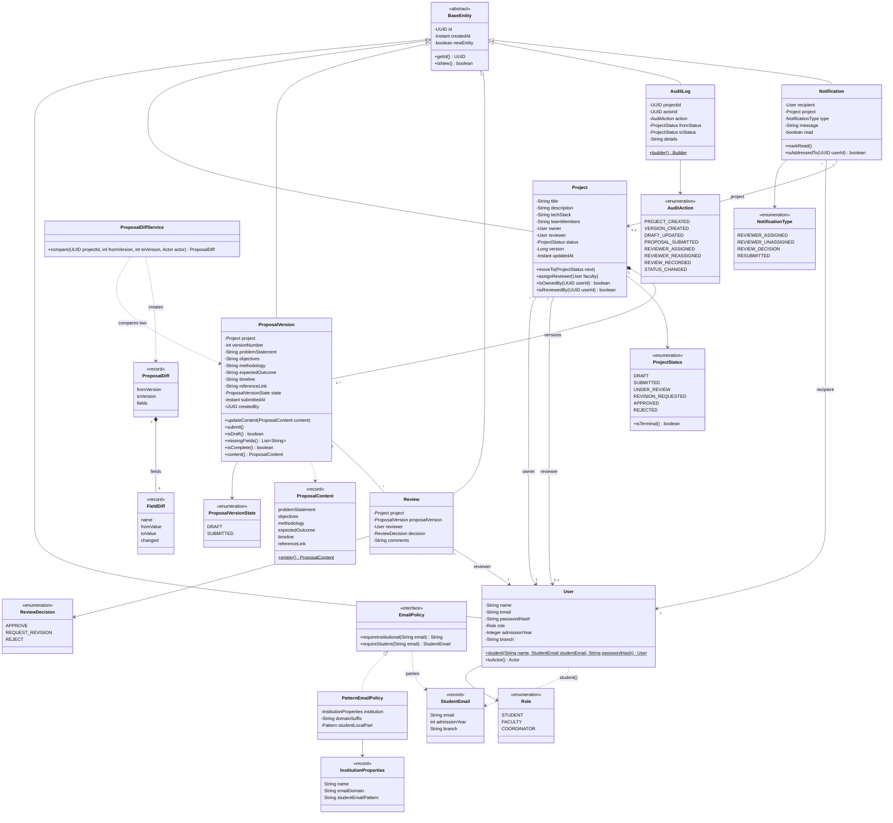

## 3. Workflow engine: State pattern

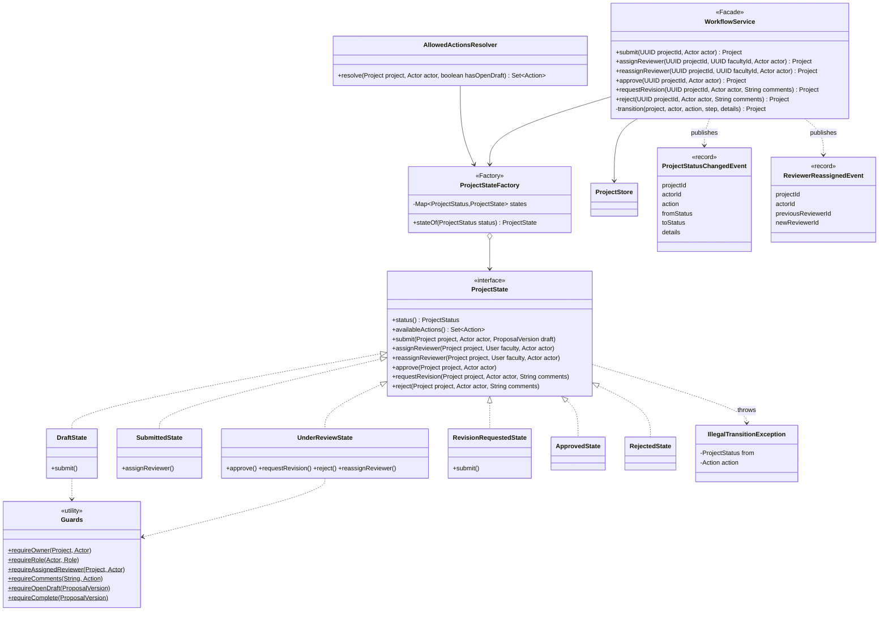

## 4. Project state diagram with guards

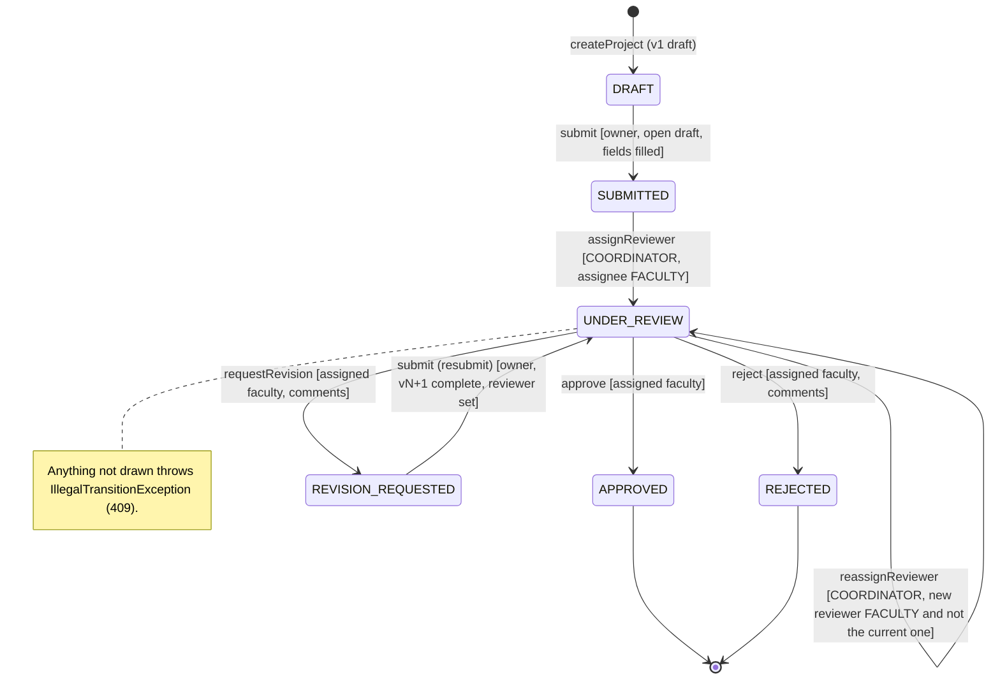

## 5. Sequence: create project and submit v1

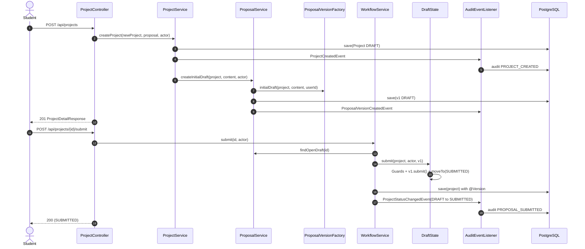

## 6. Sequence: assign, review, request revision

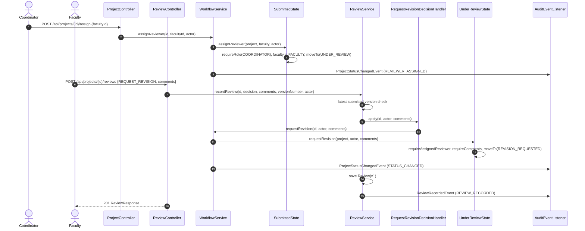

## 7. Sequence: revise, resubmit, approve

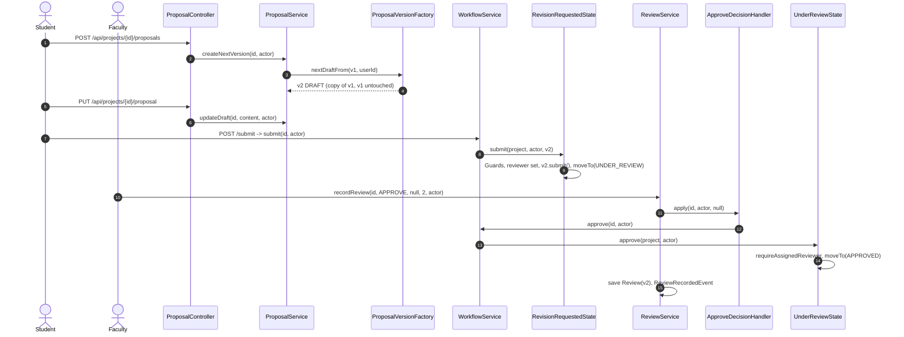

## 8. Sequence: illegal transition rejected

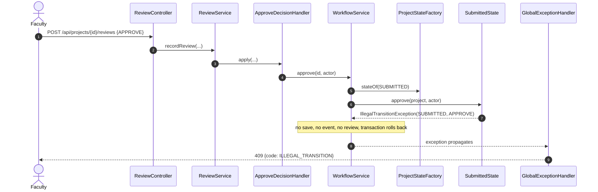

## 9. ER diagram

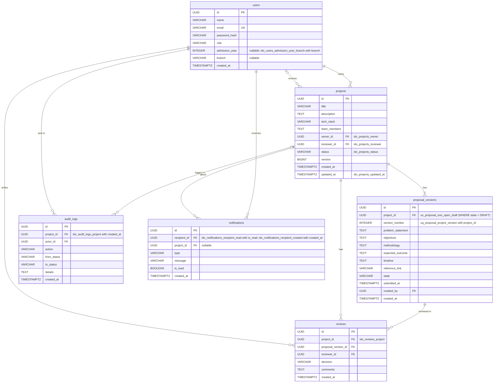

## 10. Component / architecture

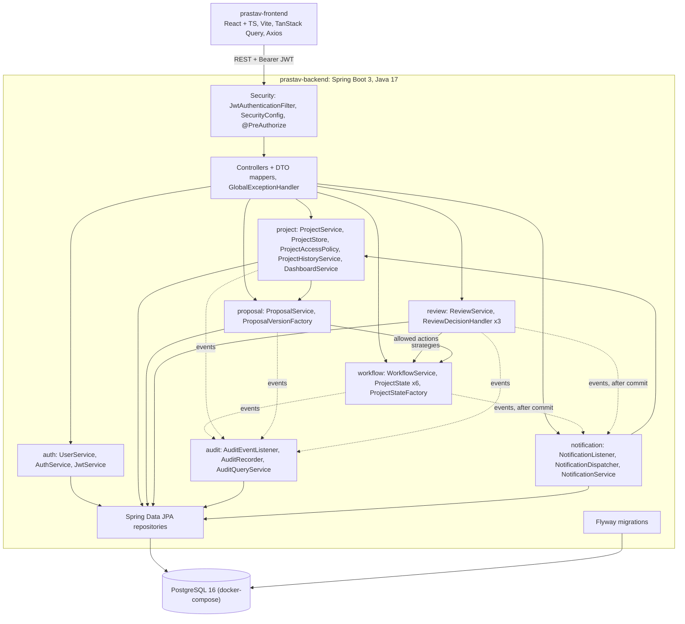

## 11. Observer, Strategy and Decorator (events, review decisions, email policy, notification channels and retries)

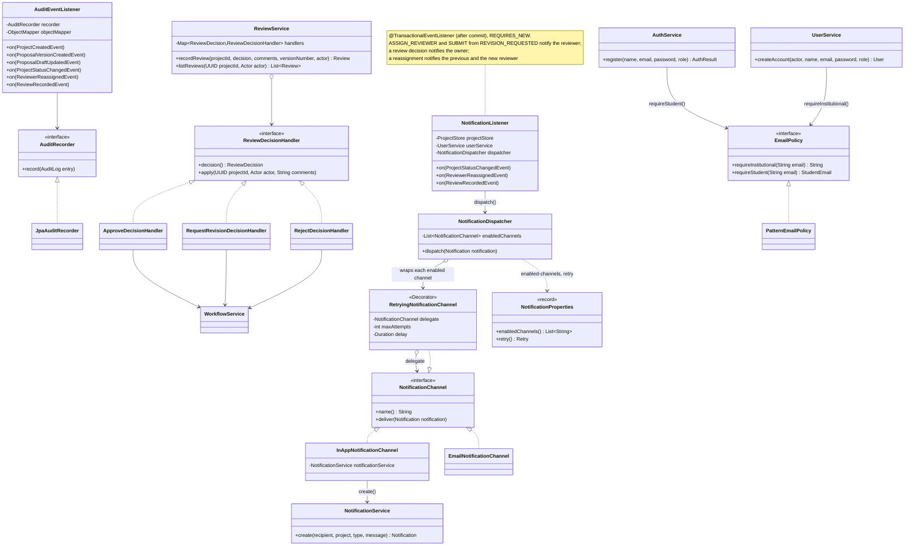
