# Prastav diagrams (Mermaid)

The same diagrams as the PlantUML sources in `docs/uml/*.puml` (rendered PNGs in `docs/uml/png/`).
Names match the code exactly, and every element exists in the code.
Mermaid renders of these blocks are in `docs/uml/mermaid-png/`.

| Section | PlantUML source and PNG name |
|---|---|
| 1. Use cases | `01_use_case` |
| 2. Domain class diagram | `02_domain_class` |
| 3. Workflow engine: State pattern | `03_workflow_state_pattern` |
| 4. Project state diagram with guards | `04_project_state` |
| 5. Sequence: create project and submit v1 | `05_seq_create_submit` |
| 6. Sequence: assign, review, request revision | `06_seq_assign_review_revision` |
| 7. Sequence: revise, resubmit, approve | `07_seq_resubmit_approve` |
| 8. Sequence: illegal transition rejected | `08_seq_illegal_transition` |
| 9. ER diagram | `10_er` |
| 10. Component / architecture | `11_component_architecture` |
| 11. Observer and Strategy | `12_events_and_strategies` |
| 12. Sequence: notification dispatch | `09_seq_notification_dispatch` |
| 13. Notification channels | `13_notification_classes` |
| 14. Auth view | `14_auth_classes` |
| 15. Activity: submit, assign, review, revise or approve | `15_activity_workflow` |

## 1. Use cases

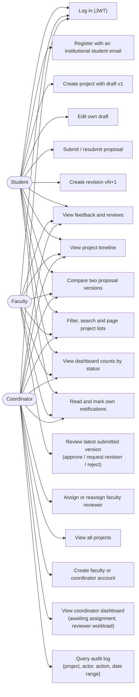

## 2. Domain class diagram

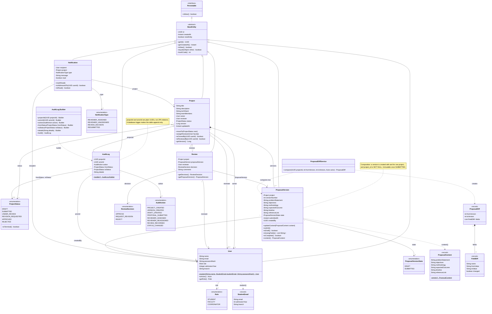

## 3. Workflow engine: State pattern

```mermaid
classDiagram
  class ProjectState {
    <<interface>>
    +status() ProjectStatus
    +availableActions() Set~Action~
    +submit(Project project, Actor actor, ProposalVersion draft)
    +assignReviewer(Project project, User faculty, Actor actor)
    +reassignReviewer(Project project, User faculty, Actor actor)
    +approve(Project project, Actor actor)
    +requestRevision(Project project, Actor actor, String comments)
    +reject(Project project, Actor actor, String comments)
  }
  class DraftState {
    +status() ProjectStatus
    +availableActions() Set~Action~
    +submit(Project project, Actor actor, ProposalVersion draft)
  }
  class SubmittedState {
    +status() ProjectStatus
    +availableActions() Set~Action~
    +assignReviewer(Project project, User faculty, Actor actor)
  }
  class UnderReviewState {
    +status() ProjectStatus
    +availableActions() Set~Action~
    +reassignReviewer(Project project, User faculty, Actor actor)
    +approve(Project project, Actor actor)
    +requestRevision(Project project, Actor actor, String comments)
    +reject(Project project, Actor actor, String comments)
  }
  class RevisionRequestedState {
    +status() ProjectStatus
    +availableActions() Set~Action~
    +submit(Project project, Actor actor, ProposalVersion draft)
  }
  class ApprovedState {
    +status() ProjectStatus
    +availableActions() Set~Action~
  }
  class RejectedState {
    +status() ProjectStatus
    +availableActions() Set~Action~
  }
  class ProjectStateFactory {
    <<Factory>>
    -Map~ProjectStatus,ProjectState~ states
    +stateOf(ProjectStatus status) ProjectState
  }
  class WorkflowService {
    <<Facade>>
    -ProjectStore projectStore
    -ProjectStateFactory stateFactory
    -ProposalService proposalService
    -UserService userService
    -ApplicationEventPublisher events
    +submit(UUID projectId, Actor actor) Project
    +assignReviewer(UUID projectId, UUID facultyId, Actor actor) Project
    +reassignReviewer(UUID projectId, UUID facultyId, Actor actor) Project
    +approve(UUID projectId, Actor actor) Project
    +requestRevision(UUID projectId, Actor actor, String comments) Project
    +reject(UUID projectId, Actor actor, String comments) Project
    -transition(Project project, Actor actor, Action action, Consumer~ProjectState~ step, Map~String,String~ details) Project
  }
  class Guards {
    <<utility>>
    +requireOwner(Project project, Actor actor)$
    +requireRole(Actor actor, Role role)$
    +requireAssignedReviewer(Project project, Actor actor)$
    +requireComments(String comments, Action action)$
    +requireOpenDraft(ProposalVersion draft)$
    +requireComplete(ProposalVersion draft)$
  }
  class AllowedActionsResolver {
    -ProjectStateFactory stateFactory
    +resolve(Project project, Actor actor, boolean hasOpenDraft) Set~Action~
  }
  class Action {
    <<enumeration>>
    SUBMIT
    ASSIGN_REVIEWER
    APPROVE
    REQUEST_REVISION
    REJECT
    REASSIGN_REVIEWER
    EDIT_DRAFT
    CREATE_REVISION
  }
  class IllegalTransitionException {
    -ProjectStatus from
    -Action action
    +getFrom() ProjectStatus
    +getAction() Action
  }
  class ProjectStatusChangedEvent {
    <<record>>
    UUID projectId
    UUID actorId
    Action action
    ProjectStatus fromStatus
    ProjectStatus toStatus
    Map~String,String~ details
  }
  class ReviewerReassignedEvent {
    <<record>>
    UUID projectId
    UUID actorId
    UUID previousReviewerId
    UUID newReviewerId
  }
  class ProjectStore {
    +getById(UUID projectId) Project
    +save(Project project) Project
  }
  class AuditEventListener {
    <<Observer>>
    +on(ProjectStatusChangedEvent event)
    +on(ReviewerReassignedEvent event)
  }
  class NotificationListener {
    <<Observer>>
    +on(ProjectStatusChangedEvent event)
    +on(ReviewerReassignedEvent event)
  }
  ProjectState <|.. DraftState
  ProjectState <|.. SubmittedState
  ProjectState <|.. UnderReviewState
  ProjectState <|.. RevisionRequestedState
  ProjectState <|.. ApprovedState
  ProjectState <|.. RejectedState
  ProjectStateFactory "1" o--> "6" ProjectState : states
  WorkflowService "1" --> "1" ProjectStateFactory : stateFactory
  WorkflowService "1" --> "1" ProjectStore : projectStore
  AllowedActionsResolver "1" --> "1" ProjectStateFactory : stateFactory
  WorkflowService ..> ProjectStatusChangedEvent : publishes
  WorkflowService ..> ReviewerReassignedEvent : publishes
  AuditEventListener ..> ProjectStatusChangedEvent : listens, same transaction
  AuditEventListener ..> ReviewerReassignedEvent : listens, same transaction
  NotificationListener ..> ProjectStatusChangedEvent : listens, after commit
  NotificationListener ..> ReviewerReassignedEvent : listens, after commit
  DraftState ..> Guards
  SubmittedState ..> Guards
  UnderReviewState ..> Guards
  RevisionRequestedState ..> Guards
  ProjectState ..> IllegalTransitionException : throws by default
  ProjectState ..> Action
  note for ProjectState "Every action is a default method that throws<br/>IllegalTransitionException. A state overrides<br/>only its legal actions."
  note for ApprovedState "APPROVED and REJECTED are terminal:<br/>they override no action."
```

## 4. Project state diagram with guards

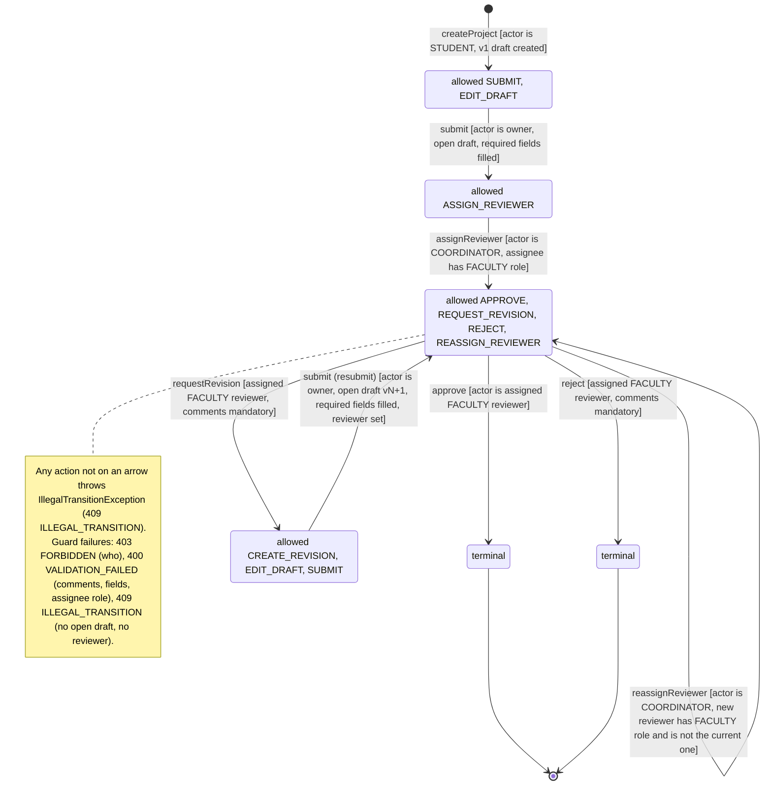

## 5. Sequence: create project and submit v1

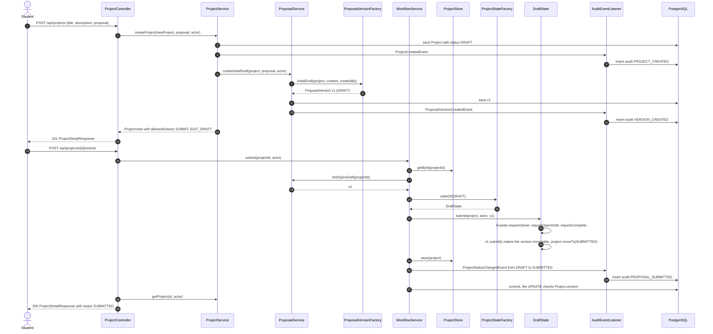

## 6. Sequence: assign, review, request revision

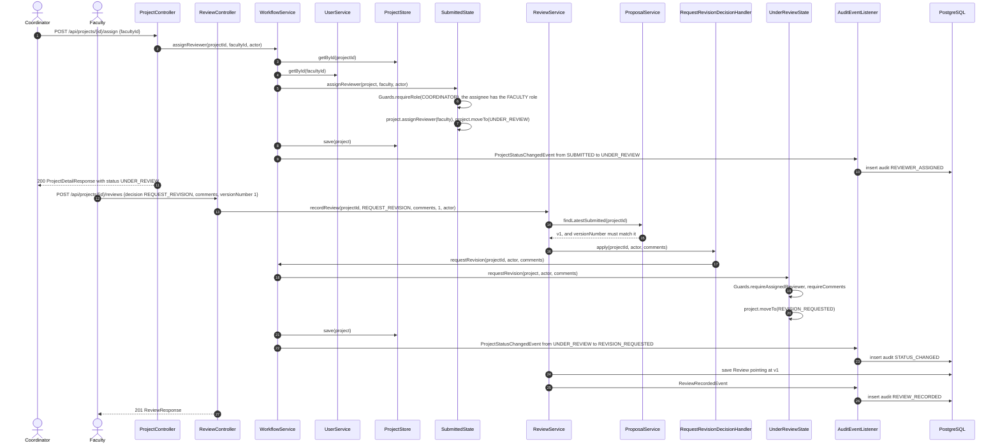

## 7. Sequence: revise, resubmit, approve

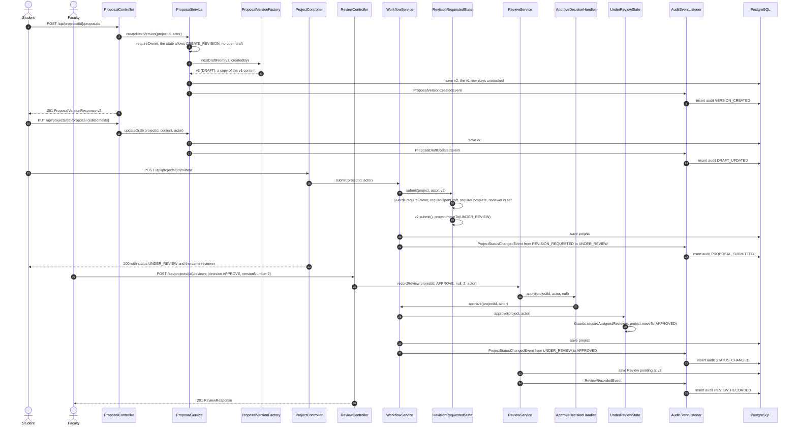

## 8. Sequence: illegal transition rejected

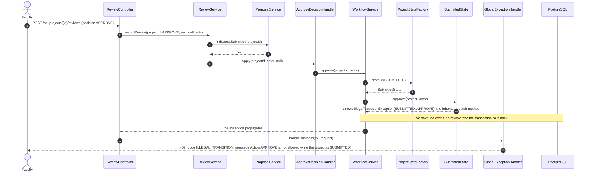

## 9. ER diagram

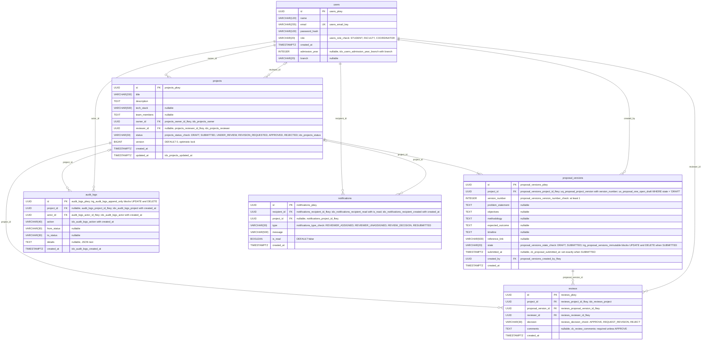

## 10. Component / architecture

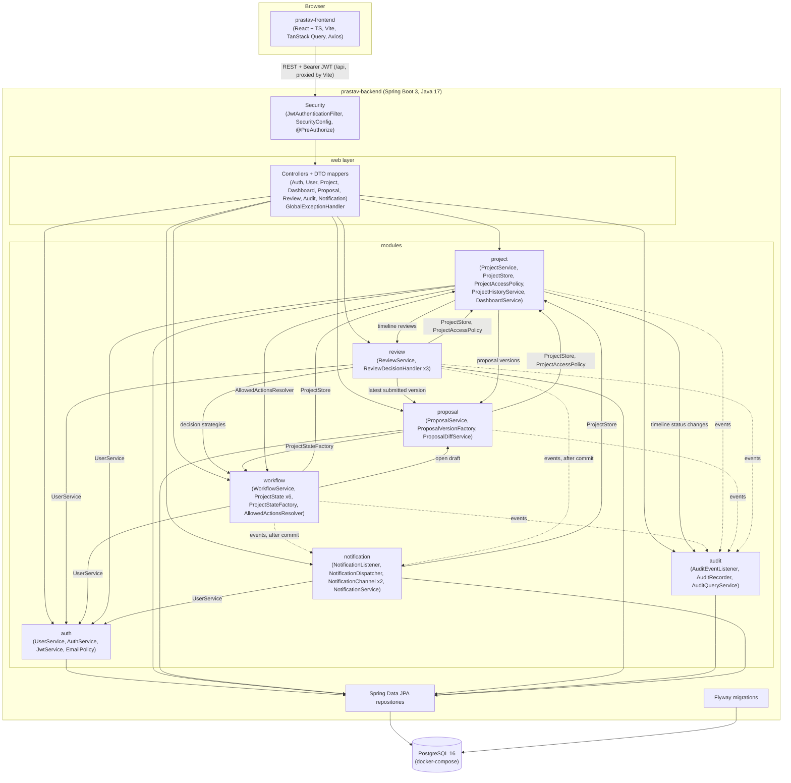

## 11. Observer and Strategy (domain events, audit, review decisions)

```mermaid
classDiagram
  class ProjectCreatedEvent {
    <<record>>
    UUID projectId
    UUID actorId
    String title
  }
  class ProposalVersionCreatedEvent {
    <<record>>
    UUID projectId
    int versionNumber
    UUID actorId
  }
  class ProposalDraftUpdatedEvent {
    <<record>>
    UUID projectId
    int versionNumber
    UUID actorId
  }
  class ProjectStatusChangedEvent {
    <<record>>
    UUID projectId
    UUID actorId
    Action action
    ProjectStatus fromStatus
    ProjectStatus toStatus
    Map~String,String~ details
  }
  class ReviewerReassignedEvent {
    <<record>>
    UUID projectId
    UUID actorId
    UUID previousReviewerId
    UUID newReviewerId
  }
  class ReviewRecordedEvent {
    <<record>>
    UUID projectId
    UUID reviewId
    int versionNumber
    UUID reviewerId
    ReviewDecision decision
  }
  class AuditEventListener {
    <<Observer>>
    -AuditRecorder recorder
    -ObjectMapper objectMapper
    +on(ProjectCreatedEvent event)
    +on(ProposalVersionCreatedEvent event)
    +on(ProposalDraftUpdatedEvent event)
    +on(ProjectStatusChangedEvent event)
    +on(ReviewerReassignedEvent event)
    +on(ReviewRecordedEvent event)
  }
  class AuditRecorder {
    <<interface>>
    +record(AuditLog entry)
  }
  class JpaAuditRecorder {
    -AuditLogRepository auditLogRepository
    +record(AuditLog entry)
  }
  class NotificationListener {
    <<Observer>>
    +on(ProjectStatusChangedEvent event)
    +on(ReviewerReassignedEvent event)
    +on(ReviewRecordedEvent event)
  }
  class ReviewDecisionHandler {
    <<interface>>
    +decision() ReviewDecision
    +apply(UUID projectId, Actor actor, String comments)
  }
  class ApproveDecisionHandler {
    -WorkflowService workflowService
  }
  class RequestRevisionDecisionHandler {
    -WorkflowService workflowService
  }
  class RejectDecisionHandler {
    -WorkflowService workflowService
  }
  class ReviewService {
    -Map~ReviewDecision,ReviewDecisionHandler~ handlers
    +recordReview(UUID projectId, ReviewDecision decision, String comments, Integer versionNumber, Actor actor) Review
    +listReviews(UUID projectId, Actor actor) List~Review~
  }
  class WorkflowService {
    <<Facade>>
    +approve(UUID projectId, Actor actor) Project
    +requestRevision(UUID projectId, Actor actor, String comments) Project
    +reject(UUID projectId, Actor actor, String comments) Project
  }
  AuditRecorder <|.. JpaAuditRecorder
  AuditEventListener "1" --> "1" AuditRecorder : recorder
  AuditEventListener ..> ProjectCreatedEvent
  AuditEventListener ..> ProposalVersionCreatedEvent
  AuditEventListener ..> ProposalDraftUpdatedEvent
  AuditEventListener ..> ProjectStatusChangedEvent
  AuditEventListener ..> ReviewerReassignedEvent
  AuditEventListener ..> ReviewRecordedEvent
  NotificationListener ..> ProjectStatusChangedEvent
  NotificationListener ..> ReviewerReassignedEvent
  NotificationListener ..> ReviewRecordedEvent
  ReviewDecisionHandler <|.. ApproveDecisionHandler
  ReviewDecisionHandler <|.. RequestRevisionDecisionHandler
  ReviewDecisionHandler <|.. RejectDecisionHandler
  ReviewService "1" o--> "3" ReviewDecisionHandler : handlers
  ReviewService ..> ReviewRecordedEvent : publishes
  ApproveDecisionHandler "1" --> "1" WorkflowService : approve()
  RequestRevisionDecisionHandler "1" --> "1" WorkflowService : requestRevision()
  RejectDecisionHandler "1" --> "1" WorkflowService : reject()
  note for AuditEventListener "Runs in the publisher's transaction: a change<br/>and its audit row commit or roll back together."
  note for NotificationListener "Runs after commit. Each delivery has its own transaction.<br/>See the notification class and sequence diagrams."
```

## 12. Sequence: notification dispatch

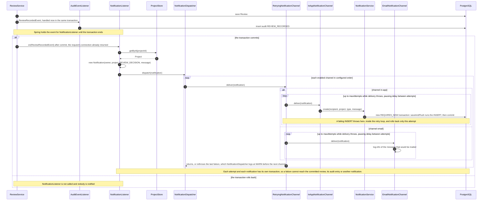

## 13. Notification channels (Strategy and Decorator)

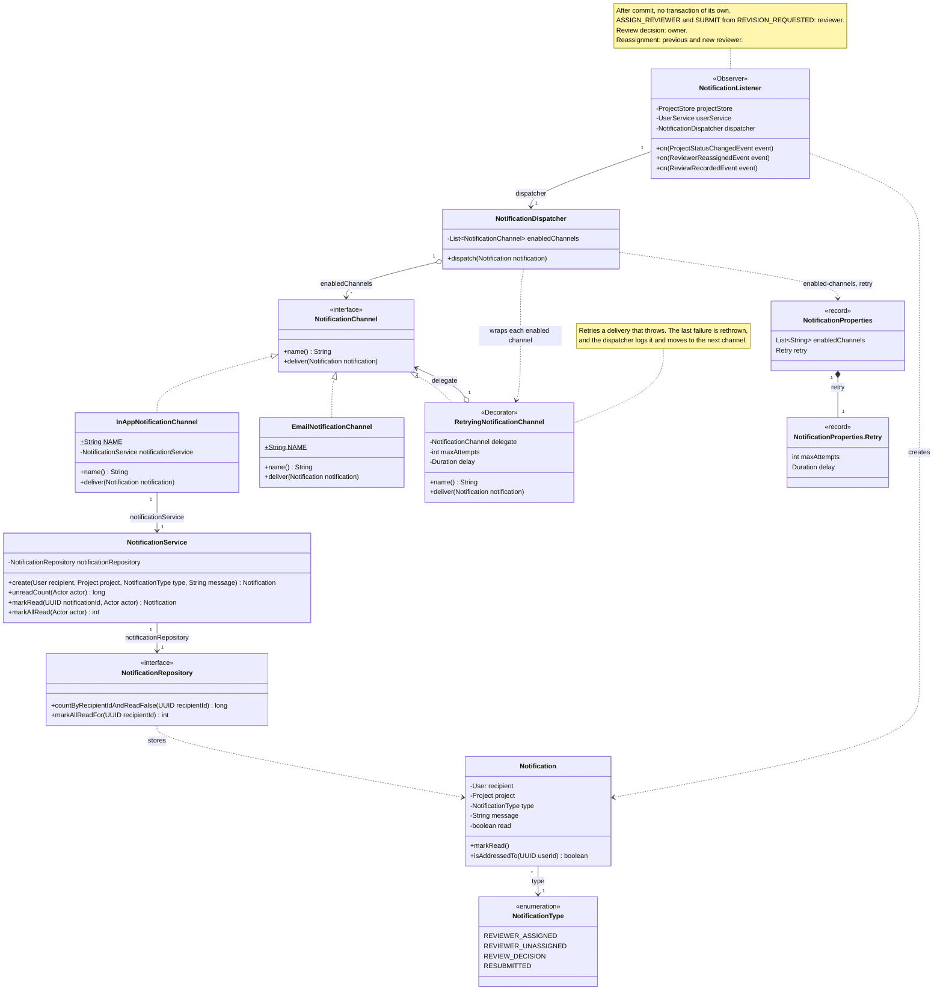

## 14. Auth view (EmailPolicy Strategy)

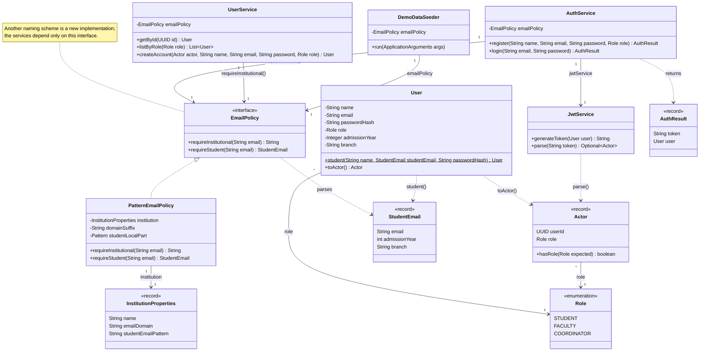

## 15. Activity: submit, assign, review, revise or approve

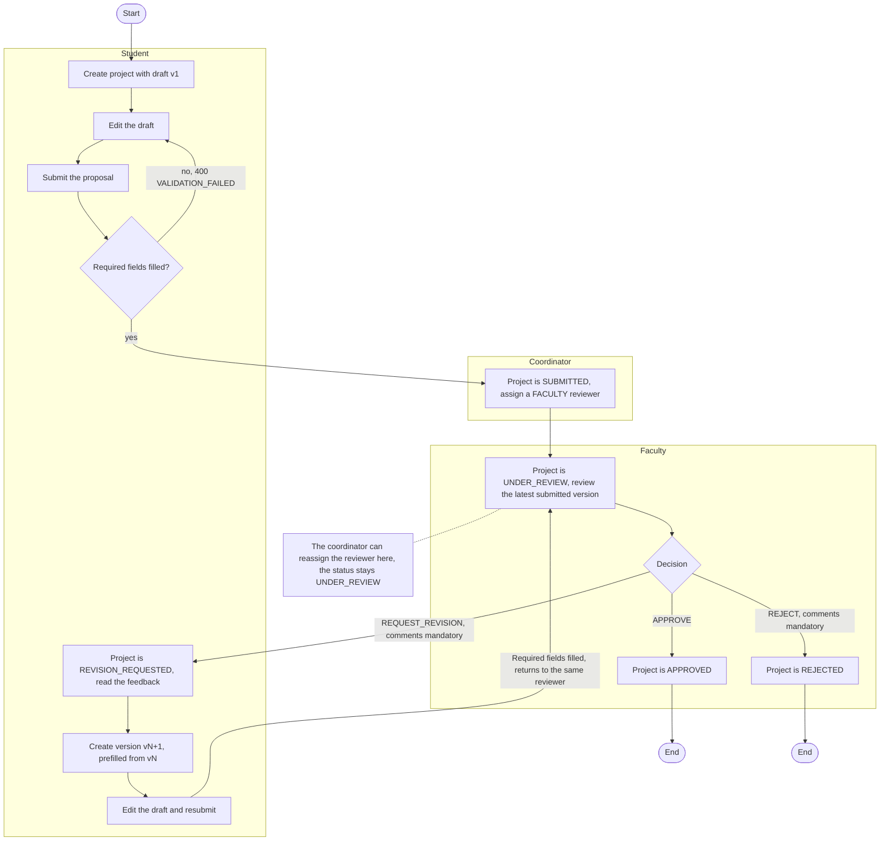
